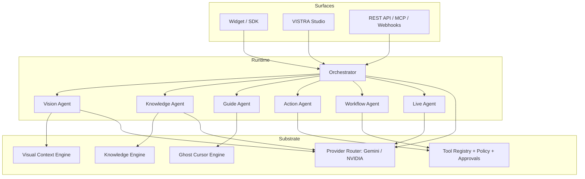

# Product Vision

**Doc ID:** 01 · **Status:** Approved · **Area:** Product
**Depends on:** [AGENTS.md](../steering/AGENTS.md) · **Related:** [02](02-PRODUCT-REQUIREMENTS.md), [03](03-PROBLEM-STATEMENT-AND-MARKET.md), [07](07-MVP-AND-PRODUCT-ROADMAP.md)

---

## 1. Purpose

Define what VISTRA is, who it is for, what "good" looks like in three years, and which product
decisions are already settled so engineering does not renegotiate them per feature.

## 2. Scope

Product direction, positioning, capability model, differentiation, and success metrics.

**Out of scope:** pricing tables, marketing copy, roadmap dates, implementation design (see
[07](07-MVP-AND-PRODUCT-ROADMAP.md) and [09](../02-system-architecture/09-SYSTEM-ARCHITECTURE.md)).

---

## 3. The vision in one paragraph

Every business application eventually needs an intelligence layer that can see what the user sees,
know what the company knows, and act inside the product safely. Today that layer is rebuilt from scratch
by every team — a chat widget bolted onto a page, a vector database wired to a PDF folder, a brittle
`querySelector` tour, and no audit trail when an agent clicks the wrong button. VISTRA is that layer as
infrastructure: **one embeddable platform that understands the screen, answers with the company's own
knowledge, guides users through the real interface with a first-party cursor, and executes authorized
actions under policy and approval.**

**Understand. Guide. Execute.**

---

## 4. Product thesis

1. **Context beats model quality.** A generic model with the current screen, the accessibility tree, the
   user's role, and three cited paragraphs outperforms a frontier model with a chat box. The moat is
   context assembly and retrieval precision, not model access.
2. **Guidance is a growth surface.** Most enterprise software failures are "I can't find it", not "the
   feature doesn't exist". A cursor that points at the real element converts support cost into activation.
3. **Execution is the hard part.** Reading is safe; acting is not. A platform that can act must own
   policy, approvals, idempotency, verification, and audit — this is why VISTRA is infrastructure, not a
   widget.
4. **Developers adopt platforms, not features.** SDKs, typed APIs, tool registration, MCP, eval tooling,
   and observability decide whether VISTRA spreads inside a customer.
5. **Visual and DOM evidence together.** Screenshots alone cannot resolve a target; DOM alone cannot see a
   canvas chart or a rendering bug. VISTRA fuses both.

---

## 5. Capability model

| Layer | Product meaning |
|---|---|
| Understand | Screen + DOM + accessibility + route + selection + tenant knowledge |
| Guide | Ghost Cursor walkthroughs over real elements, with verification |
| Execute | Policy-checked, approved, idempotent, verified tool calls |
| Operate | Studio, evaluation, analytics, cost, audit, SDK lifecycle |

---

## 6. Differentiation

| Alternative | What it does | Where VISTRA differs |
|---|---|---|
| Chat widget + docs bot | Answers questions from docs | No screen awareness, no action, no policy, no tenant-scoped retrieval ACLs |
| Product-tour libraries | Static scripted tours | Tours break on DOM change; no intent, no knowledge, no verification, no backend |
| Browser-agent automation (RPA/computer-use) | Drives coordinates | Fragile, unapproved, unauditable, no host integration, security nightmare for customers |
| In-app copilots built in-house | Tailored to one app | Months of platform work; VISTRA ships the runtime, retrieval, policy, and Studio |
| Observability/session replay | Records what happened | Passive; cannot answer, guide, or act |

The defensible combination: **embedded SDK + semantic target resolution + permission-aware RAG + policy
governed execution + evaluation loop**, all multi-tenant and auditable.

---

## 7. Who it is for

Primary buyers: product and platform teams at B2B SaaS companies (100–10,000 employees) with complex
UI and a documentation corpus. Secondary: internal platform teams at enterprises embedding assistance
into operational tools. Tertiary: developers building vertical AI products who need the runtime.

Detailed personas: [04](04-USER-PERSONAS-AND-USE-CASES.md).

---

## 8. Product principles (product-level, not engineering-level)

1. **Never fake capability.** If retrieval has no evidence, say so. If guidance cannot find a target, say
   so. If execution is not verified, do not report success.
2. **The host app stays in control.** Every capture scope, tool, and action is opt-in by the customer's
   developers, not inferred by the model.
3. **Speed is part of trust.** First token < 1.2 s for cached knowledge answers; guide step starts < 400 ms
   after resolution.
4. **One embed, whole platform.** Adding the SDK should not require adopting five products; capabilities
   unlock progressively.
5. **Developer-grade transparency.** Every answer traceable to sources; every action traceable to a run,
   a policy decision, an approval, and a verification.

---

## 9. Success metrics

| Horizon | Metric | Target |
|---|---|---|
| Activation | Time from signup → first successful embedded session | < 30 min |
| Adoption | Applications with ≥ 1 tool registered | > 45% of active apps |
| Quality | Grounded-answer citation accuracy on golden set | ≥ 95% |
| Quality | Guide-flow completion (target found → step completed) | ≥ 85% |
| Trust | Policy-denied actions correctly blocked in security suite | 100% |
| Retention | Weekly active organizations (WAO) growth | ≥ 8% MoM |
| Economics | Blended cost per resolved interaction | < $0.02 |
| Reliability | API availability (rolling 30d) | ≥ 99.9% |

Measurement definitions and instrumentation live in
[61](../10-applications-and-experience/61-ADMINISTRATION-AND-ANALYTICS.md) and
[66](../11-quality-security-and-operations/66-COST-AND-RESOURCE-PLANNING.md).

---

## 10. Three-year shape

- **Year 1 — Platform credibility.** SDK + knowledge + cursor + governed actions; Studio; evaluation;
  one reference application proving the full loop.
- **Year 2 — Depth.** Enterprise connectors, SSO/SCIM, regional data residency, self-hosted cursor and
  retrieval for regulated customers, marketplace of tools/agents.
- **Year 3 — Network.** Third-party agents and tools published to VISTRA, cross-application workflows,
  policy marketplace, and usage-based infrastructure pricing.

---

## 11. Non-goals (product)

- A general-purpose consumer chatbot.
- A browser extension that operates arbitrary third-party sites without host cooperation.
- A model vendor or fine-tuning provider (we abstract providers; we do not train foundation models).
- A replacement for the customer's own authorization system inside their app — VISTRA tools call the
  customer's APIs under their rules.
- An RPA/computer-use product that drives coordinates without semantic targets.

---

## 12. Failure scenarios the vision must survive

| Scenario | Product response |
|---|---|
| Model provider outage | Capability-gated fallback; degraded answers labelled; guidance unaffected |
| Customer's DOM changes | Semantic target resolution + retry + explicit `TARGET_MISSING` state |
| Tenant attempts cross-tenant retrieval | SQL-level denial, security event, 404 |
| Model proposes destructive action | Policy deny or human approval; never auto-execute |
| Hallucinated citation | Response validation rejects uncited claims; insufficient-evidence state |
| Prompt injection in uploaded PDF | Fenced context, instruction hierarchy, output validation |

---

## 13. Acceptance criteria

- [ ] Every capability in §5 has an owning document and a requirement ID in
      [05](05-FUNCTIONAL-REQUIREMENTS.md).
- [ ] Personas in [04](04-USER-PERSONAS-AND-USE-CASES.md) map to at least one journey in
      [60](../10-applications-and-experience/60-DEMO-APPLICATION-AND-END-TO-END-SCENARIOS.md).
- [ ] Success metrics have an instrumentation plan in [61](../10-applications-and-experience/61-ADMINISTRATION-AND-ANALYTICS.md).
- [ ] Non-goals are reflected in the API surface (no coordinate-only action endpoint).

## 14. Related documents

[02](02-PRODUCT-REQUIREMENTS.md) · [03](03-PROBLEM-STATEMENT-AND-MARKET.md) · [04](04-USER-PERSONAS-AND-USE-CASES.md) ·
[07](07-MVP-AND-PRODUCT-ROADMAP.md) · [09](../02-system-architecture/09-SYSTEM-ARCHITECTURE.md) ·
[43](../07-agents-and-execution/43-AGENT-RUNTIME-AND-ORCHESTRATION.md)

## 15. References

- Product positioning statement: internal, `docs/01-product-and-ideation/03-PROBLEM-STATEMENT-AND-MARKET.md`
- Accessibility semantics used as target contract: https://www.w3.org/TR/html-aria/
