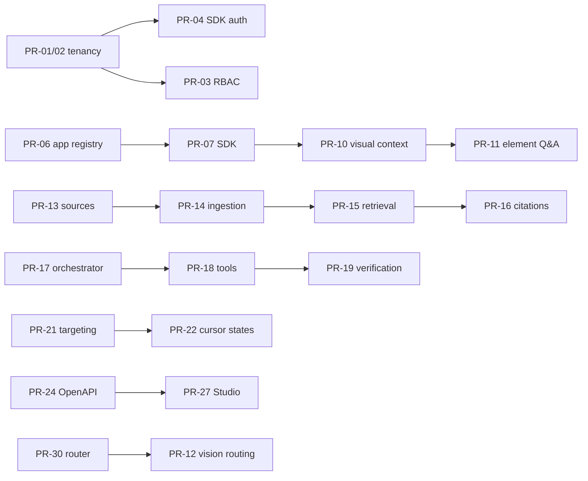

# Product Requirements

**Doc ID:** 02 · **Status:** Approved · **Area:** Product
**Depends on:** [01](01-PRODUCT-VISION.md) · **Related:** [05](05-FUNCTIONAL-REQUIREMENTS.md), [08](08-ACCEPTANCE-CRITERIA.md), [../REQUIREMENT-TRACEABILITY.md](../REQUIREMENT-TRACEABILITY.md)

---

## 1. Purpose

Enumerate the product requirements (`PR-*`) that the platform must satisfy, with priority, owner
subsystem, and the document that specifies the design. This document is the root of the traceability
chain: requirement → architecture → module → database → API → test → deployment.

## 2. Scope

Requirements at product granularity. Functional decomposition lives in [05](05-FUNCTIONAL-REQUIREMENTS.md);
quality attributes in [06](06-NONFUNCTIONAL-REQUIREMENTS.md); acceptance tests in [08](08-ACCEPTANCE-CRITERIA.md).

## 3. Priority scheme

| Priority | Meaning |
|---|---|
| P0 | Required for the first production-capable release. Release blocks without it. |
| P1 | Required for GA. May ship behind a flag in the first release. |
| P2 | Post-GA / scale phase. |

Every requirement must have exactly one owning subsystem and one acceptance criterion.

---

## 4. Requirements

### 4.1 Identity, tenancy, access

| ID | Requirement | Pri | Owner | Spec |
|---|---|---|---|---|
| PR-01 | A user signs up/signs in through Clerk (email, passwordless, social) and receives a session usable by Studio and API. | P0 | Identity | [17](../03-database-and-identity/17-CLERK-AUTHENTICATION.md) |
| PR-02 | Organizations are the tenant boundary; a user may belong to multiple organizations with different roles, and every data access is scoped to exactly one resolved organization. | P0 | Tenancy | [18](../03-database-and-identity/18-TENANCY-RBAC-AND-AUTHORIZATION.md) |
| PR-03 | Roles `owner/admin/developer/analyst/viewer` confer a documented, testable permission set; end users of embedded applications never receive organization roles. | P0 | Tenancy | [18](../03-database-and-identity/18-TENANCY-RBAC-AND-AUTHORIZATION.md) |
| PR-04 | A customer application authenticates to VISTRA with a scoped API key (server) and mints short-lived, audience-restricted session tokens for end users (browser). No secret is ever exposed to the browser. | P0 | SDK/Identity | [54](../09-sdk-and-integrations/54-JAVASCRIPT-AND-REACT-SDK.md), [18](../03-database-and-identity/18-TENANCY-RBAC-AND-AUTHORIZATION.md) |
| PR-05 | Cross-tenant access is impossible through API, SDK, retrieval, or database paths; attempts are audited. | P0 | Security | [19](../03-database-and-identity/19-SUPABASE-RLS-AND-DATABASE-SECURITY.md), [63](../11-quality-security-and-operations/63-SECURITY-THREAT-MODEL.md) |

### 4.2 Applications and SDK

| ID | Requirement | Pri | Owner | Spec |
|---|---|---|---|---|
| PR-06 | A developer registers an application, receives a public app id and API key, and restricts embedding to an allowlist of origins. | P0 | Applications | [56](../09-sdk-and-integrations/56-PUBLIC-API-AND-DEVELOPER-PLATFORM.md) |
| PR-07 | A drop-in JavaScript/React SDK initializes, authenticates, collects authorized context, streams responses, and tears down cleanly. | P0 | SDK | [54](../09-sdk-and-integrations/54-JAVASCRIPT-AND-REACT-SDK.md) |
| PR-08 | The SDK supports vanilla script-tag embedding and a React provider/hook API with identical behavior. | P0 | SDK | [54](../09-sdk-and-integrations/54-JAVASCRIPT-AND-REACT-SDK.md) |
| PR-09 | The widget is themeable, shadow-DOM isolated, keyboard accessible, and does not degrade host page performance (no layout shift, main-thread task budget met). | P0 | Widget | [55](../09-sdk-and-integrations/55-WIDGET-AND-EMBEDDING-ARCHITECTURE.md) |

### 4.3 Visual understanding

| ID | Requirement | Pri | Owner | Spec |
|---|---|---|---|---|
| PR-10 | The platform captures authorized visual context (route, title, viewport, DOM summary, accessibility tree, optional screenshot, optional selected element) with redaction of password/payment fields. | P0 | Visual | [49](../08-visual-and-ghost-cursor/49-VISUAL-CONTEXT-ENGINE.md), [50](../08-visual-and-ghost-cursor/50-DOM-AND-ACCESSIBILITY-INSPECTION.md) |
| PR-11 | A user can select a page element and ask about it; the answer references the element's accessible role/name and visible content. | P0 | Visual | [50](../08-visual-and-ghost-cursor/50-DOM-AND-ACCESSIBILITY-INSPECTION.md) |
| PR-12 | Multimodal questions (screenshot + text) are answered by a vision-capable model; a text-only model must never be silently substituted. | P0 | AI | [31](../05-ai-and-model-infrastructure/31-MODEL-ROUTING-AND-CAPABILITY-MATRIX.md) |

### 4.4 Knowledge and RAG

| ID | Requirement | Pri | Owner | Spec |
|---|---|---|---|---|
| PR-13 | An organization can create knowledge bases and add sources: PDF, DOCX, MD, TXT, HTML, CSV, JSON, PPTX, URL, sitemap, OpenAPI, GitHub repo. | P0 | Knowledge | [36](../06-knowledge-and-rag/36-DOCUMENT-INGESTION-AND-PARSING.md), [40](../06-knowledge-and-rag/40-KNOWLEDGE-SOURCE-CONNECTORS.md) |
| PR-14 | Ingestion is asynchronous, resumable, observable, and reprocessable per source and per document version. | P0 | Ingestion | [36](../06-knowledge-and-rag/36-DOCUMENT-INGESTION-AND-PARSING.md), [26](../04-backend-and-api/26-BACKGROUND-JOBS-AND-WORKERS.md) |
| PR-15 | Retrieval is hybrid (vector + full-text), permission-filtered in SQL, reranked, and deduplicated. | P0 | Retrieval | [38](../06-knowledge-and-rag/38-VECTOR-SEARCH-AND-HYBRID-RETRIEVAL.md) |
| PR-16 | Answers include citations to retrieved chunks with document title, version, page/section; uncited claims are rejected by response validation; insufficient evidence is stated explicitly. | P0 | Retrieval | [39](../06-knowledge-and-rag/39-RERANKING-CITATIONS-AND-GROUNDED-ANSWERS.md) |

### 4.5 Agents and execution

| ID | Requirement | Pri | Owner | Spec |
|---|---|---|---|---|
| PR-17 | A request is classified, planned, and routed to specialized agents (vision, knowledge, guide, action, workflow, live) via one orchestrator with persisted, resumable state. | P0 | Agents | [43](../07-agents-and-execution/43-AGENT-RUNTIME-AND-ORCHESTRATION.md) |
| PR-18 | Developers register tools with JSON Schema arguments; tool execution is denied unless a policy allows it, and irreversible/external actions require approval when configured. | P0 | Tools | [45](../07-agents-and-execution/45-TOOL-REGISTRY-AND-FUNCTION-CALLING.md), [47](../07-agents-and-execution/47-APPROVALS-POLICY-AND-SAFE-EXECUTION.md) |
| PR-19 | Side-effecting tools are idempotent and verified independently; a run never reports success on unverified state. | P0 | Agents | [47](../07-agents-and-execution/47-APPROVALS-POLICY-AND-SAFE-EXECUTION.md) |
| PR-20 | Multi-step workflows execute with per-step policy, approval, retry, and compensation where declared. | P1 | Workflows | [46](../07-agents-and-execution/46-WORKFLOW-ENGINE-AND-STATE-MACHINE.md) |

### 4.6 Guidance (Ghost Cursor)

| ID | Requirement | Pri | Owner | Spec |
|---|---|---|---|---|
| PR-21 | A guide flow targets real elements resolved semantically (host id → role+name → label → data attribute → selector → coordinates last). | P0 | Cursor | [52](../08-visual-and-ghost-cursor/52-GHOST-CURSOR-MOTION-AND-TARGET-RESOLUTION.md) |
| PR-22 | Guidance handles scrolling, dynamic DOM, resize, cancellation, and reduced motion, and reports explicit states (`TARGET_MISSING`, `INTERRUPTED`, `COMPLETED`). | P0 | Cursor | [51](../08-visual-and-ghost-cursor/51-GHOST-CURSOR-ENGINE.md) |
| PR-23 | Guide Mode (visual) and Do Mode (tool execution) are distinct; the platform never infers a business action from cursor motion. | P0 | Cursor | [53](../08-visual-and-ghost-cursor/53-VISUAL-GUIDANCE-AND-VERIFICATION.md) |

### 4.7 Developer platform

| ID | Requirement | Pri | Owner | Spec |
|---|---|---|---|---|
| PR-24 | A versioned REST API with OpenAPI 3.1 defines every operation, error, pagination, and rate limit, and generates the typed client. | P0 | API | [23](../04-backend-and-api/23-API-DESIGN-AND-OPENAPI-CONTRACTS.md) |
| PR-25 | Webhooks (outbound) and MCP integration allow external systems to receive events and expose tools to VISTRA agents. | P1 | Integrations | [57](../09-sdk-and-integrations/57-MCP-WEBHOOKS-AND-EXTERNAL-INTEGRATIONS.md) |
| PR-26 | API keys are scoped, rotatable, hashed at rest, and never retrievable after creation. | P0 | Identity | [18](../03-database-and-identity/18-TENANCY-RBAC-AND-AUTHORIZATION.md) |

### 4.8 Studio and analytics

| ID | Requirement | Pri | Owner | Spec |
|---|---|---|---|---|
| PR-27 | Studio provides applications, agents, knowledge, tools, workflows, live sessions, evaluations, usage/cost, audit, and settings, all backed by real APIs. | P0 | Studio | [59](../10-applications-and-experience/59-VISTRA-STUDIO-ARCHITECTURE.md) |
| PR-28 | Every agent run is inspectable: plan, steps, tool calls, policy decisions, approvals, provider/model, latency, cost, verification outcome. | P0 | Observability | [48](../07-agents-and-execution/48-AGENT-MEMORY-AND-EXECUTION-TRACES.md) |
| PR-29 | Usage and cost are metered per organization, application, provider, and model, and exposed in Studio with export. | P1 | Billing | [61](../10-applications-and-experience/61-ADMINISTRATION-AND-ANALYTICS.md), [66](../11-quality-security-and-operations/66-COST-AND-RESOURCE-PLANNING.md) |

### 4.9 AI infrastructure

| ID | Requirement | Pri | Owner | Spec |
|---|---|---|---|---|
| PR-30 | All model traffic passes a provider abstraction with capability-based routing, bounded retries, circuit breaking, and observable fallback to NVIDIA NIM only where capability-compatible. | P0 | AI | [28](../05-ai-and-model-infrastructure/28-AI-PROVIDER-ABSTRACTION.md), [31](../05-ai-and-model-infrastructure/31-MODEL-ROUTING-AND-CAPABILITY-MATRIX.md) |
| PR-31 | Model identifiers, prompts, and provider configuration are versioned and configurable; no model id is hardcoded in business logic. | P0 | AI | [32](../05-ai-and-model-infrastructure/32-PROMPT-AND-CONTEXT-MANAGEMENT.md) |
| PR-32 | An evaluation subsystem measures accuracy, latency, cost, structured-output validity, tool-call correctness, vision grounding, and retrieval grounding before release. | P1 | Evaluation | [34](../05-ai-and-model-infrastructure/34-AI-EVALUATION-AND-COST-MANAGEMENT.md), [42](../06-knowledge-and-rag/42-RAG-EVALUATION-AND-QUALITY.md) |

### 4.10 Operations

| ID | Requirement | Pri | Owner | Spec |
|---|---|---|---|---|
| PR-33 | The platform deploys to Render (API + workers), Vercel (Studio/demo/docs), Supabase (Postgres/Storage), with CI/CD, migrations as a release step, and rollback. | P0 | Platform | [69](../12-deployment-and-release/69-RENDER-BACKEND-DEPLOYMENT.md), [72](../12-deployment-and-release/72-CI-CD-AND-GITHUB-ACTIONS.md) |
| PR-34 | Production is observable: health, structured logs, traces, metrics, alerts, and an incident runbook. | P0 | Platform | [64](../11-quality-security-and-operations/64-OBSERVABILITY-LOGGING-AND-MONITORING.md), [75](../12-deployment-and-release/75-PRODUCTION-RUNBOOK-AND-INCIDENT-RESPONSE.md) |
| PR-35 | A reference demo application exercises the complete loop (knowledge answer with citation, element question, guide flow, approved action, verification). | P0 | Demo | [60](../10-applications-and-experience/60-DEMO-APPLICATION-AND-END-TO-END-SCENARIOS.md) |

---

## 5. Out of scope for this release

PR-36+ are deliberately deferred and recorded so they are not implemented accidentally:

| Deferred | Reason |
|---|---|
| SSO/SAML, SCIM provisioning | Enterprise phase; Clerk supports it, not wired in v1 |
| Regional data residency | Requires multi-region Supabase strategy (doc 71 §future) |
| Self-hosted MinIO / S3 storage | Adapter interface exists; production uses Supabase Storage |
| Fine-tuning / custom models | Provider abstraction only |
| Marketplace for third-party agents | Needs policy + billing primitives first |
| Mobile SDKs (iOS/Android) | Web platform first |

## 6. Dependencies between requirements

## 7. Change control

Requirements are additive by ID. Removing or re-scoping a requirement requires an ADR entry in
[10](../02-system-architecture/10-ARCHITECTURE-DECISIONS.md) and a note in [IMPLEMENTATION-STATUS.md](../IMPLEMENTATION-STATUS.md).
IDs are never reused.

## 8. Acceptance criteria (document-level)

- [ ] Every `PR-*` has a functional requirement in [05](05-FUNCTIONAL-REQUIREMENTS.md) and an acceptance
      criterion in [08](08-ACCEPTANCE-CRITERIA.md).
- [ ] Every `PR-*` appears in [../REQUIREMENT-TRACEABILITY.md](../REQUIREMENT-TRACEABILITY.md) with module,
      table, endpoint, and test references.
- [ ] No requirement is specified by two documents with different owners.

## 9. Related documents

[05](05-FUNCTIONAL-REQUIREMENTS.md) · [06](06-NONFUNCTIONAL-REQUIREMENTS.md) · [08](08-ACCEPTANCE-CRITERIA.md) ·
[07](07-MVP-AND-PRODUCT-ROADMAP.md) · [../REQUIREMENT-TRACEABILITY.md](../REQUIREMENT-TRACEABILITY.md)
