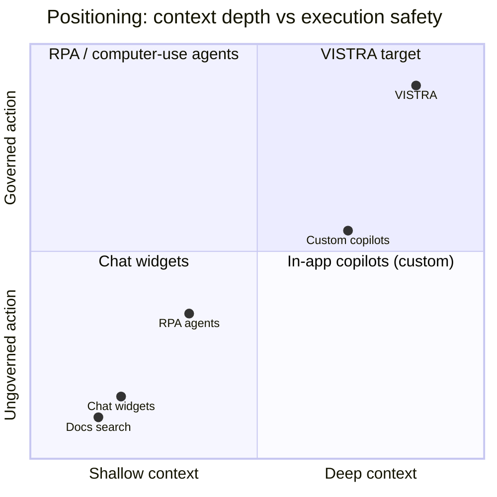

# Problem Statement and Market

**Doc ID:** 03 · **Status:** Approved · **Area:** Product
**Depends on:** [01](01-PRODUCT-VISION.md) · **Related:** [04](04-USER-PERSONAS-AND-USE-CASES.md), [07](07-MVP-AND-PRODUCT-ROADMAP.md)

---

## 1. Purpose

State the problem precisely enough that architectural choices can be judged against it, and describe the
market conditions that make an embeddable intelligence layer viable now.

## 2. The problem, decomposed

### 2.1 Users cannot find or operate what they already pay for

Enterprise and B2B SaaS interfaces accumulate features faster than users accumulate understanding.
Support tickets and onboarding drop-off cluster around navigation, permissions, and configuration — not
missing features. Existing help centers answer "what is this?" but cannot answer "where is it on my
screen, and do it for me".

### 2.2 Support and onboarding cost scales with surface area, not revenue

Every new page adds documentation debt, screenshot rot, and support load. Teams respond with more docs,
more tours, more videos — each of which decays the moment the UI changes. There is no substrate that
stays in sync with the *actual* interface.

### 2.3 AI answers are ungrounded and context-blind

Generic chat assistants receive a question and a system prompt. They do not know:
- what the user is looking at,
- what the user's role permits,
- what the company's private documentation says,
- whether the answer they produce is supported by evidence.

The result is confident hallucination in a regulated context. Companies cannot ship that to customers.

### 2.4 Acting is unsafe, so teams stop at reading

The moment an assistant can "click the button", a new set of problems appears: authorization, approval,
duplicate execution, audit, and verification. Most teams either avoid action entirely or ship brittle
automation with no policy layer — and then disable it after the first incident.

### 2.5 Building it in-house costs a year

A serious implementation needs: identity and tenancy, an embeddable SDK, DOM/accessibility capture,
screenshot handling, an ingestion pipeline with hybrid retrieval, a provider abstraction with fallback, an
agent runtime with tool policy, an evaluation harness, and an admin console. That is a platform team's
annual roadmap, not a sprint.

---

## 3. Problem statement (canonical)

> Companies cannot embed an intelligence layer into their own products that (a) understands the live
> interface, (b) answers from private knowledge with verifiable citations, (c) guides users to the right
> element on the actual screen, and (d) executes authorized actions safely, auditably, and idempotently —
> because doing so requires a multi-tenant platform spanning visual context, retrieval, agent policy,
> developer tooling, and operations, which no single product team can build and maintain alongside its
> core roadmap.

VISTRA is that platform.

---

## 4. Who feels the pain, and how much

| Segment | Pain | Economic consequence | Current workaround |
|---|---|---|---|
| B2B SaaS product teams ($5M–$100M ARR) | Onboarding drop-off, support volume | 10–25% of revenue in support; activation loss | Docs, Intercom macros, Loom videos, hand-built tours |
| Enterprise internal platforms | Complex tools, high training cost | Weeks of onboarding per role; error-prone ops | Training decks, shadowing, tribal knowledge |
| Developer platforms / API companies | Docs-to-product gap | Integration failures, long time-to-first-call | Samples, chat widgets that can't see the console |
| Vertical SaaS (health, legal, fintech) | Compliance + accuracy | Cannot ship ungrounded AI | Human review queues, no AI at all |

---

## 5. Why now

1. **Multimodal models became good enough** to read a screen and a DOM summary together, at acceptable
   latency and cost.
2. **Structured output and function calling stabilized**, making tool execution governable rather than
   prompt-hackery.
3. **Embedding + pgvector** removed the need for a separate vector database for most corpora; retrieval
   quality is now an engineering problem, not an infrastructure purchase.
4. **Buyers normalized embedded AI**, but are now asking the second-order questions — permissions,
   citations, audit, cost — that only a platform answers.
5. **Provider abstraction is now rational**: multiple capable providers exist with different
   capability/cost trade-offs, so routing and fallback are worth building.

---

## 6. Market shape

Categories and their gaps:

| Category | Strength | Structural gap VISTRA exploits |
|---|---|---|
| Documentation chatbots | Cheap, fast to deploy | No screen context, no action, weak ACLs |
| Product tour / adoption tools | Visual guidance | Static selectors, no intent, no knowledge, no backend |
| Agentic browser automation | Can operate UIs | Coordinate-based, unapproved, unauditable, hostile to hosts |
| Custom in-app copilots | Tailored | Rebuilt per company; no eval, policy, or multi-tenant ops |
| Observability / replay | Rich session data | Passive; cannot intervene |

---

## 7. Competitive moats (ordered by durability)

1. **Policy + verification model for actions.** Hard to retrofit; becomes the reason enterprises choose
   VISTRA over a demo-grade agent.
2. **Retrieval quality with tenant ACLs.** Compounding data/connector work, evaluated continuously.
3. **Semantic target resolution.** Deep, unglamorous engineering (DOM, a11y, scroll, dynamic layout) that
   competitors under-invest in.
4. **Developer surface.** SDK ergonomics, typed contracts, MCP, evaluation tooling create switching cost.
5. **Execution telemetry.** The traces become the customer's audit evidence, raising replacement cost.

Not moats: model access, prompt libraries, UI polish.

---

## 8. Risks and mitigations

| Risk | Impact | Mitigation |
|---|---|---|
| Model providers ship an "in-app agent" product | Commoditizes layer | Own tenancy, policy, retrieval ACLs, and host integration — provider-neutral by design |
| Customers refuse DOM access | Blocks visual features | Progressive capability: knowledge-only mode works without DOM; explicit capture scopes |
| Accuracy failures erode trust | Churn | Citations, insufficient-evidence state, eval gates, no-fake-success invariant |
| Cost per interaction too high | Unit economics | Model tiering, caching, retrieval budgeting, per-tenant limits (doc 66) |
| Security incident via tool execution | Existential | Policy engine, approvals, idempotency, verification, audit, threat model (doc 63) |
| Browser/platform restrictions (iframes, CSP) | Feature gaps | Documented limitations; iframe SDK variant; no overclaiming |

---

## 9. Assumptions (explicitly unverified)

- Buyers accept an embedded third-party SDK on authenticated pages when capture scope is configurable.
- A citation-first answer style is acceptable for support use cases (vs. conversational fluency).
- Customers will register tools rather than expect automatic UI automation.
- Gemini-class models remain cost-competitive for the primary path; NVIDIA NIM remains a viable fallback
  for text/reasoning workloads but not for every multimodal capability.

Each assumption is revisited in [34](../05-ai-and-model-infrastructure/34-AI-EVALUATION-AND-COST-MANAGEMENT.md)
(quality/cost) and [63](../11-quality-security-and-operations/63-SECURITY-THREAT-MODEL.md) (security).

---

## 10. Acceptance criteria

- [ ] Every persona in [04](04-USER-PERSONAS-AND-USE-CASES.md) has a documented pain from §4.
- [ ] Each differentiator in §7 maps to a subsystem document with a requirement ID.
- [ ] Risks in §8 map to a control in the threat model.

## 11. Related documents

[01](01-PRODUCT-VISION.md) · [04](04-USER-PERSONAS-AND-USE-CASES.md) · [07](07-MVP-AND-PRODUCT-ROADMAP.md) ·
[63](../11-quality-security-and-operations/63-SECURITY-THREAT-MODEL.md)
