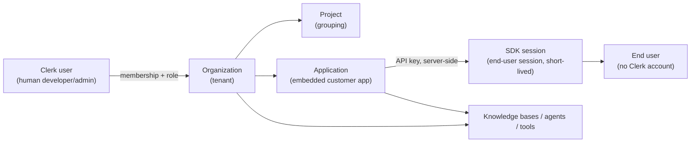

# User Personas and Use Cases

**Doc ID:** 04 · **Status:** Approved · **Area:** Product
**Depends on:** [02](02-PRODUCT-REQUIREMENTS.md) · **Related:** [60](../10-applications-and-experience/60-DEMO-APPLICATION-AND-END-TO-END-SCENARIOS.md), [59](../10-applications-and-experience/59-VISTRA-STUDIO-ARCHITECTURE.md)

---

## 1. Purpose

Define the four identity types that interact with VISTRA, their jobs, their permissions, and the concrete
use cases the system must support. Personas are the source of the authorization matrix
([18](../03-database-and-identity/18-TENANCY-RBAC-AND-AUTHORIZATION.md)) and the demo journeys
([60](../10-applications-and-experience/60-DEMO-APPLICATION-AND-END-TO-END-SCENARIOS.md)).

## 2. Scope

Human roles in Studio, developer integrators, and end users of embedded applications. Excludes internal
VISTRA staff tooling (documented in doc 61 §support access).

---

## 3. Identity model (read this before the personas)

Four distinct concepts that must never be conflated:

| Concept | Identity provider | Persisted as | Token |
|---|---|---|---|
| VISTRA user | Clerk | `users` | Clerk session JWT |
| Organization | Clerk organization, projected | `organizations` | claim `org_id`/`o.id` in token |
| Application | VISTRA | `applications` | public `app_*` id + hashed API key |
| End user of an embedded app | Host application | `application_sessions.end_user_ref` (opaque host id) | VISTRA-issued session token (audience `sdk`) |

## 4. Personas

### P1 — Maya, Staff Product Engineer at a B2B SaaS (primary)

- **Context.** Owns the in-app experience for a 40k-user platform. Has 6 weeks of platform capacity.
- **Goal.** Ship an assistant that answers from their docs, points at the right UI, and can create records
  through their existing API — without building retrieval, auth, and policy from scratch.
- **Needs.** Typed SDK, sandbox app, real docs, tool registration, local evaluation, logs she can read.
- **Frustrations.** Widgets that only do chat; black-box answers; selectors that break; no way to see why
  the model chose an action.
- **Success.** Embeds in a day, registers 3 tools in a week, sees citation accuracy and tool success in
  Studio.
- **Requirements:** PR-04, 06, 07, 08, 10, 13–19, 24, 28.

### P2 — Devon, Platform/IT Admin at an enterprise (buyer + operator)

- **Context.** Owns security review, SSO posture, data residency questions, and vendor risk.
- **Goal.** Approve a vendor that cannot leak data across tenants, exposes audit logs, bounds retention,
  and lets him revoke access instantly.
- **Needs.** Role management, audit export, session revocation, capture-scope configuration, retention
  controls, data deletion.
- **Frustrations.** "Trust us" security pages; service keys in browsers; unclear subprocessor data flows.
- **Success.** Passes review with documented RLS, audit events, and a deletion path.
- **Requirements:** PR-01–05, 26, 27, 29, 34.

### P3 — Priya, Support/Ops Lead (consumer of insight, not builder)

- **Context.** Runs a 22-person support team. Measures deflection and CSAT.
- **Goal.** Reduce "where is X" tickets and see which documentation gaps cause them.
- **Needs.** Conversation review, unanswered-question clustering, citation quality, guide-flow completion.
- **Frustrations.** Analytics that only count messages, not resolutions.
- **Success.** Weekly report showing deflection by topic and the top missing documents.
- **Requirements:** PR-16, 27, 28, 29.

### P4 — Sam, End User of an embedded application (never a VISTRA account)

- **Context.** Logged into the customer's product. Sees a VISTRA-powered assistant or cursor.
- **Goal.** Finish the task in front of them.
- **Needs.** Fast, correct, contextual answers; guidance that lands on the real control; explicit
  confirmation before anything changes; accessible, non-intrusive UI.
- **Frustrations.** Being asked to copy/paste context; being guided to a stale element; being told
  something happened when it did not.
- **Success.** Completes the task in fewer steps without contacting support.
- **Requirements:** PR-07, 09–12, 16, 21–23.

### P5 — Alex, AI engineer at the customer (secondary builder)

- **Context.** Owns prompt quality, evaluation, and cost. Wants to compare providers and prompts.
- **Needs.** Evaluation lab, prompt versioning, trace inspection, cost per capability, fallback evidence.
- **Requirements:** PR-28, 30–32.

---

## 5. Use cases

Each use case lists the actors, the preconditions, the observable outcome, and the owning subsystem.
`UC-*` IDs are referenced by acceptance criteria in [08](08-ACCEPTANCE-CRITERIA.md).

### UC-01 — Grounded documentation answer

| | |
|---|---|
| Actor | P4 end user |
| Precondition | Application embedded; knowledge base indexed and attached to the agent |
| Flow | Ask "What's included in the Starter plan?" → orchestrator classifies knowledge intent → hybrid retrieval filters by org/collection ACL → rerank → answer with 2 citations → SSE stream to widget |
| Outcome | Answer displays plan limits with a source link to the pricing document version 3, page 2 |
| Failure | No evidence above threshold → "I couldn't find this in your documentation" + top-3 suggested sources |
| Spec | [38](../06-knowledge-and-rag/38-VECTOR-SEARCH-AND-HYBRID-RETRIEVAL.md), [39](../06-knowledge-and-rag/39-RERANKING-CITATIONS-AND-GROUNDED-ANSWERS.md) |

### UC-02 — Question about a selected element

| | |
|---|---|
| Actor | P4 |
| Precondition | Element selector enabled; capture scope allows DOM |
| Flow | User selects the "Churn risk" chart → SDK captures role/name/text/bbox + crop → vision-capable model request with knowledge context → answer explains the metric and links the relevant doc |
| Outcome | Answer references the selected component by accessible name; no full-page screenshot leaves the browser when crop-only mode is on |
| Failure | Element detached before capture → `SELECTION_STALE`, prompt to reselect |
| Spec | [49](../08-visual-and-ghost-cursor/49-VISUAL-CONTEXT-ENGINE.md), [50](../08-visual-and-ghost-cursor/50-DOM-AND-ACCESSIBILITY-INSPECTION.md) |

### UC-03 — Guide flow for a workflow

| | |
|---|---|
| Actor | P4 |
| Precondition | Guide agent enabled; host exposes `data-vistra-target` on key controls |
| Flow | "Show me how to invite a teammate" → guide plan of 3 steps → Ghost Cursor resolves each target, scrolls into view, animates, explains, waits for user action, verifies the route/DOM change, advances |
| Outcome | User reaches the invite dialog; completion recorded with per-step outcomes |
| Failure | Target missing after retry budget → `TARGET_MISSING` with a text fallback instructing the user |
| Spec | [51](../08-visual-and-ghost-cursor/51-GHOST-CURSOR-ENGINE.md), [52](../08-visual-and-ghost-cursor/52-GHOST-CURSOR-MOTION-AND-TARGET-RESOLUTION.md), [53](../08-visual-and-ghost-cursor/53-VISUAL-GUIDANCE-AND-VERIFICATION.md) |

### UC-04 — Approved action execution

| | |
|---|---|
| Actor | P4 + host application |
| Precondition | `projects.create` tool registered; policy requires approval for create |
| Flow | "Create a project called Website Redesign" → action agent proposes tool call with schema-valid args → policy returns `require_approval` → widget shows confirmation with exact fields → user approves → executor calls host API with idempotency key → verifier reads back the project → success event with record id |
| Outcome | Project exists in the host app; `tool_invocations` row has request, response, verification, approver |
| Failure | Host API 500 → classified retryable → retried once with same key → still failing → run `failed_verification`, user told nothing was created |
| Spec | [45](../07-agents-and-execution/45-TOOL-REGISTRY-AND-FUNCTION-CALLING.md), [47](../07-agents-and-execution/47-APPROVALS-POLICY-AND-SAFE-EXECUTION.md) |

### UC-05 — Multi-step workflow

| | |
|---|---|
| Actor | P4 |
| Precondition | Workflow `create_project_and_invite` published |
| Flow | Steps: create project (approval) → invite teammate (approval) → verify membership; each step has its own policy and idempotency key; failure at step 2 leaves step 1 committed and reports partial completion with compensation options |
| Outcome | Both records exist, or an explicit partial state is reported |
| Spec | [46](../07-agents-and-execution/46-WORKFLOW-ENGINE-AND-STATE-MACHINE.md) |

### UC-06 — Knowledge ingestion of a mixed corpus

| | |
|---|---|
| Actor | P1 developer |
| Flow | Upload 40 PDFs + a sitemap URL + an OpenAPI spec → jobs queued → parse/chunk/embed/index → per-source status → failures listed with reasons → retry one source |
| Outcome | Collection ready with document counts, chunk counts, embedding model version; failed sources visible |
| Spec | [36](../06-knowledge-and-rag/36-DOCUMENT-INGESTION-AND-PARSING.md), [37](../06-knowledge-and-rag/37-CHUNKING-AND-METADATA-EXTRACTION.md) |

### UC-07 — Provider fallback during an outage

| | |
|---|---|
| Actor | System |
| Flow | Gemini returns 503 twice with backoff → circuit opens for the capability → router selects an NVIDIA NIM text model advertising `text.reasoning` → response validated against the VISTRA schema → trace records `fallback_used=true` |
| Outcome | User receives a slightly slower answer; Studio shows a fallback spike |
| Failure | No fallback model advertises the capability → `CapabilityUnavailable`, user sees degraded-mode message, no fake answer |
| Spec | [28](../05-ai-and-model-infrastructure/28-AI-PROVIDER-ABSTRACTION.md), [31](../05-ai-and-model-infrastructure/31-MODEL-ROUTING-AND-CAPABILITY-MATRIX.md) |

### UC-08 — Developer inspects a bad run

| | |
|---|---|
| Actor | P1 / P5 |
| Flow | Studio → Live Sessions → open a run → see intent, plan, retrieval (chunks + scores), provider/model, tokens, latency, policy decision, approval, tool call, verification |
| Outcome | Root cause identified without reading server logs |
| Spec | [48](../07-agents-and-execution/48-AGENT-MEMORY-AND-EXECUTION-TRACES.md), [59](../10-applications-and-experience/59-VISTRA-STUDIO-ARCHITECTURE.md) |

### UC-09 — Security review evidence

| | |
|---|---|
| Actor | P2 |
| Flow | Export audit events for 30 days; verify a cross-tenant probe returned 404 and was logged; confirm capture redaction config; confirm retention policy and deletion run |
| Outcome | Review package produced from the product, not from a spreadsheet |
| Spec | [61](../10-applications-and-experience/61-ADMINISTRATION-AND-ANALYTICS.md), [63](../11-quality-security-and-operations/63-SECURITY-THREAT-MODEL.md) |

### UC-10 — Voice interaction (P2 feature)

| | |
|---|---|
| Actor | P4 |
| Precondition | Live capability enabled; provider supports realtime voice |
| Flow | Spoken question → live session → transcript + response + optional guide step |
| Outcome | Hands-free guidance; transcript persisted per retention policy |
| Failure | Provider lacks live capability → explicit "voice unavailable", text fallback offered (never a silent text-only "voice" answer) |
| Spec | [28](../05-ai-and-model-infrastructure/28-AI-PROVIDER-ABSTRACTION.md), [31](../05-ai-and-model-infrastructure/31-MODEL-ROUTING-AND-CAPABILITY-MATRIX.md) |

---

## 6. Persona → permission summary

| Action | Owner | Admin | Developer | Analyst | Viewer | End user (SDK) |
|---|---|---|---|---|---|---|
| Manage billing/subscription | ✅ | ❌ | ❌ | ❌ | ❌ | ❌ |
| Invite/remove members | ✅ | ✅ | ❌ | ❌ | ❌ | ❌ |
| Create applications / reveal API key once | ✅ | ✅ | ✅ | ❌ | ❌ | ❌ |
| Manage knowledge sources | ✅ | ✅ | ✅ | ❌ | ❌ | ❌ |
| Publish agents/workflows/tools | ✅ | ✅ | ✅ | ❌ | ❌ | ❌ |
| View sessions/traces | ✅ | ✅ | ✅ | ✅ | ❌ | own session only |
| View analytics/usage | ✅ | ✅ | ✅ | ✅ | ✅ | ❌ |
| Export audit logs | ✅ | ✅ | ❌ | ✅ | ❌ | ❌ |
| Start a chat session in an embedded app | — | — | — | — | — | ✅ |
| Approve an action in an embedded app | — | — | — | — | — | ✅ (if policy allows) |

Full matrix, including resource-level rules: [18](../03-database-and-identity/18-TENANCY-RBAC-AND-AUTHORIZATION.md).

---

## 7. Failure scenarios

| Scenario | Expected behavior |
|---|---|
| End user's session token expires mid-conversation | SDK refreshes via host-provided mint endpoint; on failure, conversation continues read-only or prompts reauth |
| User belongs to 2 orgs, opens a link to a resource in org B | Server resolves membership; if absent → 404 with audit event |
| Analyst tries to open a knowledge source detail | 403 `INSUFFICIENT_ROLE` (resource exists, role insufficient — no existence leak concern within tenant) |
| Removed member with a live session | Next request rejected (membership re-checked), session revoked |

---

## 8. Acceptance criteria

- [ ] Each `UC-*` appears in an E2E test or a Playwright journey in [62](../11-quality-security-and-operations/62-TESTING-STRATEGY.md).
- [ ] The permission table in §6 is identical to the matrix in [18](../03-database-and-identity/18-TENANCY-RBAC-AND-AUTHORIZATION.md).
- [ ] The demo application implements at least UC-01, UC-02, UC-03, UC-04, UC-05 (see [60](../10-applications-and-experience/60-DEMO-APPLICATION-AND-END-TO-END-SCENARIOS.md)).

## 9. Related documents

[01](01-PRODUCT-VISION.md) · [02](02-PRODUCT-REQUIREMENTS.md) · [08](08-ACCEPTANCE-CRITERIA.md) ·
[18](../03-database-and-identity/18-TENANCY-RBAC-AND-AUTHORIZATION.md) ·
[60](../10-applications-and-experience/60-DEMO-APPLICATION-AND-END-TO-END-SCENARIOS.md)
