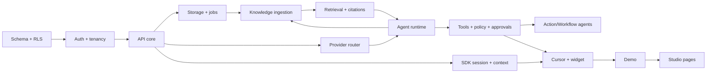

# MVP and Product Roadmap

**Doc ID:** 07 · **Status:** Approved · **Area:** Product / Delivery
**Depends on:** [02](02-PRODUCT-REQUIREMENTS.md) · **Related:** [../IMPLEMENTATION-ROADMAP.md](../IMPLEMENTATION-ROADMAP.md), [08](08-ACCEPTANCE-CRITERIA.md)

---

## 1. Purpose

Define the MVP boundary, the release phases, and the sequencing constraints that make each phase
shippable without rework. The engineering execution order lives in
[../IMPLEMENTATION-ROADMAP.md](../IMPLEMENTATION-ROADMAP.md); this document explains *why* that order.

## 2. MVP definition (what "v1" means)

The MVP is the smallest set of capabilities that proves the full loop **understand → guide → execute**
with production-grade safety on one real application:

1. Clerk identity + organization tenancy with database-enforced isolation.
2. Application registry + API keys + origin allowlist + SDK session tokens.
3. One embedded SDK (script tag + React) with widget.
4. Visual context capture (DOM/a11y summary, optional element selection, optional screenshot).
5. Knowledge ingestion for PDF/DOCX/MD/TXT/HTML/URL + hybrid retrieval + cited answers.
6. Orchestrator with vision, knowledge, guide, and action agents.
7. Tool registry + policy + approvals + verification for one host application.
8. Ghost Cursor with semantic target resolution and guide flows.
9. Studio: applications, knowledge, agents/tools, live sessions, usage, audit, settings.
10. Demo application exercising all journeys end-to-end.
11. Observability, evaluation harness, CI/CD, deployment, runbook.

Explicitly **not** in MVP: workflows with compensation beyond two steps, MCP server registration UI,
voice/live, enterprise SSO, marketplace, multi-region, self-hosted storage.

## 3. Phase plan

```mermaid
gantt
  title VISTRA delivery phases (relative, not calendar-committed)
  dateFormat  X
  axisFormat  %s
  section Foundation
  Repo + CI + types + local env        :p0, 0, 3
  Supabase schema + RLS + migrations   :p1, 2, 4
  Clerk auth + webhooks + projection   :p2, 3, 3
  section Backend core
  API foundation + errors + tenancy    :p3, 6, 3
  Storage + jobs + workers             :p4, 8, 3
  Provider router (Gemini/NVIDIA)      :p5, 9, 4
  Agent runtime + tools + approvals    :p6, 12, 5
  Knowledge ingestion + retrieval      :p7, 13, 5
  section Experience
  SDK core + cursor + widget           :p8, 16, 6
  Demo application                     :p9, 20, 4
  Studio                               :p10, 21, 6
  section Hardening
  Evaluation + security + load tests   :p11, 26, 4
  Release + runbook                    :p12, 29, 2
```

### Phase 0 — Engineering foundation (must precede everything)

Repo layout, pnpm/uv workspaces, lint/format/typecheck, CI skeleton, local Supabase + Redis, secret
handling, docs validation. **Why first:** every later phase depends on a reproducible environment and a
green pipeline; retrofitting is expensive.

### Phase 1 — Data and identity substrate

Schema domains for identity, organizations, projects, applications, agents, knowledge, sessions, usage.
RLS policies. Clerk integration and webhook projection. **Why before features:** tenancy and identity
shape every table and every endpoint; changing them later means data migration.

### Phase 2 — Backend core

FastAPI skeleton with config validation, auth dependency, tenant dependency, error envelope, audit hook,
pagination, idempotency, structured logging. **Why before modules:** every module inherits these; building
them once prevents five inconsistent implementations.

### Phase 3 — Storage, jobs, workers

Storage adapter, signed URLs, file metadata, job table, worker skeleton, retry/dead-letter, SIGTERM
draining. **Why before knowledge:** ingestion is the first heavy job consumer and validates the model.

### Phase 4 — AI provider infrastructure

Provider ports, Gemini adapter, NVIDIA adapter, capability registry, router, retry, circuit breaker,
telemetry, cost accounting. **Why before agents:** agents are consumers; building agents on a direct SDK
call guarantees a rewrite and a fallback that cannot be tested.

### Phase 5 — Agent runtime, tools, policy, approvals

Run/step persistence, orchestrator, intent classification, tool registry, policy engine, approval service,
verifier, traces. **Why before knowledge-heavy features:** the knowledge agent is an agent; it needs the
runtime, not a bespoke endpoint.

### Phase 6 — Knowledge engine

Source connectors, parser adapters, chunking, embeddings, hybrid retrieval, reranking, citations.
**Why after runtime:** retrieval is invoked by the knowledge agent and validated by its citation contract.

### Phase 7 — Visual and cursor

Context collectors, DOM/a11y serialization, selection, target resolver, motion engine, state machine,
accessibility. **Why after backend:** the though cursor consumes a plan produced by the guide agent; it
needs the real contract, not a mock.

### Phase 8 — SDK, widget, demo

SDK core, React bindings, widget, then the Acme Workspace demo integrating everything. **Why last among
build phases:** the SDK is a thin client over tested contracts; building it earlier encourages inventing
endpoints.

### Phase 9 — Studio

Administrative surface over existing endpoints. **Why near the end:** Studio is a consumer of every API;
building it early creates fake data pressure.

### Phase 10 — Hardening and release

Evaluation suites, adversarial security tests, load tests, cost validation, documentation review, release
and rollback rehearsal.

## 4. Milestones and exit criteria

| Milestone | Exit criteria |
|---|---|
| M1 — Skeleton | CI green; migrations apply cleanly; `/healthz` up; docs validator green |
| M2 — Identity | Sign-in works; org switching; cross-tenant tests pass; webhooks idempotent |
| M3 — First answer | Knowledge agent answers with a valid citation from an indexed PDF over the API |
| M4 — First guide | Guide flow finds 3 real elements in the demo app and reports completion |
| M5 — First action | Approved tool creates a record; verifier confirms; duplicate request does not duplicate |
| M6 — Fallback proven | Induced Gemini failure routes to NVIDIA for a text capability, recorded in the trace |
| M7 — Studio complete | Every Studio page bound to a real endpoint; no mock data |
| M8 — Release candidate | E2E journeys, security suite, RAG thresholds, load budgets, runbook |

## 5. Sequencing constraints (hard dependencies)

Rules:
- No knowledge UI before retrieval can cite.
- No cursor work before guide plan contract exists.
- No action agent before policy engine returns decisions.
- No Studio page before its endpoint has integration tests.
- No SDK release before session auth is proven with a cross-tenant denial test.

## 6. Release criteria for MVP (GA)

- All P0 requirements in [02](02-PRODUCT-REQUIREMENTS.md) implemented and traceable.
- [../steering/DEFINITION-OF-DONE.md](../steering/DEFINITION-OF-DONE.md) §10 release gate satisfied.
- NFR budgets from [06](06-NONFUNCTIONAL-REQUIREMENTS.md) measured, not assumed.
- Demo passes the five canonical journeys in
  [60](../10-applications-and-experience/60-DEMO-APPLICATION-AND-END-TO-END-SCENARIOS.md).
- Runbook and rollback rehearsed.

## 7. Post-MVP roadmap

| Horizon | Themes |
|---|---|
| v1.1 | Workflow compensation, webhook subscriptions UI, MCP tool import, better analytics funnels |
| v1.2 | Voice/live agent (capability-gated), iframe SDK variant, multi-language prompts |
| v1.3 | Enterprise: SSO/SCIM, audit export API, retention policies per collection, regional deployment |
| v2.0 | Marketplace for agents/tools, cross-application workflows, self-hosted option for regulated tenants |

## 8. Risks to the roadmap

| Risk | Mitigation |
|---|---|
| Ingestion quality (bad PDFs) slips the milestone | Parser adapter tests on a fixture corpus; per-source failure visibility from day one |
| Cursor target resolution unstable across hosts | Host target-id contract + semantic fallback + explicit `TARGET_MISSING` |
| Provider capability gaps | Capability matrix enforced; no silent downgrade |
| Scope creep into Studio polish | Studio pages ship only when the endpoint exists (M7 gate) |
| Cost overrun in eval | Budgets per suite; sampled live calls only in nightly |

## 9. Acceptance criteria

- [ ] Every phase lists a verifiable exit condition.
- [ ] The roadmap order matches [../IMPLEMENTATION-ROADMAP.md](../IMPLEMENTATION-ROADMAP.md).
- [ ] MVP scope matches the P0 set in [02](02-PRODUCT-REQUIREMENTS.md).

## 10. Related documents

[02](02-PRODUCT-REQUIREMENTS.md) · [08](08-ACCEPTANCE-CRITERIA.md) · [../IMPLEMENTATION-ROADMAP.md](../IMPLEMENTATION-ROADMAP.md) ·
[../IMPLEMENTATION-STATUS.md](../IMPLEMENTATION-STATUS.md)
