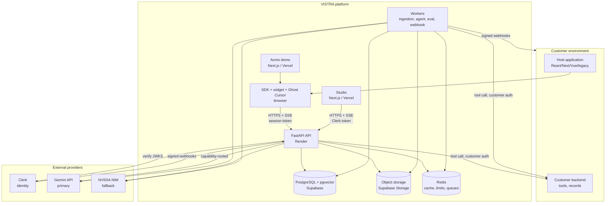
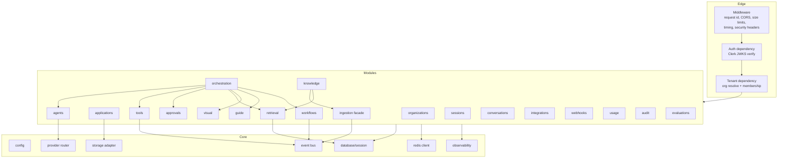
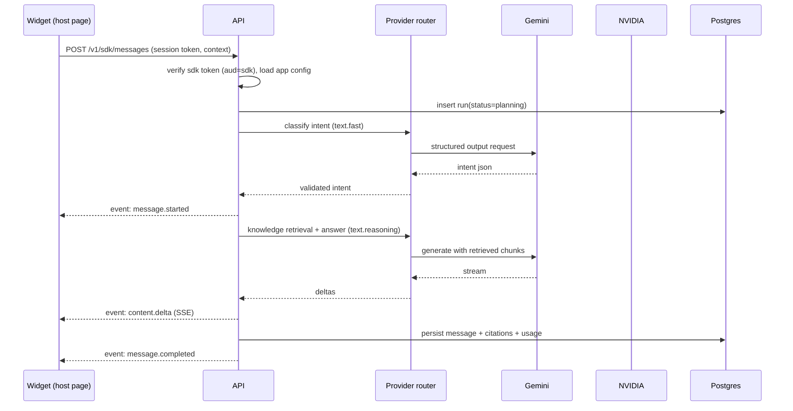
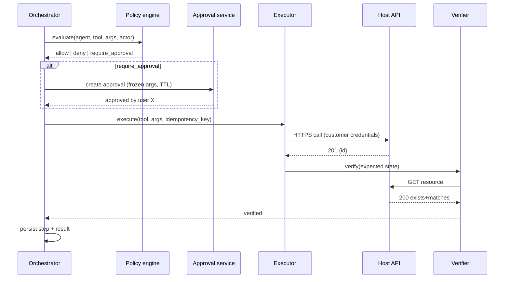
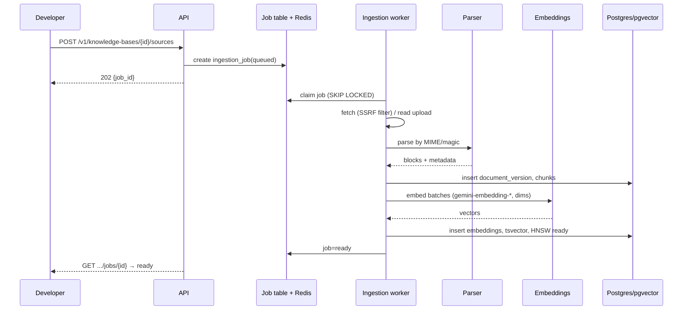
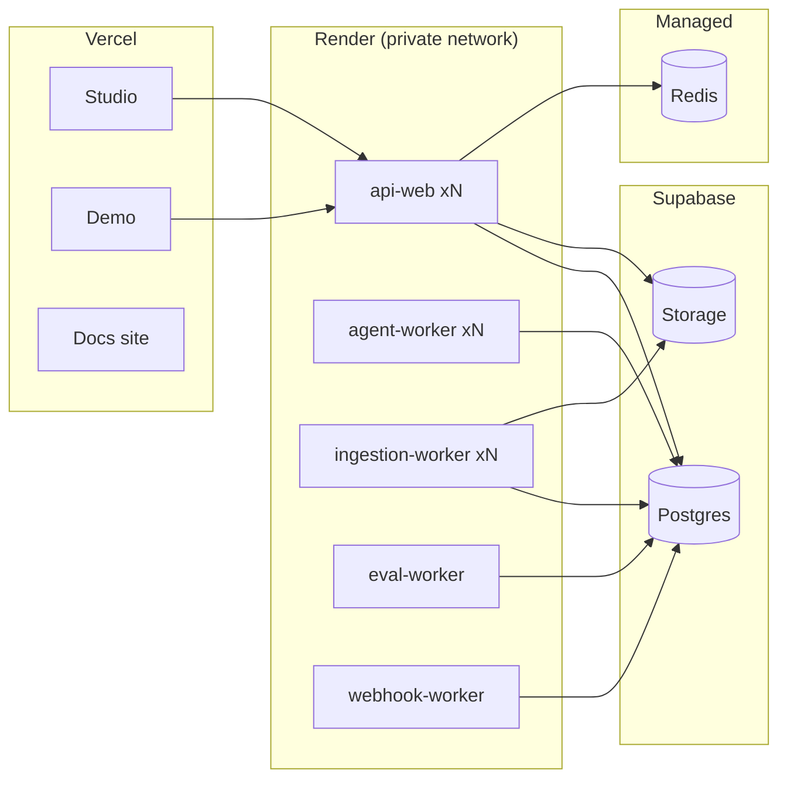

# System Architecture

**Doc ID:** 09 · **Status:** Approved · **Area:** Architecture
**Depends on:** [AGENTS.md](../steering/AGENTS.md) · **Related:** [10](10-ARCHITECTURE-DECISIONS.md), [12](12-SERVICE-BOUNDARIES-AND-MODULE-MAP.md), [13](13-DATA-FLOW-AND-SEQUENCE-DIAGRAMS.md)

---

## 1. Purpose

Describe VISTRA as one system: its containers, components, boundaries, trust zones, persistence map,
request lifecycles, and failure points. Every other architecture document elaborates one region of this
picture; none may contradict it.

## 2. Scope

Logical and physical architecture of the platform: browser SDK, API, workers, database, storage, cache,
providers, and third-party services. Not included: UI page inventory (doc 59), API field-level detail
(doc 23), deployment runbooks (docs 67–75).

## 3. Goals and non-goals

**Goals**
- One backend contract serving Studio, demo, SDK, REST, MCP.
- Tenant isolation enforced in the database, not only in code.
- Capability-based model routing with explicit degradation.
- Durable, resumable, auditable execution.
- Independently deployable frontends without duplicated business logic.

**Non-goals**
- Microservice-per-module (rejected: ADR-005).
- Multi-region active-active in v1.
- Real-time collaborative editing.
- Model training.

---

## 4. Context diagram (system and actors)



**Reading the diagram.** The browser never talks to a model provider, the database, or storage with
privileged credentials. All authoritative reads/writes flow through the API or workers. Clerk is the only
identity source; Supabase is the only primary datastore; Gemini and NVIDIA are reached exclusively through
the provider router.

---

## 5. Container responsibilities

| Container | Technology | Owns | Scales on |
|---|---|---|---|
| `sdk` | TypeScript (ESM + IIFE) | Capture, widget UI, SSE consumption, cursor | CDN / customer page |
| `api` | FastAPI (ASGI, uvicorn) | Auth, tenancy, CRUD, orchestration entry, SSE | CPU + in-flight requests |
| `ingestion worker` | Python process | Fetch/parse/chunk/embed/index | Queue depth |
| `agent worker` | Python process | Durable runs, workflows, tool execution | Queue depth + run duration |
| `evaluation worker` | Python process | Eval suites, golden sets, regression reports | Scheduled |
| `webhook worker` | Python process | Outbound deliveries, retries, DLQ | Queue depth |
| `studio` | Next.js (server components) | Admin/dev console | Request rate |
| `demo` | Next.js | Reference host application | Request rate |
| `docs-site` | Next.js static | Public docs | CDN |
| `db` | PostgreSQL 15+ / pgvector | All authoritative state | Vertical + read replicas (later) |
| `storage` | Supabase Storage (S3 API) | Originals, parsed text, assets, exports | Provider-managed |
| `redis` | Redis 7-compatible | Rate limits, locks, cache, queue signals | Provider-managed |

---

## 6. Component architecture (inside the API)



Module dependency rules and the complete allowed-import matrix are normative in
[12](12-SERVICE-BOUNDARIES-AND-MODULE-MAP.md). The key invariant: **orchestration depends on capability
modules; capability modules never depend on orchestration.**

---

## 7. Trust boundaries

| Boundary | Crossing mechanism | Controls |
|---|---|---|
| Browser ↔ API | HTTPS, `Authorization: Bearer` (Clerk or SDK session) | Origin allowlist, token audience, CORS, rate limits, body size caps |
| API ↔ Postgres | Pooled TLS connection | RLS for user-scoped path; service path restricted to enumerated operations + explicit org filter |
| API/Workers ↔ providers | HTTPS with provider keys | Egress allowlist, key isolation, no key in browser, per-org budgets |
| Workers ↔ customer systems | HTTPS tool calls / webhooks | Per-integration credentials (encrypted), SSRF filter, timeouts, idempotency |
| Clerk ↔ API webhooks | Signed HTTP | Signature verification, timestamp tolerance, event-id dedupe |
| Customer page ↔ SDK | In-page same-origin JS | Explicit capture config, redaction, user permission for screenshots |
| Studio ↔ API | HTTPS with Clerk token | RBAC, tenant resolution, audit on mutations |

**Never trusted:** request-body `organization_id`/`user_id`; `Origin` alone; model output; retrieved
document text; tool output; webhook payload before signature verification.

---

## 8. Persistence map (what lives where, and why)

| Data | Store | Rationale | Lifetime |
|---|---|---|---|
| Users, orgs, memberships (projection) | Postgres | Relational queries, RLS, audit joins | Account lifetime |
| Applications, API keys (hash), domains | Postgres | Tenant config, key rotation | Until deleted |
| Agents, versions, tools, policies, workflows | Postgres (JSONB for config) | Versioned config, referential integrity | Versioned |
| Knowledge bases, sources, documents, versions | Postgres | Relational + ACL | Until deleted |
| Chunks (+ `tsvector`) | Postgres | Hybrid retrieval in one query | Until deleted |
| Embeddings (`vector`) | Postgres + pgvector (HNSW) | Filtered ANN with RLS | Until deleted |
| Original files, parsed text, assets, exports | Object storage | Size, streaming, lifecycle | Retention policy |
| Conversations, messages, citations | Postgres | Auditability, export | Tenant retention |
| Sessions, session events | Postgres (+ Redis for live fan-out) | Durability + realtime | Retention |
| Agent runs, steps, tool invocations, approvals | Postgres | Trace/audit, resume | 90 d default |
| Usage records, model usage | Postgres (partitioned by month) | Billing/analytics | 2 y |
| Audit events | Postgres (append-only) | Compliance | 1 y+ |
| Rate-limit counters, locks, hot cache | Redis | Ephemeral speed | TTL |
| Job queues | Postgres job table + Redis signals | Durable source of truth | Until DLQ cleared |
| Screenshots (opt-in) | Object storage | Large, short-lived | ≤ 30 d |
| Prompts | Postgres `prompt_versions` | Versioning + eval linkage | Indefinite |

The rule: **Postgres is the source of truth for anything that must survive a restart or be audited.
Redis is a cache, lock, and signal — never the record.** Objects are addressed by a `files` row; deletion is
a two-phase operation (mark → delete object → hard delete row).

---

## 9. Request lifecycles

### 9.1 Authenticated Studio request

```mermaid
sequenceDiagram
  participant U as User (browser)
  participant S as Studio (Vercel)
  participant C as Clerk
  participant A as API (Render)
  participant P as Postgres (RLS)
  U->>S: open /applications
  S->>C: session token (server-side via middleware)
  S->>A: GET /v1/applications (Bearer)
  A->>A: verify signature, iss, exp, azp
  A->>A: resolve org + membership + role
  A->>A: authorize(role, resource, action)
  A->>P: SELECT ... WHERE organization_id = :org
  P-->>A: rows (RLS enforced)
  A->>P: INSERT audit_event (read of sensitive list is not audited; mutations are)
  A-->>S: 200 {data, next_cursor}
  S-->>U: rendered (server component, no-store)
```

### 9.2 Embedded chat turn (SSE)



Fallback is transparent to the widget except for a `provider_fallback` metadata field and a degraded-mode
notice when quality may be lower.

### 9.3 Tool execution



### 9.4 Ingestion



---

## 10. Failure points and containment

| Failure | Blast radius | Containment |
|---|---|---|
| Gemini outage | Text/vision answers | Retry → capability-gated NVIDIA fallback → 503 with `PROVIDER_UNAVAILABLE`; guidance unaffected |
| Postgres primary down | All writes | Read-only degraded mode if replica exists; otherwise 503; health reports `db: down` |
| Redis down | Rate limits, live fan-out | Fail-closed on auth-sensitive limits; SSE falls back to DB polling |
| Storage down | Uploads/downloads | Queue uploads; retrieval still works from parsed text |
| Ingestion worker crash | One job | Job heartbeat expires → reclaimed → resumes from last stage |
| Agent worker crash | In-flight runs | Run state persisted per step → resumed; idempotency prevents duplicate side effects |
| Customer host API down | Tool executions | `TOOL_UPSTREAM_ERROR`, no retry for non-idempotent, run `failed`, user informed |
| Clerk unavailable | New logins, token verification if JWKS uncached | JWKS cached with TTL; existing sessions continue until cache expiry; otherwise 503 |
| Vercel incident | Studio/demo | API unaffected; SDK embedded in customer apps unaffected |
| Prompt injection | Answer quality/behavior | Fenced context, no policy authority, output schema validation, tool args schema |

## 11. Deployment topology



Details, including private networking, health checks, and worker commands, are in
[69](../12-deployment-and-release/69-RENDER-BACKEND-DEPLOYMENT.md). All containers are stateless;
all state is in Supabase or Redis.

## 12. Cross-cutting concerns

| Concern | Mechanism | Document |
|---|---|---|
| IDs | UUIDv7 generated in app; Clerk ids kept as text | [16](../03-database-and-identity/16-DATABASE-SCHEMA-AND-RELATIONSHIPS.md) |
| Time | `timestamptz` UTC; ISO-8601 at the edge | doc 23 |
| Config | Pydantic settings, validated at boot, no secret defaults | [68](../12-deployment-and-release/68-ENVIRONMENT-AND-SECRETS-MANAGEMENT.md) |
| Errors | Typed exceptions → problem+json with stable codes | [27](../04-backend-and-api/27-ERROR-HANDLING-AND-RESILIENCE.md) |
| Events | `domain.entity.past_tense`, persisted then published | [25](../04-backend-and-api/25-REALTIME-AND-EVENT-ARCHITECTURE.md) |
| Auth | Clerk verification + tenant resolution dependency | [17](../03-database-and-identity/17-CLERK-AUTHENTICATION.md) |
| Tracing | OpenTelemetry spans across API → provider → DB | [64](../11-quality-security-and-operations/64-OBSERVABILITY-LOGGING-AND-MONITORING.md) |

## 13. Scaling model

- API is horizontally scalable and stateless; SSE uses async generators (no thread-per-connection).
- Workers scale independently by queue; concurrency tuned per queue (`ingestion` CPU-bound, `agent`
  IO-bound).
- Hot reads (app config, agent version, prompt) cached in Redis with short TTL and explicit invalidation
  on publish.
- Retrieval scales with pgvector HNSW + org-leading indexes; very large tenants get dedicated index
  partitions (documented threshold in doc 38).
- Cost controls (model tiering, retrieval budgets, answer caching) are architectural, not an afterthought
  (doc 66).

## 14. Architecture acceptance criteria

- [ ] No component calls a provider, database, or storage system outside its documented adapter.
- [ ] Every cross-boundary call in §4–§6 appears in the module map with an owner.
- [ ] Every failure in §10 has a matching test in the chaos/resilience suite.
- [ ] The persistence map in §8 matches the schema doc's table inventory exactly.

## 15. Related documents

[10](10-ARCHITECTURE-DECISIONS.md) · [11](11-REPOSITORY-AND-MONOREPO-STRUCTURE.md) ·
[12](12-SERVICE-BOUNDARIES-AND-MODULE-MAP.md) · [13](13-DATA-FLOW-AND-SEQUENCE-DIAGRAMS.md) ·
[14](14-TECHNOLOGY-STACK-AND-DEPENDENCIES.md) ·
[16](../03-database-and-identity/16-DATABASE-SCHEMA-AND-RELATIONSHIPS.md) ·
[69](../12-deployment-and-release/69-RENDER-BACKEND-DEPLOYMENT.md)

## 16. References

- FastAPI — https://fastapi.tiangolo.com/
- Supabase architecture — https://supabase.com/docs/guides/platform/architecture
- pgvector — https://github.com/pgvector/pgvector
- Clerk token verification — https://clerk.com/docs/backend-requests/overview
- Render architecture — https://render.com/docs
- Vercel — https://vercel.com/docs
