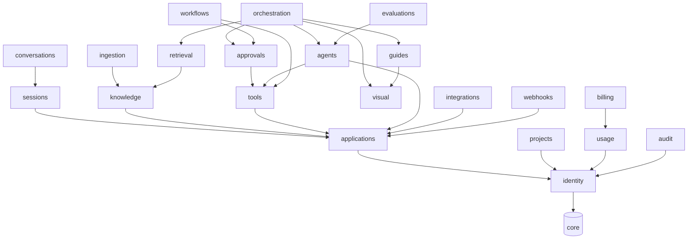

# Service Boundaries and Module Map

**Doc ID:** 12 · **Status:** Approved · **Area:** Architecture
**Depends on:** [09](09-SYSTEM-ARCHITECTURE.md), [11](11-REPOSITORY-AND-MONOREPO-STRUCTURE.md) · **Related:** [16](../03-database-and-identity/16-DATABASE-SCHEMA-AND-RELATIONSHIPS.md), [25](../04-backend-and-api/25-REALTIME-AND-EVENT-ARCHITECTURE.md)

---

## 1. Purpose

Define each backend module: what it owns, its public service interface, its tables, the modules it may
depend on, and the events it emits or consumes. This is the map that prevents a monolith from becoming a
muddle.

## 2. Module inventory

| Module | Owns | Tables | Depends on |
|---|---|---|---|
| `identity` | User/org/membership projection, Clerk sync | `users`, `organizations`, `organization_members`, `webhook_events` | `core/*` |
| `applications` | Apps, keys, domains, capability config | `applications`, `application_domains`, `api_keys` | `identity` |
| `projects` | Grouping of apps/agents/knowledge | `projects` | `identity` |
| `agents` | Definitions, versions, bindings | `agents`, `agent_versions`, `agent_tools`, `agent_policies` | `applications`, `tools` (read) |
| `orchestration` | Intent, planning, run lifecycle, agent dispatch | `agent_runs`, `agent_run_steps` | `agents`, `retrieval`, `visual`, `guides`, `tools`, `approvals`, `ai` |
| `sessions` | SDK/end-user sessions, tokens | `application_sessions`, `session_events` | `applications`, `identity` |
| `conversations` | Messages, citations, streaming records | `sessions`, `session_messages`, `message_citations` | `sessions` |
| `tools` | Registry, schema validation, execution, verification hooks | `tools`, `tool_versions`, `tool_invocations`, `tool_credentials` | `applications`, `core/egress` |
| `approvals` | Policy evaluation + approval records | `approvals`, `policy_decisions` | `tools` (read), `identity` |
| `workflows` | Definitions, step state machine | `workflows`, `workflow_versions`, `workflow_steps`, `workflow_runs` | `tools`, `approvals` |
| `knowledge` | KBs, collections, sources, documents, versions | `knowledge_bases`, `knowledge_collections`, `knowledge_sources`, `documents`, `document_versions` | `applications`, `storage` |
| `ingestion` | Job orchestration, parser registry, normalization | `ingestion_jobs`, `document_chunks` (writes with `retrieval`) | `knowledge`, `ai` (embeddings), `storage` |
| `retrieval` | Hybrid search, rerank, context assembly, citations | `document_chunks`, `embeddings`, `retrieval_events` | `knowledge`, `ai` |
| `visual` | Context normalization, element descriptors, capture policy | `visual_context_snapshots` (short-lived) | `sessions` |
| `guides` | Guide plans, step state, cursor commands | `guide_flows`, `guide_steps` | `visual`, `conversations` |
| `integrations` | OAuth/credential connections, MCP servers | `integrations`, `oauth_connections`, `mcp_servers` | `applications` |
| `webhooks` | Endpoints, deliveries, retries | `webhook_endpoints`, `webhook_deliveries` | `applications` |
| `usage` | Metering, rollups, quotas | `usage_records`, `model_usage`, `usage_rollups` | `identity` |
| `audit` | Append-only audit log | `audit_events` | `identity` |
| `evaluations` | Suites, cases, results | `evaluation_suites`, `evaluation_cases`, `evaluation_results` | `agents`, `retrieval` |
| `billing` | Plans, entitlements (post-MVP) | `subscriptions`, `entitlements` | `identity`, `usage` |

`core/` is not a module: it holds cross-cutting primitives with no business rules (`config`, `db`,
`auth`, `tenancy`, `storage`, `redis`, `events`, `observability`, `exceptions`, `egress`, `crypto`).

---

## 3. Dependency graph



**Forbidden edges** (enforced by import-linter):
`knowledge → retrieval`, `retrieval → orchestration`, `tools → orchestration`, `sessions → agents`,
any `→ apps/studio | apps/demo`, any module → another module's `repository`.

---

## 4. Service interfaces (Python)

Interfaces are the only cross-module surface. Signatures are normative at the semantic level; parameter
names may be refined during implementation with the doc updated.

```python
class KnowledgeService:
    async def create_source(self, ctx: TenantContext, kb_id: UUID, input: SourceInput) -> Source: ...
    async def enqueue_ingestion(self, ctx: TenantContext, source_id: UUID) -> IngestionJob: ...
    async def document_delete(self, ctx: TenantContext, document_id: UUID) -> None: ...

class RetrievalService:
    async def search(self, ctx: RetrievalContext, query: str,
                     collections: list[UUID], k: int = 20) -> RetrievalResult: ...
    async def assemble_context(self, result: RetrievalResult,
                               budget_tokens: int) -> ContextBundle: ...

class ToolService:
    async def validate_args(self, tool: ToolVersion, args: dict) -> ValidatedArgs: ...
    async def execute(self, ctx: ExecutionContext, tool: ToolVersion, args: ValidatedArgs,
                      idempotency_key: str) -> ToolResult: ...
    async def verify(self, invocation: ToolInvocation) -> VerificationResult: ...

class PolicyService:
    async def decide(self, ctx: DecisionContext, tool: ToolVersion,
                     args: dict) -> PolicyDecision: ...  # allow | deny | require_approval

class OrchestrationService:
    async def start_run(self, ctx: RunContext, request: UserRequest) -> AgentRun: ...
    async def resume_run(self, run_id: UUID) -> AgentRun: ...
    async def cancel_run(self, run_id: UUID, reason: str) -> None: ...

class SessionService:
    async def mint_sdk_session(self, app: Application, end_user_ref: str,
                               ttl_seconds: int = 900) -> SdkSession: ...
    async def revoke(self, session_id: UUID) -> None: ...

class StorageService:  # core port
    async def upload(self, key: ObjectKey, data: BinaryIO, content_type: str) -> StoredObject: ...
    async def signed_download(self, key: ObjectKey, ttl_seconds: int = 300) -> str: ...
```

**DTO rule:** a module never returns ORM objects across boundaries. It returns dataclasses/Pydantic DTOs
with only the fields the consumer needs.

---

## 5. Module anatomy (every module)

```
modules/<name>/
  router.py       # HTTP; calls service; no SQL, no policy logic inline
  schemas.py      # Pydantic v2 request/response
  service.py      # use cases; transaction boundary; calls policies + repositories
  repository.py   # SQL only; returns ORM/DTO rows
  models.py       # SQLAlchemy models matching migrations
  policies.py     # authorization predicates for this module's resources
  events.py       # emitted domain events (names + payload schemas)
  exceptions.py   # module-specific typed errors with stable codes
  tests/
    test_service.py
    test_router.py
    test_policies.py
    test_rls.py
```

A module must be deletable without breaking unrelated modules (modulo FK constraints documented in doc 16).

---

## 6. Synchronous vs asynchronous responsibilities

| Operation | Sync (request path) | Async (worker) |
|---|---|---|
| Create source record | ✅ validate + insert + enqueue | — |
| Parse/embed/index | — | ✅ ingestion worker |
| Answer a question | ✅ classify → retrieve → generate (stream) | ✅ long plans, multi-step workflows |
| Tool execution | ✅ single fast tool (< 2 s) with approval already granted | ✅ slow/external tools, retries, workflows |
| Webhook delivery | — | ✅ webhook worker |
| Evaluation | — | ✅ evaluation worker |
| Usage aggregation | increment counters sync | ✅ hourly rollups |
| Screenshot storage | — | ✅ async upload after response (best effort) |

Rule of thumb: if it can exceed ~2 s p95 or must survive a deploy, it belongs to a worker.

---

## 7. Events

Naming: `<domain>.<entity>.<past_tense>`. Emitted after the transaction commits (outbox pattern:
`events_outbox` row in the same transaction; a dispatcher publishes).

| Event | Producer | Consumers |
|---|---|---|
| `organization.member.added` / `.removed` | `identity` | `audit`, `usage` |
| `application.created` / `.key.rotated` | `applications` | `audit` |
| `knowledge.source.created` | `knowledge` | `ingestion` |
| `ingestion.job.completed` / `.failed` | `ingestion` | `knowledge`, `webhooks`, `audit` |
| `document.indexed` / `.deleted` | `ingestion` | `retrieval` (cache invalidation) |
| `session.started` / `.ended` | `sessions` | `usage`, `webhooks` |
| `conversation.message.completed` | `conversations` | `usage`, `evaluations` |
| `agent.run.started` / `.completed` / `.failed` / `.cancelled` | `orchestration` | `usage`, `webhooks`, `audit` |
| `agent.step.completed` | `orchestration` | `conversations` (progress), `evaluations` |
| `tool.invocation.requested` / `.succeeded` / `.failed` | `tools` | `audit`, `usage`, `webhooks` |
| `approval.requested` / `.granted` / `.rejected` / `.expired` | `approvals` | `conversations`, `audit` |
| `guide.flow.started` / `.step.completed` / `.completed` / `.abandoned` | `guides` | `usage`, `webhooks` |
| `usage.threshold.reached` | `usage` | `billing`, `webhooks` |
| `audit.event.recorded` | `audit` | (external SIEM export, later) |

Payload schemas live with the producer (`events.py`), are versioned (`schema_version`), and are validated on
consume. Consumers must be idempotent on `event_id`.

---

## 8. Boundary tests (must exist)

- Import-linter fails on a forbidden edge.
- Each module has a test that imports only its declared dependencies (compile-time smoke).
- Event consumer tests use a persisted outbox row, not a direct function call.
- No module test reaches into another module's tables (enforced by using services in fixtures).

## 9. Acceptance criteria

- [ ] Every table in doc 16 has exactly one owning module in §2.
- [ ] The dependency graph matches the import rules in CI.
- [ ] Every event in §7 has a producer, at least one consumer, and a payload schema.
- [ ] New modules require an ADR (doc 10) and a row in this table.

## 10. Related documents

[09](09-SYSTEM-ARCHITECTURE.md) · [13](13-DATA-FLOW-AND-SEQUENCE-DIAGRAMS.md) ·
[16](../03-database-and-identity/16-DATABASE-SCHEMA-AND-RELATIONSHIPS.md) ·
[22](../04-backend-and-api/22-BACKEND-ARCHITECTURE.md) ·
[25](../04-backend-and-api/25-REALTIME-AND-EVENT-ARCHITECTURE.md)
