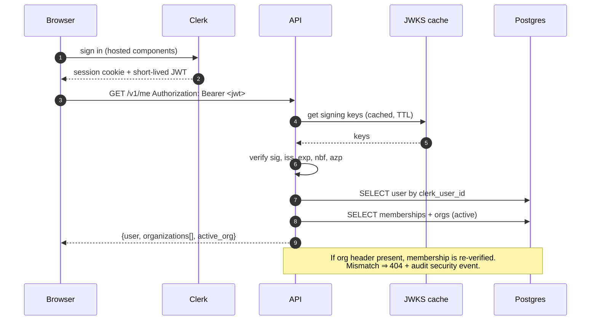
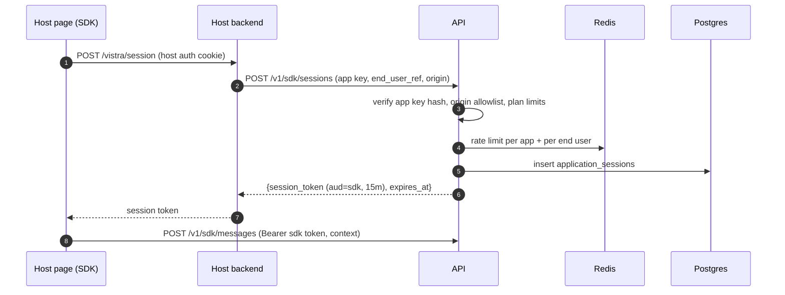
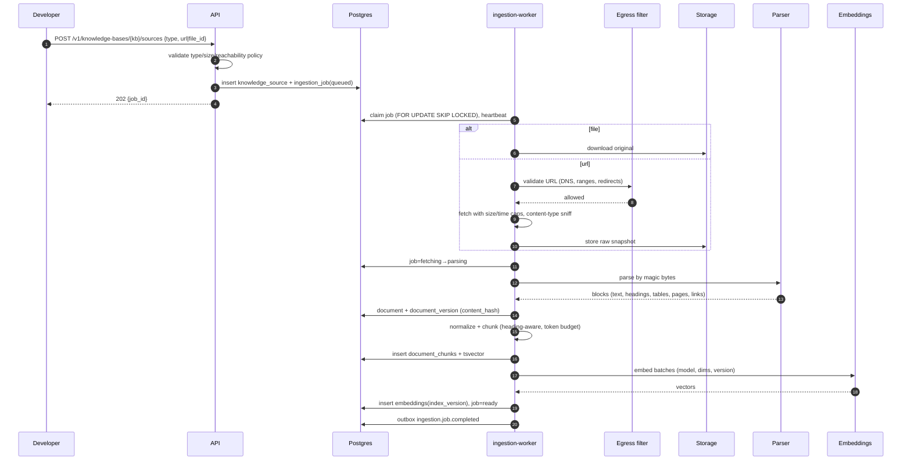
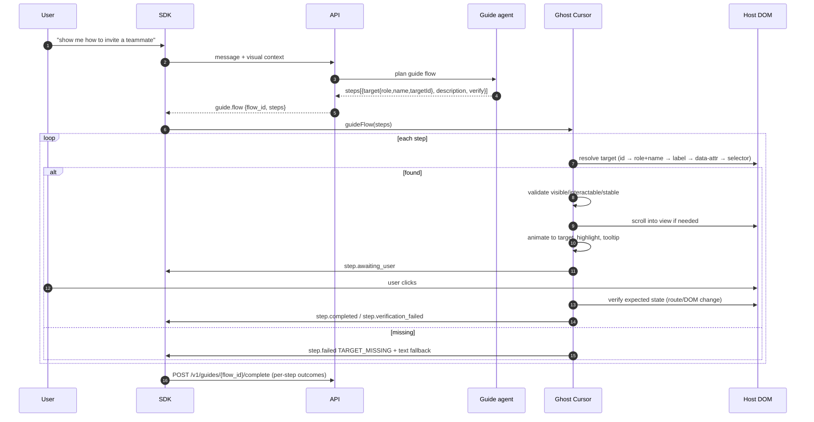
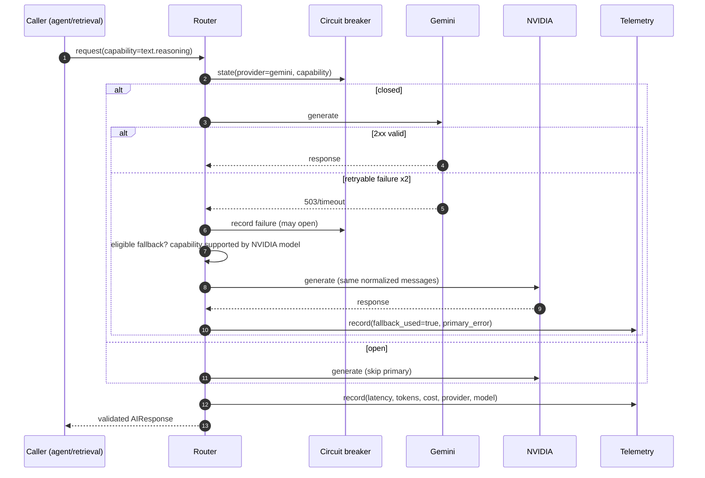
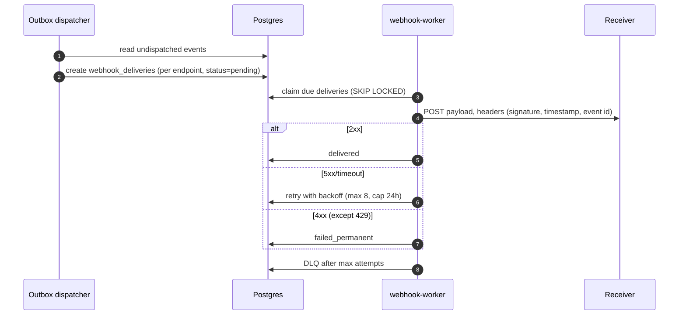

# Data Flow and Sequence Diagrams

**Doc ID:** 13 · **Status:** Approved · **Area:** Architecture
**Depends on:** [09](09-SYSTEM-ARCHITECTURE.md), [12](12-SERVICE-BOUNDARIES-AND-MODULE-MAP.md) · **Related:** [25](../04-backend-and-api/25-REALTIME-AND-EVENT-ARCHITECTURE.md), [43](../07-agents-and-execution/43-AGENT-RUNTIME-AND-ORCHESTRATION.md)

---

## 1. Purpose

Show exactly how data moves for the platform's critical paths, including where it is persisted, where it
crosses a trust boundary, and what happens when a step fails. Diagrams are normative: implementation
must match them or the document must change.

## 2. Legend

- **Sync** = inside the HTTP request. **Async** = worker or background.
- Every mutation writes an outbox row in the same transaction; dispatch happens after commit.
- Every arrow carrying model input is subject to the prompt-injection fence (doc 32).

---

## 3. Authentication and tenant resolution



**Failure points:** JWKS fetch failure (use cache, else 503 `AUTH_UNAVAILABLE`); clock skew > 60 s (401);
token from another Clerk instance (`iss` mismatch, 401); user exists in Clerk but not yet projected
(webhook lag → 409 `IDENTITY_NOT_READY` with retry-after, or on-the-fly projection from verified claims).

---

## 4. SDK session establishment



**Why server-minted:** the browser never holds an API key; end users never need Clerk accounts. The host
controls who is allowed to obtain a session (its own auth), and VISTRA controls scope and lifetime.

**Failure points:** origin mismatch (403 + security event); key revoked (401); expired token (401
`SESSION_EXPIRED` → SDK calls host refresh); concurrency limit reached (429 with `Retry-After`).

---

## 5. Agent execution (full path)

```mermaid
sequenceDiagram
  autonumber
  participant S as SDK/Studio
  participant A as API
  participant DB as Postgres
  participant W as agent-worker
  participant AI as Provider router
  participant R as Retrieval
  participant P as Policy
  participant X as Executor
  participant H as Host API
  S->>A: POST /v1/sdk/messages (or /v1/agents/{id}/runs)
  A->>DB: insert session_message + agent_run(planning)
  A-->>S: 202 {run_id, stream_url} / SSE begins
  A->>W: signal run_id (Redis)
  W->>DB: load run + agent_version + prompt_version + context
  W->>AI: classify intent (text.fast, structured)
  AI-->>W: intent + confidence (validated)
  W->>DB: step: intent (persisted)
  W->>AI: plan (text.reasoning, structured)
  AI-->>W: plan steps (validated; max steps enforced)
  W->>DB: step: plan
  loop each plan step
    alt knowledge
      W->>R: search(query, collections, k)
      R->>DB: hybrid SQL (tenant + ACL filtered)
      R-->>W: chunks + scores + citations seed
      W->>AI: answer grounded in chunks
    else vision
      W->>AI: vision request (capability-gated)
    else guide
      W->>DB: create guide_flow + steps (target descriptors)
    else action
      W->>P: decide(tool, args)
      P-->>W: allow | deny | require_approval
      alt require_approval
        W->>DB: approval(pending, frozen args)
        W-->>S: event approval.required
        S->>A: POST /v1/approvals/{id}/approve
        A->>DB: approval granted
      end
      W->>X: execute(tool, args, idempotency_key)
      X->>H: HTTPS (customer credentials)
      H-->>X: result
      W->>DB: tool_invocation + verification
    end
    W->>DB: step completed + events
    W-->>S: SSE step event
  end
  W->>DB: run completed + usage + trace
  W-->>S: message.completed
```

**Sync vs async:** the first token is streamed from the API process for simple knowledge answers
(fast path); multi-step plans with tools/approvals run in the worker and stream through the session event
channel. Both paths persist the same `agent_runs`/`agent_run_steps` shape so traces are uniform.

**Failure points:** worker dies mid-step (heartbeat expiry → reclaim → resume from last persisted step);
approval expiry (409 → re-propose); tool upstream error (classified; no retry if non-idempotent);
verification failure (run `failed_verification`); provider exhaustion (deadline → `PROVIDER_TIMEOUT`).

---

## 6. Knowledge ingestion



**Failure points:** fetch 404/timeout (job failed, retryable with cap); unsupported type (422 before job);
encrypted PDF (`PARSE_ENCRYPTED`); oversized (413); duplicate hash (no-op, link to existing version);
embedding quota (retry with backoff, job `embedding` status retained for resume).

---

## 7. Retrieval and grounded answer

```mermaid
sequenceDiagram
  autonumber
  participant O as Orchestrator
  participant RW as Query rewriter
  participant DB as Postgres
  participant RR as Reranker
  participant AI as Gemini
  O->>RW: rewrite (optional, text.fast) → {semantic_query, lexical_terms, filters}
  RW-->>O: rewritten query
  O->>DB: vector candidates (HNSW, org+ACL filters, k=60)
  O->>DB: lexical candidates (tsvector, filters, k=60)
  DB-->>O: two candidate lists
  O->>O: RRF fuse + dedupe by (document_id, section)
  O->>RR: rerank top 30 (provider or heuristic)
  RR-->>O: scored top-k (k≤10), with citation metadata
  O->>O: assemble context within token budget (parent section expansion)
  O->>AI: answer prompt with fenced evidence + citation instruction
  AI-->>O: answer + claimed citations
  O->>O: validate: citations ⊆ retrieved; claims ↔ citations
  O-->>O: if invalid ⇒ repair once, else grounded=false
```

**Invariant:** filters are applied in SQL. A chunk from another tenant cannot be a candidate, so it cannot
appear in a citation, so it cannot reach the model.

---

## 8. Ghost Cursor guide execution



**Guide never executes the business action.** Do Mode requires a separate tool invocation through
policy/approval.

---

## 9. Provider fallback



**Not allowed:** fallback for `vision.image` unless the fallback model declares vision; fallback for
`realtime.voice` (no equivalent integration) — the call fails with `CapabilityUnavailable`; fallback on
401/403 (configuration error).

---

## 10. Outbound webhook delivery



---

## 11. Inventory of mutation flows

| Flow | Rows written | Events | Reversible |
|---|---|---|---|
| Create application | `applications`, `api_keys`, `audit_events` | `application.created` | key revoke |
| Mint session | `application_sessions` | `session.started` | revoke |
| Ask question | `session_messages`, `agent_runs`, `agent_run_steps`, `message_citations`, `usage_records` | `agent.run.completed` | no (append) |
| Upload source | `files`, `knowledge_sources`, `ingestion_jobs` | `knowledge.source.created` | delete source |
| Execute tool | `tool_invocations`, `approvals`, `agent_run_steps` | `tool.invocation.succeeded` | depends on host |
| Guide completion | `guide_flows`, `guide_steps` | `guide.flow.completed` | no |
| Rotate key | `api_keys`, `audit_events` | `application.key.rotated` | revoke new |

## 12. Failure injection matrix (tested)

| Path | Injected failure | Expected |
|---|---|---|
| Auth | JWKS 500 | cached keys used; else 503 |
| Session | Redis down | fail-closed limit path returns 503, no session minted |
| Agent | worker SIGKILL | run resumes, no duplicate tool call |
| Tool | host timeout | `TOOL_UPSTREAM_TIMEOUT`, no retry for `external` |
| Retrieval | embed service 429 | retry/backoff, then `RETRIEVAL_DEGRADED` with lexical-only + warning |
| Ingestion | storage 503 | job retried, source not marked ready |
| Webhook | receiver 500 ×8 | DLQ + alert |
| Cursor | target removed | `TARGET_MISSING` + text fallback |

## 13. Related documents

[09](09-SYSTEM-ARCHITECTURE.md) · [24](../04-backend-and-api/24-SESSION-AND-CONVERSATION-MANAGEMENT.md) ·
[25](../04-backend-and-api/25-REALTIME-AND-EVENT-ARCHITECTURE.md) ·
[36](../06-knowledge-and-rag/36-DOCUMENT-INGESTION-AND-PARSING.md) ·
[43](../07-agents-and-execution/43-AGENT-RUNTIME-AND-ORCHESTRATION.md) ·
[52](../08-visual-and-ghost-cursor/52-GHOST-CURSOR-MOTION-AND-TARGET-RESOLUTION.md)
