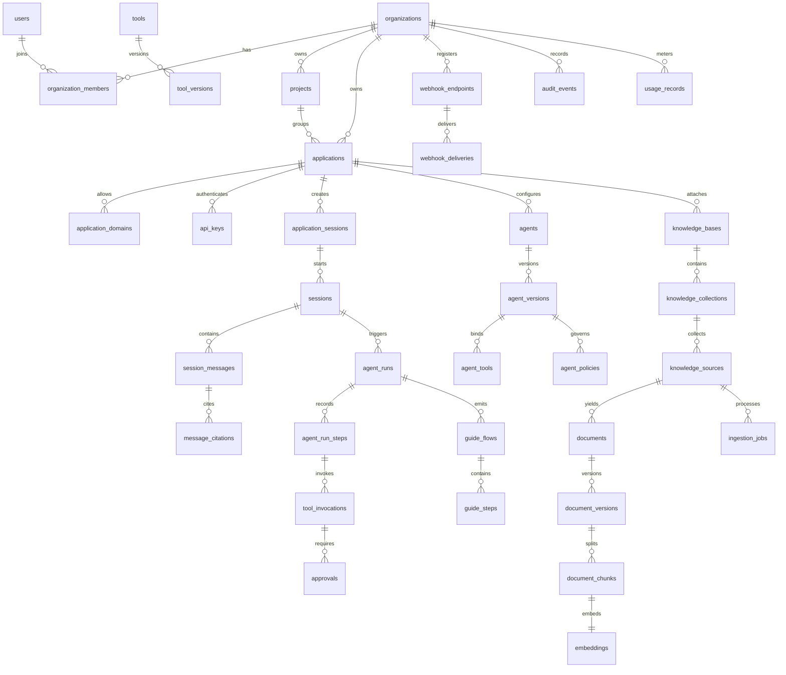
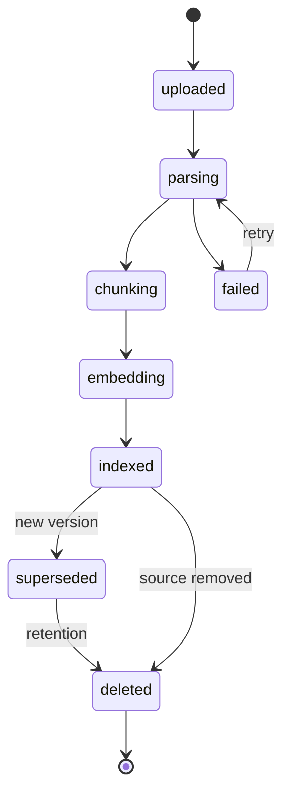

# Database Design and ERD

**Doc ID:** 15 · **Status:** Approved · **Area:** Data
**Depends on:** [09](../02-system-architecture/09-SYSTEM-ARCHITECTURE.md) · **Related:** [16](16-DATABASE-SCHEMA-AND-RELATIONSHIPS.md), [19](19-SUPABASE-RLS-AND-DATABASE-SECURITY.md), [21](21-MIGRATIONS-BACKUPS-AND-DISASTER-RECOVERY.md)

---

## 1. Purpose

Explain the data model as a whole: domains, relationships, tenancy strategy, indexing philosophy, growth
and retention. Column-level definitions are in [16](16-DATABASE-SCHEMA-AND-RELATIONSHIPS.md); policies in
[19](19-SUPABASE-RLS-AND-DATABASE-SECURITY.md).

## 2. Scope

PostgreSQL 15+ on Supabase, pgvector, full-text search, and the relationships between all persisted
entities. Object storage layout is in [20](20-STORAGE-AND-FILE-LIFECYCLE.md).

## 3. Design principles

1. **One tenant column.** Every tenant-owned table carries `organization_id text not null`, indexed as the
   leading column of its primary access paths.
2. **Explicit referential integrity.** No orphan rows; `ON DELETE` behavior is declared per FK.
3. **Append-only where truth matters.** Runs, steps, invocations, audit, usage are immutable histories.
4. **Version configuration, don't mutate it.** Agents, tools, prompts, workflows are versioned; runs
   reference an immutable version.
5. **JSONB only for genuinely open payloads** (tool args, provider raw usage, config blobs that are read
   whole). Anything filtered or joined becomes a column.
6. **Postgres is the source of truth.** Redis is cache; storage holds bytes addressed by `files` rows.
7. **Soft delete only where a restore window is a product requirement** (orgs, applications, knowledge
   bases, documents). Everything else is hard delete.
8. **Indexes serve named queries.** Each index in doc 16 names the query pattern it supports.

## 4. Domains

| Domain | Tables | Growth | Retention |
|---|---|---|---|
| Identity | `users`, `organizations`, `organization_members`, `webhook_events` | low | account life |
| Tenancy config | `projects`, `applications`, `application_domains`, `api_keys` | low | until deleted |
| Agent config | `agents`, `agent_versions`, `agent_tools`, `agent_policies`, `prompts`, `prompt_versions` | low, versioned | indefinite (versioned) |
| Tools & policy | `tools`, `tool_versions`, `tool_credentials`, `policy_decisions`, `approvals` | medium | 1 y (decisions), 90 d (approvals) |
| Workflows | `workflows`, `workflow_versions`, `workflow_steps`, `workflow_runs` | medium | 90 d runs |
| Knowledge | `knowledge_bases`, `knowledge_collections`, `knowledge_sources`, `documents`, `document_versions`, `document_chunks`, `embeddings`, `ingestion_jobs` | **high** | until deleted |
| Conversational | `application_sessions`, `sessions`, `session_messages`, `message_citations`, `session_events` | **high** | 30–90 d configurable |
| Execution | `agent_runs`, `agent_run_steps`, `tool_invocations` | **high** | 90 d |
| Visual/guide | `visual_context_snapshots`, `guide_flows`, `guide_steps` | high | 7–30 d |
| Integrations | `integrations`, `oauth_connections`, `mcp_servers`, `webhook_endpoints`, `webhook_deliveries` | medium | 30 d deliveries |
| Quality | `evaluation_suites`, `evaluation_cases`, `evaluation_results`, `feedback` | medium | 1 y |
| Operations | `audit_events`, `usage_records`, `model_usage`, `usage_rollups`, `events_outbox`, `files`, `error_events` | **very high** | 1 y audit, 2 y usage, 7 d outbox |
| Billing (post-MVP) | `subscriptions`, `entitlements` | low | account life |

## 5. Entity relationship diagram (core)

## 6. Key relationship decisions

| Decision | Rationale |
|---|---|
| `organizations.id` is Clerk's org id (`org_…`), text | No ID translation layer; token claim maps directly; projection stays stable |
| `users.id` is Clerk's user id (`user_…`), text | Same; profile fields projected |
| UUIDv7 for all platform-generated ids | Time-sortable, index-friendly, no sequence contention |
| `agent_runs` references `agent_version_id`, not just `agent_id` | Reproducible traces after config changes |
| `tool_invocations` references `tool_version_id` + frozen args | Replay/audit without relying on current config |
| `document_chunks` has `parent_chunk_id` | Context expansion without re-parsing |
| `embeddings` is a separate table (1:1 with chunk) | Re-embedding/versioning without touching chunk text; supports multiple index versions |
| `message_citations` is a join table with offsets | Citation UI needs exact spans and page numbers |
| `approvals` references the frozen argument snapshot (JSONB) | Approval can't be silently applied to changed args |

## 7. Tenancy and isolation

- All tenant tables have `organization_id`; RLS policies compare it to the JWT claim (doc 19).
- Child tables inherit tenancy denormalized (`session_messages.organization_id`) to keep policies simple and
  indexes effective, enforced by FK + trigger consistency check.
- Cross-tenant FKs are impossible because every FK chain preserves `organization_id`; a composite FK
  `(organization_id, parent_id)` is used where cheap.
- Service-role (privileged) access still filters by `organization_id` in application code and is covered by
  tests.

## 8. Indexing philosophy

| Need | Index |
|---|---|
| Tenant listing, newest first | `(organization_id, created_at desc)` |
| Lookup by external id | unique `(organization_id, external_id)` |
| Cursor pagination | `(organization_id, created_at, id)` composite |
| Vector search | HNSW on `embeddings.embedding` with `vector_cosine_ops`, filtered by `organization_id` |
| Lexical search | GIN on `document_chunks.content_tsv` |
| Job claiming | partial index on `status IN ('queued','retrying')`, `(run_after)` |
| Idempotency | unique `(organization_id, idempotency_key)` |
| Uniqueness of content | unique `(document_id, content_hash, index_version)` |

Every index must name a query in doc 16; unused indexes are removed during quarterly review.

## 9. Sizing model (planning)

| Entity | Row size (approx) | 1M rows |
|---|---|---|
| `document_chunks` (text 700 B) | ~1.2 KB incl. overhead | ~1.2 GB + GIN |
| `embeddings` (768 dims, halfvec optional) | ~3.1 KB (float4) / 1.6 KB (halfvec) | ~3.1 GB / 1.6 GB |
| `embeddings` (1536 dims float4) | ~6.2 KB | ~6.2 GB |
| `agent_run_steps` | ~1.5 KB JSONB | ~1.5 GB |
| `usage_records` | ~300 B | ~300 MB |
| `audit_events` | ~600 B | ~600 MB |

Implications: embeddings dominate; prefer 768 dims for chunks unless evaluation shows a meaningful gain
(doc 33/38). Monthly partitioning for `usage_records`, `audit_events`, `model_usage` at >10M rows.

## 10. Concurrency and consistency

- Isolation: `READ COMMITTED` default; `SERIALIZABLE` not used (retry complexity) except for a few
  invariant-critical operations implemented with `SELECT … FOR UPDATE`.
- Job claiming uses `FOR UPDATE SKIP LOCKED`.
- Optimistic concurrency on config tables via `version` integer + `WHERE version = :expected`.
- Outbox pattern: business mutation + `events_outbox` insert in one transaction; dispatcher publishes
  after commit. Consumers dedupe on `event_id`.

## 11. Data lifecycle

Retention enforcement runs daily: sessions/runs/snapshots past TTL are hard-deleted in batches; storage
objects are deleted after the row is marked; audit rows are never deleted by tenant action.

## 12. Failure and recovery characteristics

| Scenario | Effect | Recovery |
|---|---|---|
| Migration fails mid-way | Transactional DDL rolls back per migration file | Fix forward; never partially apply |
| Pooler connection exhaustion | Requests 503 | Reduce pool, add timeout, page on saturation |
| HNSW index bloat | Slower retrieval | `REINDEX CONCURRENTLY` (maintenance window) |
| Chunk/embedding drift | Orphan chunks | Consistency job: chunks without embeddings older than 1 h → re-enqueue |
| Tenant deletion interrupted | Partial objects | Idempotent deletion job keyed by `files.id` |

## 13. Acceptance criteria

- [ ] Every entity in §4 has a column definition in doc 16 and an owner module in doc 12.
- [ ] ERD matches actual FKs (validated by a schema introspection test).
- [ ] Every index in doc 16 references a query; no unindexed foreign key used in a filter.
- [ ] Sizing model reviewed against real data at 100k/1M/10M chunk thresholds.

## 14. Related documents

[16](16-DATABASE-SCHEMA-AND-RELATIONSHIPS.md) · [19](19-SUPABASE-RLS-AND-DATABASE-SECURITY.md) ·
[20](20-STORAGE-AND-FILE-LIFECYCLE.md) · [21](21-MIGRATIONS-BACKUPS-AND-DISASTER-RECOVERY.md) ·
[38](../06-knowledge-and-rag/38-VECTOR-SEARCH-AND-HYBRID-RETRIEVAL.md)

## 15. References

- PostgreSQL data types — https://www.postgresql.org/docs/current/datatype.html
- pgvector — https://github.com/pgvector/pgvector
- Supabase database — https://supabase.com/docs/guides/database/overview
