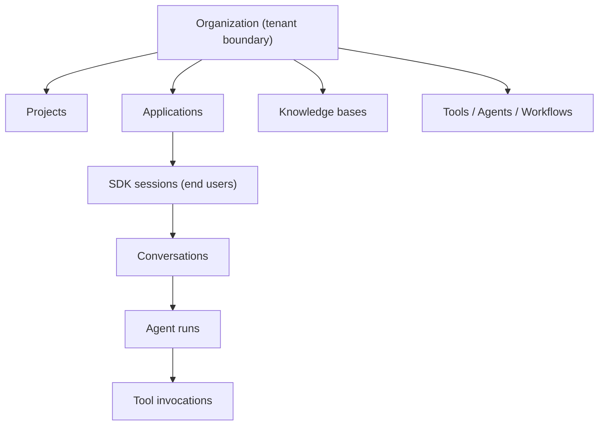

# Tenancy, RBAC, and Authorization

**Doc ID:** 18 · **Status:** Approved (normative) · **Area:** Identity / Security
**Depends on:** [17](17-CLERK-AUTHENTICATION.md) · **Related:** [19](19-SUPABASE-RLS-AND-DATABASE-SECURITY.md), [54](../09-sdk-and-integrations/54-JAVASCRIPT-AND-REACT-SDK.md), [63](../11-quality-security-and-operations/63-SECURITY-THREAT-MODEL.md)

---

## 1. Purpose

Define the four identity types, the role model, the complete permission matrix, the API-key scope model, and
the decision order the backend must follow. Ambiguity here becomes a cross-tenant breach.

## 2. Identity types (never conflate)

| # | Identity | Lives in | Authenticates with | Can do |
|---|---|---|---|---|
| 1 | **VISTRA user** (human) | Clerk + `users` | Clerk session JWT | Studio, API as a person |
| 2 | **Organization** (tenant) | Clerk + `organizations` | — (a scope, not an actor) | Owns all data |
| 3 | **Application** (customer's embedded product) | `applications` | Hashed API key (server) | Mint SDK sessions, call server APIs |
| 4 | **End user of an application** | Host system + `application_sessions` | VISTRA SDK session token | Chat, guide, approve (if allowed) |

- An end user is **not** a VISTRA user and has no organization role.
- An application is **not** a tenant; it always belongs to exactly one organization.
- A project is a grouping, never an authorization boundary.

## 3. Scope hierarchy



**Rule:** every resource resolves to exactly one `organization_id`, and every authorization decision is made
against that value. Resource ids are never globally addressable across tenants.

## 4. Roles and permissions

Roles exist only at organization scope. Stored in `organization_members.role`.

| Permission | owner | admin | developer | analyst | viewer |
|---|---|---|---|---|---|
| `org.read` | ✅ | ✅ | ✅ | ✅ | ✅ |
| `org.update` (name, settings, retention) | ✅ | ✅ | ❌ | ❌ | ❌ |
| `org.delete` | ✅ | ❌ | ❌ | ❌ | ❌ |
| `billing.read` | ✅ | ✅ | ❌ | ❌ | ❌ |
| `billing.manage` | ✅ | ❌ | ❌ | ❌ | ❌ |
| `member.read` | ✅ | ✅ | ✅ | ✅ | ✅ |
| `member.invite` / `member.remove` | ✅ | ✅ | ❌ | ❌ | ❌ |
| `member.role.update` | ✅ | ✅¹ | ❌ | ❌ | ❌ |
| `application.read` | ✅ | ✅ | ✅ | ✅ | ✅ |
| `application.create` / `update` | ✅ | ✅ | ✅ | ❌ | ❌ |
| `application.delete` | ✅ | ✅ | ❌ | ❌ | ❌ |
| `apikey.read` (list metadata) | ✅ | ✅ | ✅ | ❌ | ❌ |
| `apikey.create` / `revoke` | ✅ | ✅ | ✅ | ❌ | ❌ |
| `knowledge.read` | ✅ | ✅ | ✅ | ✅ | ✅ |
| `knowledge.write` (sources, delete) | ✅ | ✅ | ✅ | ❌ | ❌ |
| `agent.read` | ✅ | ✅ | ✅ | ✅ | ✅ |
| `agent.write` / `publish` | ✅ | ✅ | ✅ | ❌ | ❌ |
| `tool.read` | ✅ | ✅ | ✅ | ✅ | ❌ |
| `tool.write` / `credentials.write` | ✅ | ✅ | ✅ | ❌ | ❌ |
| `policy.write` | ✅ | ✅ | ❌ | ❌ | ❌ |
| `workflow.write` | ✅ | ✅ | ✅ | ❌ | ❌ |
| `session.read` (all sessions) | ✅ | ✅ | ✅ | ✅ | ❌ |
| `run.read` | ✅ | ✅ | ✅ | ✅ | ❌ |
| `run.cancel` | ✅ | ✅ | ✅ | ❌ | ❌ |
| `evaluation.read` | ✅ | ✅ | ✅ | ✅ | ❌ |
| `evaluation.run` | ✅ | ✅ | ✅ | ✅ | ❌ |
| `analytics.read` | ✅ | ✅ | ✅ | ✅ | ✅ |
| `usage.read` | ✅ | ✅ | ✅ | ✅ | ❌ |
| `audit.read` / `audit.export` | ✅ | ✅ | ❌ | ✅ | ❌ |
| `webhook.write` | ✅ | ✅ | ✅ | ❌ | ❌ |
| `integration.write` | ✅ | ✅ | ✅ | ❌ | ❌ |
| `member.role.update` → assigning `owner` | ✅ | ❌ | ❌ | ❌ | ❌ |

¹ admins may change roles among `admin/developer/analyst/viewer` but not grant/remove `owner`.

Role changes take effect on the next request (membership is read per request). There is no role caching.

## 5. Decision order (backend, mandatory)

```python
# core/tenancy/authorize.py — conceptual
async def authorize(ctx, action: Action, resource: ResourceRef) -> None:
    # 1. authenticated
    if ctx.user is None: raise AuthMissing()
    # 2. tenant resolved and matches resource
    if resource.organization_id != ctx.organization_id: raise NotFound()  # 404, audit security
    # 3. membership active
    if not ctx.membership or ctx.membership.status != "active": raise NotFound()
    # 4. role permits action
    if action not in ROLE_PERMISSIONS[ctx.role]: raise InsufficientRole()
    # 5. resource-level rules (ownership, scope, soft-delete state)
    check_resource_rules(ctx, action, resource)   # e.g. ACL on collection
```

Order matters: tenant mismatch is checked **before** existence is revealed, and returns `404` to avoid
existence oracles. Insufficient role within the same tenant returns `403`.

## 6. Resource-level rules

| Resource | Rule |
|---|---|
| Knowledge collection | `access_scope=organization` → all members; `restricted` → ACL roles/users; retrieval applies the same rule in SQL |
| Agent | Must belong to the application; publishing requires `developer+` |
| Tool credentials | Write-only; never returned by any endpoint (only name/created_at) |
| Session/run | Members with `run.read` see all org runs; end users see only their own session |
| API key | Creator or `admin+` may revoke; key value never retrievable |
| Approval | End-user approvals require the same `application_session_id`; user approvals require the role in the policy |
| Export | `analyst+`, and export is audited |

## 7. API keys (machine identity)

| Property | Value |
|---|---|
| Format | `vst_live_<32 base62>` / `vst_test_<32 base62>` |
| Storage | `sha256(key)` in `api_keys.key_hash`; display prefix only |
| Scopes | `sdk:session`, `agents:run`, `knowledge:read`, `knowledge:write`, `tools:invoke`, `webhooks:manage` |
| Default scope | `sdk:session` only (least privilege) |
| Expiry | Optional; required for `test` keys? No — configurable, default 1 year |
| Rotation | Create new key, overlap window, revoke old (`rotated_from` links them) |
| Transport | `Authorization: Bearer vst_…` (server-to-server only) |
| Rate limit | Per key and per application (doc 27) |
| Audit | Create/revoke/use-of-privileged-scope events |

An API key authenticates an **application**, never a user. Endpoints accepting API keys must not accept a
`user_id` and must not perform user-scoped operations.

## 8. SDK session tokens (end-user identity)

Minted by the backend (`POST /v1/sdk/sessions`) with:

```json
{
  "iss": "https://api.vistra.dev",
  "aud": "sdk",
  "sub": "aus_01H…",                       // application_session id
  "org_id": "org_…",
  "app_id": "app_…",
  "end_user_ref": "hashed-or-opaque-ref",
  "scope": ["chat", "guide", "approve"],
  "iat": 1731000000, "exp": 1731000900     // TTL ≤ 900s
}
```

Rules:
- Signed with a dedicated key (not the Clerk key); verified by the same `core/auth` module with audience
  `sdk`.
- Cannot call organization endpoints (audience mismatch → 401 `AUTH_INVALID_AUDIENCE`).
- `end_user_ref` is stored hashed in the token; the raw value lives only in the session row (host-supplied).
- Scope `approve` is granted only if the app config allows end-user approvals.
- Revocation: `application_sessions.status='revoked'` is checked on each request (cached 30 s max).

## 9. Authorization enforcement points

| Layer | What it enforces | What it must not be trusted for |
|---|---|---|
| Router dependency | Authn, tenant resolution, role check | Field-level rules |
| Service | Resource ownership, state transitions, policy | Bypassing RLS |
| Repository SQL | RLS (user path) + explicit org predicate (service path) | Deciding roles |
| Postgres RLS | Row visibility for every query | Column-level redaction |
| Response serializer | Field allowlists (never return secrets) | Access control |

Defense in depth: a bug in one layer must not create a cross-tenant read. Tests exist per layer.

## 10. Adversarial test matrix (must exist)

| # | Attempt | Expected |
|---|---|---|
| A1 | Org A token + Org B resource id (GET) | 404, audit `security.cross_tenant_attempt` |
| A2 | Org A token + `X-Organization-Id: org_B` | 404 (no membership), audit |
| A3 | Body `organization_id` overridden | Ignored; server uses resolved context |
| A4 | `viewer` creates application | 403 `INSUFFICIENT_ROLE` |
| A5 | `developer` tries `org.delete` | 403 |
| A6 | Admin grants `owner` | 403 |
| A7 | SDK token calls `/v1/applications` | 401 `AUTH_INVALID_AUDIENCE` |
| A8 | API key calls `/v1/me` | 401 (key is not a user) |
| A9 | Revoked API key | 401 `API_KEY_REVOKED` |
| A10 | Expired session token | 401 `SESSION_EXPIRED`; refresh path works |
| A11 | End user A approves end user B's action | 404/403, audit |
| A12 | Retrieval query targeting another org's collection | 0 results (SQL filter), no chunk content |
| A13 | Citation id from another tenant injected into request | Rejected; not in run's retrieval set |
| A14 | Removed member with cached UI | Next request 403/404 |
| A15 | API key from test mode against production data | 404 (mode scoping) |
| A16 | Tool invocation with `organization_id` in args | Args validated by schema; org fields rejected/ignored |

These become `tests/security/test_tenancy.py` and the RLS suite in doc 19.

## 11. Audit requirements

Record `audit_events` for: role changes, membership changes, API key lifecycle, application create/delete,
knowledge source deletion, agent publish, policy change, approval decision, credential write, audit export,
and every cross-tenant denial. Fields: actor type/id, action, resource, before/after summary, request id, ip,
user agent. Audit writes must not fail the primary request silently — they are in the same transaction for
mutations.

## 12. Failure scenarios

| Scenario | Response |
|---|---|
| Token valid, projection missing | 409 `IDENTITY_NOT_READY` |
| Token valid, membership suspended | 404 |
| Role removed mid-session | Next request 403, UI redirects |
| Org soft-deleted | All requests 404 `ORGANIZATION_DELETED` |
| Two orgs, no org header, token has no org claim | 400 `ORGANIZATION_REQUIRED` with the org list |

## 13. Acceptance criteria

- [ ] Every endpoint declares a permission; a route without an explicit permission fails the route inventory test.
- [ ] The matrix in §4 matches `ROLE_PERMISSIONS` in code exactly (generated test).
- [ ] All 16 adversarial tests pass.
- [ ] RLS denies cross-tenant reads even when the service layer is bypassed in a test harness.
- [ ] No endpoint returns a credential, key, or token it did not just mint.

## 14. Implementation checklist

1. Define `Permission` enum and `ROLE_PERMISSIONS` map; generate tests from this document.
2. Implement `require_permission(action)` dependency; annotate every route.
3. Implement API-key auth with hashing, scopes, mode, revocation, rate limits.
4. Implement SDK session minting/verification (audience `sdk`).
5. Add resource-level checks in services (ACL, ownership, state).
6. Add adversarial tests and audit events.
7. Verify against doc 19 RLS suite.

## 15. Related documents

[17](17-CLERK-AUTHENTICATION.md) · [19](19-SUPABASE-RLS-AND-DATABASE-SECURITY.md) ·
[23](../04-backend-and-api/23-API-DESIGN-AND-OPENAPI-CONTRACTS.md) ·
[47](../07-agents-and-execution/47-APPROVALS-POLICY-AND-SAFE-EXECUTION.md) ·
[63](../11-quality-security-and-operations/63-SECURITY-THREAT-MODEL.md)
