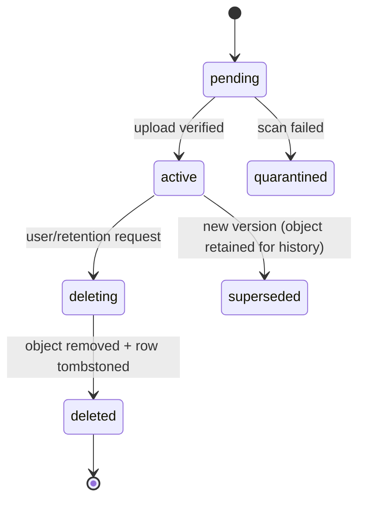

# Storage and File Lifecycle

**Doc ID:** 20 · **Status:** Approved · **Area:** Data
**Depends on:** [16](16-DATABASE-SCHEMA-AND-RELATIONSHIPS.md) · **Related:** [36](../06-knowledge-and-rag/36-DOCUMENT-INGESTION-AND-PARSING.md), [49](../08-visual-and-ghost-cursor/49-VISUAL-CONTEXT-ENGINE.md), [21](21-MIGRATIONS-BACKUPS-AND-DISASTER-RECOVERY.md)

---

## 1. Purpose

Define where bytes live, how they are addressed, uploaded, validated, served, retained, and deleted.
Postgres stores metadata and text; object storage stores blobs. Never the reverse.

## 2. Scope

User uploads (documents), parsed artifacts, extracted assets, screenshots, exports, evaluation datasets, and
avatars. Application code images are build artifacts and are not part of this system.

## 3. Provider and adapter

Primary: **Supabase Storage** (S3-compatible API). Future: any S3-compatible store (AWS S3, Cloudflare R2,
MinIO) via the same port.

```python
class StorageProvider(Protocol):
    async def upload(self, *, bucket: str, key: str, data: BinaryIO,
                     content_type: str, metadata: dict[str, str] | None = None) -> StoredObject: ...
    async def download(self, *, bucket: str, key: str) -> AsyncIterator[bytes]: ...
    async def delete(self, *, bucket: str, key: str) -> None: ...
    async def exists(self, *, bucket: str, key: str) -> bool: ...
    async def create_signed_upload_url(self, *, bucket: str, key: str, content_type: str,
                                       max_size: int, ttl: int = 900) -> str: ...
    async def create_signed_download_url(self, *, bucket: str, key: str,
                                         ttl: int = 300, download_name: str | None = None) -> str: ...
    async def head(self, *, bucket: str, key: str) -> ObjectMetadata: ...
    async def health_check(self) -> HealthStatus: ...
```

Rules: the adapter is the only module that imports a storage SDK; keys are generated by the platform (never
from user input); all paths are org-prefixed; signed URLs are short-lived and never logged.

## 4. Buckets and key layout

| Bucket | Purpose | Public | Max size | Retention |
|---|---|---|---|---|
| `documents-original` | Uploaded/raw fetched files | no | 50 MB | until source/document deleted |
| `documents-processed` | Normalized text, page JSON, extracted tables | no | 50 MB | with the version |
| `extracted-assets` | Images/figures from documents | no | 10 MB each | with the version |
| `screenshots` | Opt-in capture crops | no | 5 MB | 7–30 d |
| `exports` | User-requested exports | no | 500 MB | 7 d |
| `datasets` | Evaluation fixtures | no | 50 MB | 1 y |
| `avatars` | Org/user images | yes (CDN) | 2 MB | account life |

Key convention:

```
{bucket}/{org_id}/{entity}/{entity_id}/{version_or_uuid}-{safe_name}
# examples
documents-original/org_2abc/knowledge_source/src_01H/pricing-2026.pdf
documents-processed/org_2abc/document_version/dv_01H/text.jsonl
screenshots/org_2abc/session/ses_01H/snap_01H.png
exports/org_2abc/job/exp_01H/audit-2026-11.csv
```

`safe_name` is slugified, length-capped, and never trusted for content-type decisions. `files` rows are the
only way to resolve a key.

## 5. Upload flows

### 5.1 Direct-to-storage (preferred for large files)

```mermaid
sequenceDiagram
  participant B as Browser/Studio
  participant A as API
  participant S as Storage
  B->>A: POST /v1/files/presign {name,mime,size,purpose}
  A->>A: validate purpose, size, quota, extension/mime
  A->>S: create signed upload URL (key generated by API)
  A-->>B: {file_id, upload_url, expires_at}
  B->>S: PUT bytes (Content-Type pinned)
  B->>A: POST /v1/files/{id}/complete
  A->>S: head() → verify size + content-type + checksum
  A->>A: enqueue validation/scan job; mark file active
```

The API never proxies large uploads through the request process (memory and timeout limits on Render).

### 5.2 Server-side fetch (URL/sitemap sources)

Ingestion workers fetch with egress controls (doc 40 §5), cap bytes and time, sniff content type from magic
bytes, and write to `documents-original` before parsing. A hash of the fetched bytes becomes the document
version identity.

## 6. Validation

| Check | Rule |
|---|---|
| Size | ≤ bucket limit; reject with 413 `FILE_TOO_LARGE` |
| MIME | magic-byte detection must agree with declared type for the allowlist (pdf, docx, pptx, md, txt, html, csv, json, png/jpeg/webp for avatars) |
| Extension | must be in the allowlist for the purpose; mismatch → 422 `FILE_TYPE_NOT_ALLOWED` |
| Archives | only OOXML (docx/pptx); zip bombs rejected by uncompressed-size ratio and total cap |
| Malware | optional ClamAV/scanning integration; quarantined files are never parsed |
| Duplicate | SHA-256 compared within the org + purpose; duplicates link to the existing `files` row |
| Filename | sanitized; path traversal impossible because keys are generated |

## 7. Serving files

- Downloads are always via a short-lived signed URL (300 s default), generated server-side after an
  authorization check.
- `Content-Disposition: attachment` for originals; `inline` only for images with a strict content type.
- No direct public access to any bucket except `avatars` (read-only, cacheable).
- Signed URLs are never included in logs, analytics, or webhook payloads.
- Range requests are supported by the provider for large PDFs.

## 8. Deletion and lifecycle



Deletion is a job (`files.status=deleting` → delete objects → `status=deleted`, `deleted_at=now()`):

1. Resolve all keys for the entity (original, parsed, assets, screenshots).
2. Mark rows `deleting` (idempotent).
3. Delete objects; tolerate 404 as success.
4. Hard-delete or tombstone metadata per retention (document rows hard delete; audit keeps the event).
5. Invalidate caches (retrieval cache entries keyed by document/chunk).

**Guarantee:** a document's chunks and embeddings are removed in the same transaction as the metadata; the
object deletion follows asynchronously and is retried until completion (24 h max, then alert).

## 9. Retention

| Artifact | Default | Override |
|---|---|---|
| Originals/parsed | life of document | tenant policy |
| Screenshots | 7 d | app config 0–30 d |
| Snapshots (DOM/a11y) | 7 d | 7–30 d |
| Exports | 7 d | fixed |
| Ingestion job records | 30 d after finish | fixed |
| Deleted objects | purged ≤ 24 h after request | fixed |

Retention runs as a `pg_cron` + worker sweep; every sweep writes counts to metrics.

## 10. Quotas and cost controls

- Per-org storage quota by plan; enforced at presign time (`STORAGE_QUOTA_EXCEEDED`).
- Per-file cap (50 MB) and per-source page cap (documented in doc 36).
- Orphan detection: objects without a `files` row older than 24 h are reported, then purged.
- Storage usage metered into `usage_records` (`capability='storage.bytes'`) daily.

## 11. Security considerations

- Bucket policies deny `anon`; only server-issued signed URLs and service credentials access objects.
- Object keys include `org_id` so a leaked key is attributable and revocable by prefix.
- Uploaded HTML/SVG is never rendered inline from the storage origin (XSS); sanitize before rendering.
- EXIF/metadata on uploaded images is stripped when generating avatars/crops.
- Signed upload URLs are single-purpose (one key, one content type, short TTL, size-capped).

## 12. Failure scenarios

| Scenario | Behavior |
|---|---|
| Upload succeeds, `complete` never called | Orphan sweep deletes after 24 h |
| Storage 503 during ingestion | Job retries with backoff; source remains `ingesting`/`failed` |
| Delete fails for some objects | Retried; row stays `deleting`; alert after 3 failures |
| Checksum mismatch on complete | File marked `quarantined`; user asked to re-upload |
| Provider outage during signed download | 503 with `STORAGE_UNAVAILABLE`; retry in UI |
| Quota exceeded | Presign rejected 402/403 `STORAGE_QUOTA_EXCEEDED` with current usage |

## 13. Acceptance criteria

- [ ] No object is reachable publicly except avatars.
- [ ] Every object has a `files` row with org, checksum, MIME, size, purpose.
- [ ] Deleting a source removes all derived objects and vectors within 24 h (tested).
- [ ] Signed URLs expire and cannot be replayed after deletion.
- [ ] S3-compatible adapter passes the same contract test suite as Supabase.

## 14. Implementation checklist

1. Provision buckets + policies in `infrastructure/supabase`.
2. Implement `StorageProvider` + Supabase adapter + contract tests.
3. Implement presign/complete/download endpoints with validation and quota checks.
4. Implement deletion + orphan sweep jobs.
5. Wire usage metering for bytes stored.
6. Add EXIF stripping and MIME sniffing utilities.

## 15. Related documents

[16](16-DATABASE-SCHEMA-AND-RELATIONSHIPS.md) · [21](21-MIGRATIONS-BACKUPS-AND-DISASTER-RECOVERY.md) ·
[36](../06-knowledge-and-rag/36-DOCUMENT-INGESTION-AND-PARSING.md) ·
[40](../06-knowledge-and-rag/40-KNOWLEDGE-SOURCE-CONNECTORS.md) ·
[49](../08-visual-and-ghost-cursor/49-VISUAL-CONTEXT-ENGINE.md)

## 16. References

- Supabase Storage — https://supabase.com/docs/guides/storage
- Supabase signed URLs — https://supabase.com/docs/guides/storage/serving/downloads
- S3 API compatibility — https://docs.aws.amazon.com/AmazonS3/latest/API/Welcome.html
