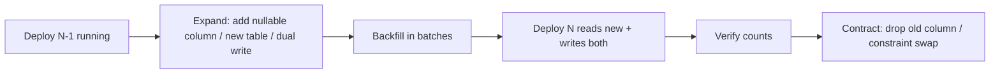

# Migrations, Backups, and Disaster Recovery

**Doc ID:** 21 · **Status:** Approved · **Area:** Data / Operations
**Depends on:** [16](16-DATABASE-SCHEMA-AND-RELATIONSHIPS.md) · **Related:** [71](../12-deployment-and-release/71-SUPABASE-AND-REDIS-PRODUCTION-SETUP.md), [74](../12-deployment-and-release/74-PRODUCTION-RELEASE-AND-ROLLBACK.md), [75](../12-deployment-and-release/75-PRODUCTION-RUNBOOK-AND-INCIDENT-RESPONSE.md)

---

## 1. Purpose

Make schema change safe and recoverable: ordered migrations, tests, expand/contract rollout, verified
backups, and a rehearsed disaster recovery procedure with explicit RPO/RTO.

## 2. Migration policy

1. **Forward-only.** Files are numbered `NNNN_description.sql`, immutable once applied.
2. **One logical change per file.** DDL + its policies + its indexes together.
3. **Backward compatible during rollout** (expand/contract, §4).
4. **Reviewed** by a second engineer for any destructive or locking operation.
5. **Tested** on: empty DB, previous-schema snapshot with data, and the RLS suite.
6. **Applied by a release step**, never at application boot, never manually in the dashboard for production.
7. **No `create_all`** anywhere.

Location: `infrastructure/supabase/migrations/`. Runbook: `scripts/migrate.py` (idempotent, advisory-locked,
records into `schema_migrations`).

## 3. Migration file anatomy

```sql
-- 0007_knowledge.sql
-- Up
begin;
create table knowledge_bases ( ... );
create index ...;
alter table knowledge_bases enable row level security;
alter table knowledge_bases force row level security;
create policy ...;
insert into schema_migrations(version, name, checksum, applied_at)
values (7, 'knowledge', :checksum, now());
commit;
```

Requirements:
- Explicit transaction; `lock_timeout = '5s'`, `statement_timeout = '60s'` set at the top for safety.
- No `CONCURRENTLY` inside a transaction: separate file `NNNN_x_concurrent.sql` run outside the transaction.
- Comments explain *why*, and name the query an index serves.
- Data backfills are separate, batched, and idempotent.

## 4. Expand/contract rollout



| Change | Procedure |
|---|---|
| Add column | nullable or defaulted, no rewrite (PG 11+ fast default) |
| Rename column | add new → dual write → backfill → switch reads → drop old |
| Change type | add new column, backfill, switch, drop; never `ALTER TYPE` on a hot table |
| Add NOT NULL | add `CHECK NOT VALID` → validate → set NOT NULL |
| Add index | `CREATE INDEX CONCURRENTLY` in its own file |
| Add FK | `NOT VALID` then `VALIDATE CONSTRAINT` |
| Drop table/column | ensure no deployed code references it (grep + one release cycle) |
| Enum value add | `ALTER TYPE ... ADD VALUE` is non-transactional in older PG; isolate |
| RLS policy change | additive, then remove old policy in the next release |

## 5. Migration testing in CI

1. Spin up a clean Postgres with required extensions.
2. Apply all migrations from 0 → head.
3. Apply to a snapshot of the previous release with seeded data.
4. Run schema diff against doc 16 (introspection test).
5. Run RLS suite, constraints tests, and a representative query plan check.
6. Run the application's integration tests against the migrated DB.

Failure of any step blocks merge.

## 6. Seed and fixtures

| Data | Where | Notes |
|---|---|---|
| Reference data (plans, capability registry rows) | migrations | small, idempotent inserts |
| Demo tenant (Acme) | `infrastructure/supabase/seed.sql` | local/staging only, never production |
| Evaluation corpus | `datasets/` in storage | versioned, referenced by suite |
| Test fixtures | `tests/fixtures/` | deterministic; no real PII |

Seeds must be re-runnable (`ON CONFLICT DO NOTHING`) and must not include secrets.

## 7. Backups

| Layer | Mechanism | Frequency | Retention |
|---|---|---|---|
| Postgres PITR | Supabase daily backup + WAL archiving (plan-dependent) | continuous | 7–30 d by plan |
| Logical dump | `pg_dump --format=custom` to separate bucket | daily | 30 d |
| Storage objects | Provider durability + versioning where enabled | continuous | per retention |
| Configuration/secrets | Secret store version history | on change | 1 y |
| Migration checksums | `schema_migrations` in every dump | — | forever |

Verification: a weekly automated restore of the latest logical dump into a scratch project, running
`select count(*)` on 10 canonical tables and the RLS suite. A backup that has never been restored is not a
backup.

## 8. Recovery objectives

| Scenario | RPO | RTO | Procedure |
|---|---|---|---|
| Accidental row deletion | ≤ 5 min (PITR) | ≤ 60 min | PITR to a new project, validate, repoint |
| Bad migration | 0 (forward fix) | ≤ 30 min | Roll back app, ship corrective migration |
| Region/provider incident | ≤ 24 h (last dump) | ≤ 4 h | Restore to new project, update secrets, redeploy |
| Storage object loss | ≤ 24 h | ≤ 2 h | Restore from dump/versioning; re-ingest sources if needed |
| Redis loss | n/a (ephemeral) | ≤ 5 min | Recreate; caches warm naturally; queues rebuild from Postgres |

Documented, rehearsed quarterly; results recorded in the incident log with actual timings.

## 9. Disaster recovery runbook (summary)

1. **Declare** incident, assign incident commander (doc 75).
2. **Assess**: is the primary DB writable? Is data corrupted or unavailable?
3. **Freeze writes**: enable maintenance mode (`503` with `Retry-After`) via a config flag/edge rule.
4. **Restore**: PITR to a new Supabase project at `T` (last known good), or restore the latest dump.
5. **Validate**: run migration head check, row counts, RLS suite, one authenticated read, one retrieval query.
6. **Repoint**: update `SUPABASE_DB_URL`/keys in the secret store; redeploy API and workers.
7. **Resume**: disable maintenance mode; monitor error rate, queue depth, provider calls.
8. **Reconcile**: compare outbox/deliveries, re-enqueue failed ingestions, replay missed webhooks.
9. **Postmortem** within 48 h with timeline, blast radius, and preventive actions.

## 10. Partial-failure handling

| Case | Handling |
|---|---|
| Migration applied to DB but deploy failed | App is backward compatible (expand phase), so old app still works |
| Deploy succeeded, migration failed | Release automation applies migrations before switching traffic; abort deploy |
| Restore to a point before a migration | Re-run migrations after restore; verify checksums |
| Cross-region restore | Data region changes state; notify tenants per policy |

## 11. Tooling and commands

```bash
# apply migrations (release step)
uv run python scripts/migrate.py --database-url "$SUPABASE_DB_URL" --to head

# verify checksums / drift
uv run python scripts/migrate.py --verify

# logical backup
pg_dump --format=custom --no-owner --no-acl "$SUPABASE_DB_URL" > backup-$(date +%F).dump

# restore (scratch project)
pg_restore --clean --if-exists --no-owner --no-acl -d "$SCRATCH_DB_URL" backup.dump
```

All commands are non-interactive and safe to re-run; destructive flags require `--confirm`.

## 12. Security

- Dumps contain tenant data: encrypted at rest, access restricted to the ops role, deleted after retention.
- Restores into scratch projects must not use production secrets or public buckets.
- Migration role is separate from the application role and is not available to the API at runtime.

## 13. Acceptance criteria

- [ ] Every migration is idempotent in effect and recorded with a checksum.
- [ ] CI proves clean-DB and previous-schema application.
- [ ] A restore drill has completed within RTO with recorded timings.
- [ ] Expand/contract procedure is followed for any column removal (verified in release review).
- [ ] No production schema change occurs outside the migration pipeline.

## 14. Related documents

[15](15-DATABASE-DESIGN-AND-ERD.md) · [16](16-DATABASE-SCHEMA-AND-RELATIONSHIPS.md) ·
[71](../12-deployment-and-release/71-SUPABASE-AND-REDIS-PRODUCTION-SETUP.md) ·
[74](../12-deployment-and-release/74-PRODUCTION-RELEASE-AND-ROLLBACK.md) ·
[75](../12-deployment-and-release/75-PRODUCTION-RUNBOOK-AND-INCIDENT-RESPONSE.md)

## 15. References

- Supabase backups — https://supabase.com/docs/guides/platform/backups
- PostgreSQL PITR — https://www.postgresql.org/docs/current/continuous-archiving.html
- `CREATE INDEX CONCURRENTLY` — https://www.postgresql.org/docs/current/sql-createindex.html
