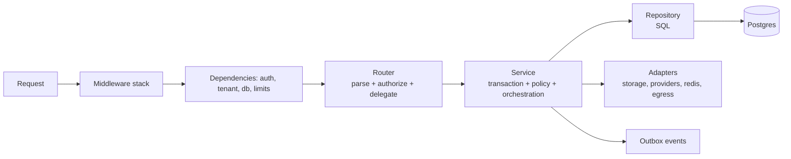

# Backend Architecture

**Doc ID:** 22 · **Status:** Approved · **Area:** Backend
**Depends on:** [09](../02-system-architecture/09-SYSTEM-ARCHITECTURE.md), [12](../02-system-architecture/12-SERVICE-BOUNDARIES-AND-MODULE-MAP.md) · **Related:** [23](23-API-DESIGN-AND-OPENAPI-CONTRACTS.md), [26](26-BACKGROUND-JOBS-AND-WORKERS.md), [27](27-ERROR-HANDLING-AND-RESILIENCE.md)

---

## 1. Purpose

Specify the internals of the FastAPI application: process model, configuration, layering, dependency
injection, transaction boundaries, middleware, and the rules that keep a modular monolith modular.

## 2. Process model

| Process | Entrypoint | Concurrency | Lifetime |
|---|---|---|---|
| `web` | `uvicorn app.main:app` | async event loop, N workers per container | request-scoped, drains on SIGTERM |
| `ingestion` | `python -m app.workers.ingestion` | async, bounded concurrency (default 4 docs) | long-lived, heartbeats |
| `agent` | `python -m app.workers.agent` | async, bounded (default 8 runs) | long-lived |
| `eval` | `python -m app.workers.evaluation` | serial per suite | scheduled |
| `webhook` | `python -m app.workers.webhook` | async, bounded (default 32 deliveries) | long-lived |

No process holds authoritative state in memory. Workers use `SIGTERM` → stop claiming → finish current item →
exit within 25 s.

## 3. Configuration

`app/core/config/settings.py` — Pydantic `BaseSettings`, loaded once, validated at import.

```python
class Settings(BaseSettings):
    app_env: Literal["development", "test", "staging", "production"]
    api_base_url: AnyHttpUrl
    database_url: PostgresDsn
    redis_url: RedisDsn
    clerk_issuer: str
    clerk_jwks_url: AnyHttpUrl
    clerk_webhook_secret: SecretStr
    supabase_url: AnyHttpUrl
    supabase_publishable_key: str
    supabase_secret_key: SecretStr
    storage_provider: Literal["supabase", "s3"] = "supabase"
    gemini_api_key: SecretStr | None = None
    nvidia_api_key: SecretStr | None = None
    ai_primary_provider: Literal["gemini"] = "gemini"
    ai_fallback_provider: Literal["nvidia"] | None = "nvidia"
    session_token_ttl_seconds: int = 900
    rate_limit_enabled: bool = True
    log_level: str = "INFO"
    otel_exporter_endpoint: str | None = None
    model_config = SettingsConfigDict(env_file=".env", extra="forbid")
```

Rules: `extra="forbid"` (typos fail fast); optional providers allow a knowledge-only deployment; **no default
values for secrets**; production startup fails if a required value is missing; `model_config` never reads a
committed `.env` in production (env vars injected by the platform).

## 4. Layering and request flow



**Router contract:** ≤ 15 lines per handler; no SQL; no branching on business rules; all inputs are Pydantic
models; returns a response model.

**Service contract:** owns the transaction; may call other modules' services; raises typed errors; never
builds HTTP responses.

**Repository contract:** parameterized SQL only; returns ORM rows/DTOs; never commits.

## 5. Dependency injection

```python
async def get_db(request: Request) -> AsyncSession: ...
async def get_principal(...) -> Principal: ...            # user | api_key | sdk_session
async def get_tenant(principal=Depends(get_principal)) -> TenantContext: ...
def require(permission: Permission):
    async def dep(ctx: TenantContext = Depends(get_tenant)) -> TenantContext:
        if permission not in ROLE_PERMISSIONS[ctx.role]:
            raise InsufficientRole(permission)
        return ctx
    return dep

@router.post("/applications", response_model=ApplicationOut)
async def create_application(
    body: ApplicationCreate,
    ctx: TenantContext = Depends(require(Permission.APPLICATION_CREATE)),
    svc: ApplicationService = Depends(get_application_service),
) -> ApplicationOut:
    return await svc.create(ctx, body)
```

Dependencies are the only place auth/tenant logic runs. Tests override dependencies with fakes; they never
patch internals.

## 6. Transaction management

- One transaction per request, owned by the service method (`async with uow:`).
- Nested service calls share the unit of work (contextvar-scoped session).
- External calls (providers, storage, tools) happen **outside** the DB transaction where possible; if a
  transaction must stay open, it never spans a network call longer than 2 s.
- Outbox rows are inserted in the same transaction as the mutation; dispatch after commit.
- Retries on serialization/deadlock are bounded (2) and only for idempotent transactions.

## 7. Middleware stack (order matters)

1. `RequestIdMiddleware` — accepts/generates `X-Request-Id`, binds to contextvar, echoes in response.
2. `AccessLogMiddleware` — method, path, status, duration, org, actor type. No bodies.
3. `SecurityHeadersMiddleware` — `X-Content-Type-Options`, `Referrer-Policy`, HSTS at the edge.
4. `CORSMiddleware` — explicit origins per environment; credentials only where needed.
5. `BodySizeLimitMiddleware` — JSON ≤ 2 MB; multipart handled by presigned upload, not this service.
6. `RateLimitMiddleware` — Redis token bucket per principal/app; 429 + `Retry-After`.
7. `TimeoutMiddleware` — request deadline (default 30 s; streaming routes exempt with explicit budgets).
8. `ExceptionMiddleware` — typed errors → problem+json (doc 27).

## 8. Async rules

- Every I/O call is awaited with a timeout.
- Sync libraries (parsing some formats, PDF tooling) run in `anyio.to_thread.run_sync` with a semaphore.
- CPU-heavy work (embeddings batching, large PDFs) belongs to workers, not the request path.
- No `asyncio.create_task` for work that must survive the request; persist a job.
- Streaming responses use `async def` generators with backpressure-aware yields and client-disconnect checks.

## 9. Module boundaries in code

```
app/modules/applications/
  __init__.py        # exports only the public service + schemas
  router.py
  schemas.py
  service.py
  repository.py
  models.py
  policies.py
  events.py
  exceptions.py
```

- `__init__.py` defines the module's public surface; importing `applications.repository` from another module
  fails the import-linter contract.
- Cross-module reads go through services returning DTOs (`ApplicationSummary`), not ORM objects.
- Shared primitives live in `app/core/*`; a primitive used by ≥3 modules is promoted there deliberately.

## 10. Caching

| Data | Cache | TTL | Invalidation |
|---|---|---|---|
| Application config by public id | Redis | 60 s | on app update (explicit delete) |
| Agent published version | Redis | 60 s | on publish |
| Prompt version content | in-process LRU + Redis | 5 min | on activation |
| JWKS | in-process + Redis | 300 s | on unknown `kid` |
| Retrieval embedding of query | Redis | 10 min (hash of query+model) | n/a |
| Answer cache (exact query) | Redis, opt-in per agent | 5 min | on knowledge change (namespace bump) |

Never cache: authorization decisions, session validity beyond 30 s, tool results with side effects.

## 11. Observability hooks

- Every request span: `http.request` with route template (not raw path), status, org (hashed where required).
- Service spans: `service.<module>.<method>`; adapter spans: `provider.gemini.generate`, `db.query`.
- Metrics: request duration histogram, error counter by `code`, provider latency, queue depth, run duration.
- Structured logs carry `request_id`, `organization_id`, `actor_type`, `module`, `event`. Prompts and document
  text are excluded at INFO.

## 12. Failure behavior

| Failure | Behavior |
|---|---|
| DB unavailable | 503 `DATABASE_UNAVAILABLE`; health degraded; no retry storm (circuit breaker) |
| Redis unavailable | Rate limits fail closed for sensitive routes; cache misses tolerated |
| Provider timeout | Bounded retry then capability fallback (doc 31) |
| Malformed internal state | 500 with `INTERNAL_ERROR` + `request_id`; details only in logs |
| Partial batch failure | Per-item results with `errors[]`; never silently drop |

## 13. Testing strategy

- Unit: services with fake repositories and fake adapters.
- Integration: routers with a real Postgres (testcontainers or local Supabase) and fake providers.
- Contract: `openapi.json` snapshot + schema validation of every response in integration tests.
- Performance: p95 assertions on hot endpoints in a benchmark suite (nightly).
- No test hits a provider, Clerk, or Supabase production.

## 14. Acceptance criteria

- [ ] Every router handler authorizes via a `require(...)` dependency (route inventory test).
- [ ] No module imports another module's repository (lint).
- [ ] All configuration validated at boot; missing secrets fail fast.
- [ ] Every request path has a timeout and a typed error mapping.
- [ ] Integration tests run with providers faked at the adapter boundary.

## 15. Related documents

[12](../02-system-architecture/12-SERVICE-BOUNDARIES-AND-MODULE-MAP.md) · [23](23-API-DESIGN-AND-OPENAPI-CONTRACTS.md) ·
[24](24-SESSION-AND-CONVERSATION-MANAGEMENT.md) · [26](26-BACKGROUND-JOBS-AND-WORKERS.md) ·
[27](27-ERROR-HANDLING-AND-RESILIENCE.md) · [64](../11-quality-security-and-operations/64-OBSERVABILITY-LOGGING-AND-MONITORING.md)
