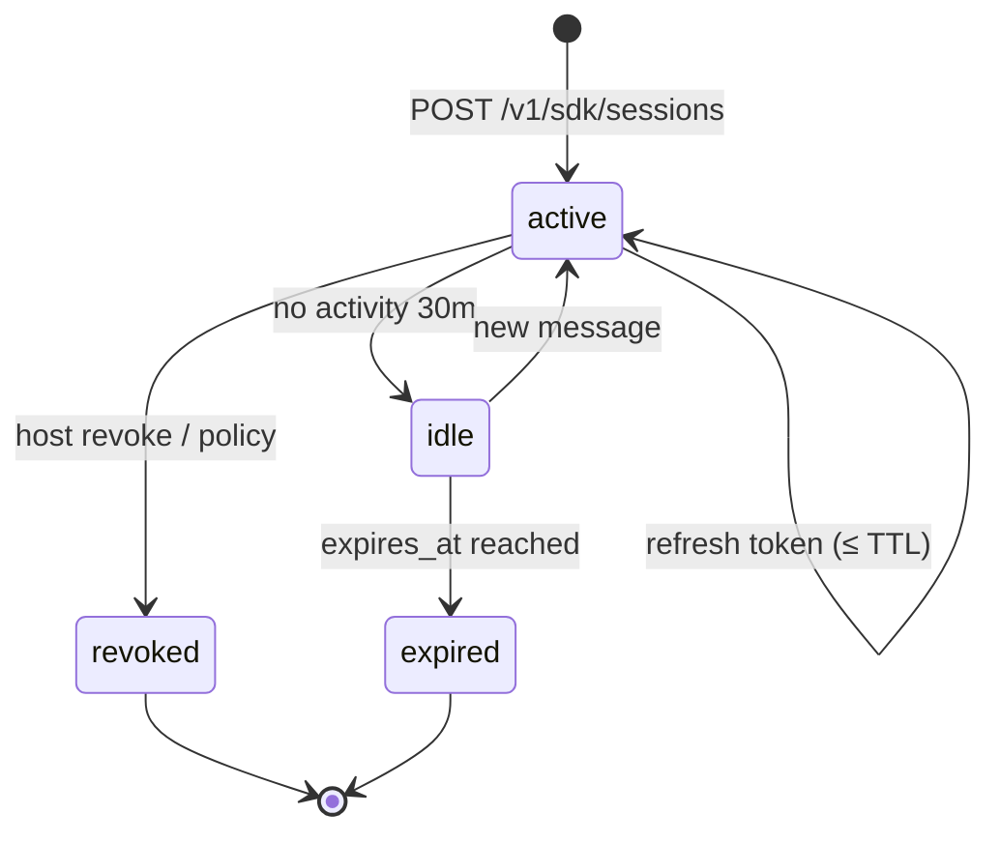
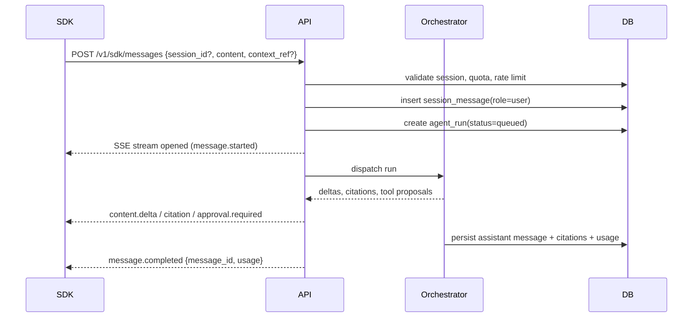

# Session and Conversation Management

**Doc ID:** 24 · **Status:** Approved · **Area:** Backend
**Depends on:** [23](23-API-DESIGN-AND-OPENAPI-CONTRACTS.md) · **Related:** [25](25-REALTIME-AND-EVENT-ARCHITECTURE.md), [43](../07-agents-and-execution/43-AGENT-RUNTIME-AND-ORCHESTRATION.md), [48](../07-agents-and-execution/48-AGENT-MEMORY-AND-EXECUTION-TRACES.md)

---

## 1. Purpose

Define the lifecycle of end-user sessions and conversations: authentication, creation, message flow,
context windows, persistence, resumption, retention, and concurrency. Sessions are the unit of cost, privacy,
and debugging in an embedded product.

## 2. Two levels, deliberately separate

| Level | Table | Meaning | Lifetime |
|---|---|---|---|
| Application session | `application_sessions` | An end user authenticated into an embedded app on a device | Hours–days; explicit revoke |
| Conversation session | `sessions` | A thread of messages with a chosen agent | User-scoped; idle-close |

One application session can host many conversations (e.g. "new chat"). A conversation never spans
application sessions.

## 3. End-user session lifecycle



- Token TTL: 900 s. The SDK refreshes via the host's mint endpoint (`POST /v1/sdk/sessions/{id}/refresh`).
- `end_user_ref` is opaque to VISTRA. The host maps it to its own user; VISTRA stores it in the session row
  and a hash in the token.
- `end_user_meta` may include safe display fields (name, plan tier) explicitly provided by the host; never
  inferred.
- Concurrency: max 3 active tokens per session; older tokens are invalidated on refresh (single-use rotation).

## 4. Conversation creation

`POST /v1/sdk/messages` with `session_id` absent creates a conversation implicitly (channel `widget`) bound
to the application's default published agent. Explicit creation is available for Studio/API:

```json
POST /v1/sessions
{ "application_id": "app_01H…", "agent_id": "agt_01H…", "channel": "api", "title": "Onboarding help" }
```

Rules:
- The agent must be published and belong to the application.
- The knowledge collections bound to the agent version are snapshotted into `sessions.metadata` so later
  edits do not retroactively change historical context.
- A session cannot switch agents mid-thread; a new session is required (deterministic traces).

## 5. Message flow



Message content is an array of parts (multimodal-ready):

```json
{ "parts": [
  { "type": "text", "text": "Explain this chart" },
  { "type": "element_ref", "snapshot_id": "vcs_01H…", "descriptor": { "role": "img", "name": "Churn risk" } },
  { "type": "image_ref", "file_id": "fil_01H…" }
]}
```

## 6. Context assembly

Order and budget (tokens, default 32k window, configurable per agent):

| Segment | Budget | Notes |
|---|---|---|
| System instructions (prompt version) | 2k | Pinned |
| Agent policy summary | 300 | Tool names + constraints |
| Page/visual context | 2.5k | Truncated deterministically (doc 49) |
| Conversation history | 8k | Sliding window + summary of older turns |
| Retrieved evidence | 12k | Top-k chunks, parent expansion (doc 39) |
| Tool schemas | 4k | Only tools the policy allows |
| Output reserve | 4k | Enforced `max_output_tokens` |

Summarization: when history exceeds budget, the oldest turns are replaced by a structured summary stored in
`sessions.metadata.history_summary` (versioned). Never drop the system prompt or the most recent user turn.

## 7. Persistence rules

- User message persisted **before** the model is called (so a crash never loses the question).
- Assistant message persisted exactly once, on completion or terminal failure, with `error_code` when failed.
- Streaming deltas are not persisted individually (cost); `session_events` holds the stream log for replay.
- Citations persisted per message with chunk id, page range, section, score.
- Usage recorded per message and per run; session totals updated in the same transaction.

## 8. Idempotent message submission

The SDK sends `client_message_id` (UUID). Unique constraint `(session_id, client_message_id)`; a retry
returns the existing message/run instead of creating a duplicate. This is essential on flaky mobile
networks.

## 9. Cancellation and resumption

- `POST /v1/sdk/messages/{id}/cancel` (and `/v1/runs/{id}/cancel`) sets a cancel flag; the orchestrator checks
  before the next step and before any side effect.
- Partial assistant output is persisted with `status=cancelled`; the UI must render it as incomplete.
- Resumption after a page reload: `GET /v1/sdk/sessions/{id}/messages` returns history; the SSE endpoint with
  `Last-Event-ID` replays missed events from `session_events`.

## 10. Retention and privacy

| Data | Default retention | Control |
|---|---|---|
| Messages + citations | 90 d | tenant setting 7–365 d |
| Session events | 90 d | same |
| Visual snapshots | 7 d | app config |
| Screenshots | 7 d (if enabled) | app config 0–30 d |
| Runs/steps | 90 d | tenant setting |

- End-user deletion: `DELETE /v1/sdk/sessions/{id}` erases messages, events, snapshots, and runs (hard delete
  within 24 h), keeping only aggregate usage without content.
- Tenant deletion cascades as documented in doc 16.
- "Do not store" mode (`retention_days=0`) keeps only in-flight state and aggregate counts.

## 11. Concurrency and ordering

- One active run per conversation at a time; a second message while a run is active is queued (max 3) and
  the UI shows "thinking". This prevents interleaved plans.
- Events are ordered by `sequence` per session; the client buffers and sorts.
- Optimistic concurrency on session metadata via `version`.

## 12. Failure scenarios

| Scenario | Behavior |
|---|---|
| Model fails after user message stored | Assistant message with `error_code=PROVIDER_UNAVAILABLE`; retry affordance; no fabricated answer |
| Client disconnects mid-stream | Generation continues to completion and persists; client resumes via replay |
| Duplicate submit | Idempotent by `client_message_id` |
| Session revoked mid-run | Run cancelled before next step; partial output kept |
| Token expired mid-stream | Stream closes with `SESSION_EXPIRED`; SDK refreshes and replays |
| Context over budget | Deterministic truncation with `context_truncated` flag in the run |

## 13. Observability

Metrics: messages/min per app, p50/p95 first-token and completion latency, grounded rate, citation count,
cancellation rate, error rate by code, context-truncation rate, average tokens per message. Traces link
`session_id → run_id → steps → provider calls`.

## 14. Acceptance criteria

- [ ] User message persisted before any provider call.
- [ ] Assistant message persisted exactly once per completion/terminal failure.
- [ ] Duplicate `client_message_id` never creates a second run.
- [ ] Reconnect with `Last-Event-ID` replays without gaps or duplicates.
- [ ] Retention deletion removes content but preserves aggregate usage.
- [ ] Context assembly respects budgets and never drops the system prompt.

## 15. Related documents

[25](25-REALTIME-AND-EVENT-ARCHITECTURE.md) · [32](../05-ai-and-model-infrastructure/32-PROMPT-AND-CONTEXT-MANAGEMENT.md) ·
[39](../06-knowledge-and-rag/39-RERANKING-CITATIONS-AND-GROUNDED-ANSWERS.md) ·
[43](../07-agents-and-execution/43-AGENT-RUNTIME-AND-ORCHESTRATION.md) ·
[48](../07-agents-and-execution/48-AGENT-MEMORY-AND-EXECUTION-TRACES.md)
