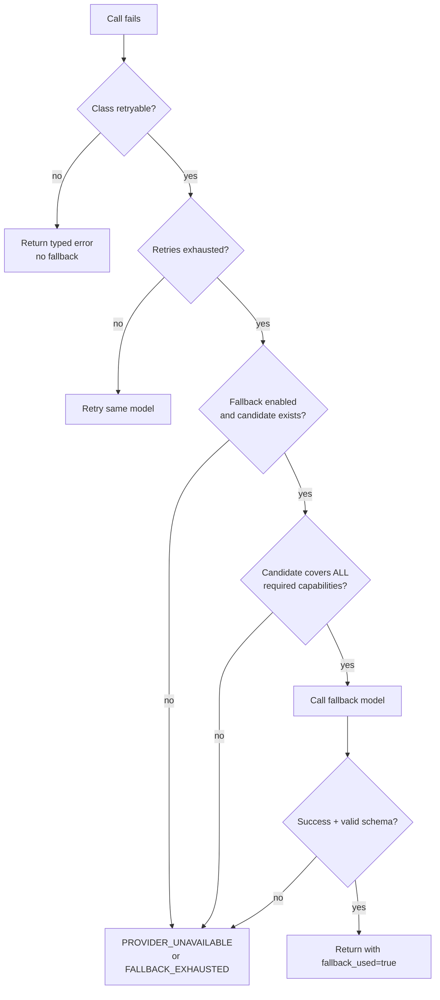

# Model Routing and Capability Matrix

**Doc ID:** 31 · **Status:** Approved (normative) · **Area:** AI
**Depends on:** [28](28-AI-PROVIDER-ABSTRACTION.md), [29](29-GEMINI-PRIMARY-INTEGRATION.md), [30](30-NVIDIA-NIM-FALLBACK-INTEGRATION.md) · **Related:** [32](32-PROMPT-AND-CONTEXT-MANAGEMENT.md), [34](34-AI-EVALUATION-AND-COST-MANAGEMENT.md), [66](../11-quality-security-and-operations/66-COST-AND-RESOURCE-PLANNING.md)

---

## 1. Purpose

Define which model serves which capability, how a model is selected, when fallback is legal, and how the
system behaves when nothing eligible exists. This is the document that prevents "silently degrade the product"
failures.

## 2. Capability matrix

`P` = primary, `F` = fallback eligible (only if the specific model passes the capability suite), `—` = not
supported. The matrix is about **capability**, not vendor; per-model rows live in the registry.

| Capability | Gemini (primary) | NVIDIA NIM (fallback) | Notes |
|---|---|---|---|
| `text.fast` | P | F | low-latency classification, rewriting |
| `text.reasoning` | P | F | planning, grounded answers |
| `structured.json` | P (native schema) | F (json_object/prompt, validated) | prefer native when schema is complex |
| `tools.function_calling` | P | F (only probed models) | execution still policy-gated |
| `vision.image` | P | F only for verified multimodal models | **never** route to text-only |
| `embedding.text` | P | — (v1) | separate index required if ever enabled |
| `rerank` | P (if configured) or local heuristic | F (rerank endpoint, if configured) | degraded = fused order |
| `realtime.voice` | P | — | no silent text substitute |
| `long_context` | P | F (model-specific window) | pre-check token estimate |

Rules:
1. A request declares required capabilities; the router intersects with model support.
2. **No capability substitution.** A missing capability is an error (`CAPABILITY_UNAVAILABLE`), not a downgrade.
3. Fallback must preserve *all* required capabilities, not just the primary one.
4. Provider preference is Gemini first; a model is only a candidate if `enabled` and its capability suite
   passed within the last 7 days.

## 3. Registry schema (logical)

```yaml
- provider: gemini
  model_id: ${GEMINI_MODEL_FAST}
  capabilities: [text.fast, structured.json]
  context_window: 1000000
  max_output_tokens: 8192
  structured_support: native
  tool_support: native
  tier: fast
  pricing: { input_per_mtok: 0.10, output_per_mtok: 0.40 }
- provider: nvidia
  model_id: ${NVIDIA_MODEL_DEFAULT}
  capabilities: [text.fast, text.reasoning, structured.json]
  structured_support: validated
  tool_support: validated
  tier: balanced
  pricing: { input_per_mtok: 0.00, output_per_mtok: 0.00 }   # free tier; verify
```

Environment indirection keeps model IDs out of code. Ops can disable a model without a deploy.

## 4. Selection algorithm

```python
def select(required: set[Capability], tier: str, constraints: Constraints) -> list[ModelSpec]:
    specs = [s for s in registry.enabled()
             if required <= s.capabilities
             and s.context_window >= constraints.estimated_tokens
             and s.max_output_tokens >= constraints.max_output_tokens
             and s.healthy]
    # preference: primary provider, then tier match, then cost, then recent p95 latency
    return sorted(specs, key=lambda s: (
        0 if s.provider == "gemini" else 1,
        0 if s.tier == tier else 1,
        s.estimated_cost(constraints),
        latency_stats.p95(s),
    ))
```

`constraints.estimated_tokens` is computed before the call (messages + system + tool schemas + output reserve).
Over-budget requests fail `CONTEXT_TOO_LARGE` rather than being truncated silently.

## 5. Fallback eligibility



Explicitly **not** retryable/fallbackable: 400/401/403/404 (configuration), safety block, invalid schema after
repair, capability mismatch, policy denial.

## 6. Routing by use case

| Use case | Capabilities | Tier | Fallback |
|---|---|---|---|
| Intent classification | `text.fast`, `structured.json` | fast | yes |
| Query rewriting | `text.fast` | fast | yes |
| Retrieval reranking | `rerank` (else heuristic) | fast | degraded flag |
| Grounded answer | `text.reasoning` | balanced | yes, marked |
| Multi-step planning | `text.reasoning`, `structured.json` | reasoning | yes, marked |
| Element understanding | `vision.image`, `structured.json` | balanced | yes only if vision-capable |
| Screenshot Q&A | `vision.image`, `text.reasoning` | balanced | vision-capable only |
| Tool turn | `tools.function_calling` | balanced | probed models only |
| Embeddings | `embedding.text` | fast | **no** (index compatibility) |
| Live voice | `realtime.voice` | fast | **no** |
| Summarizing long docs | `long_context`, `text.fast` | fast | if window fits |

## 7. Health and circuit state

- Health = last 5 minutes of success rate ≥ 90% and p95 latency within budget; otherwise the model is
  deprioritized (not necessarily removed).
- Breaker per `(provider, model, capability)`. Open breaker removes the model from candidates.
- A model failing its nightly capability suite is marked `degraded` and used only if it is the last resort for a
  **non-critical** capability (never vision, never tools).
- Health state is cached in Redis (60 s) and exported as metrics.

## 8. Configuration surface

```env
AI_PRIMARY_PROVIDER=gemini
AI_FALLBACK_PROVIDER=nvidia
AI_FALLBACK_ENABLED=true
AI_ROUTING_TIER_DEFAULT=balanced
AI_MAX_RETRIES=2
AI_BREAKER_FAILURES=5
AI_BREAKER_WINDOW_S=60
AI_BREAKER_COOLDOWN_S=30
AI_ALLOW_DEGRADED_MODELS=false
```

Tenant control: an org may pin a model **within** the registry for evaluation, but cannot enable a model that
failed its suite, and cannot disable the capability gate.

## 9. Cost-aware routing

- When both providers satisfy a capability and quality is within tolerance on the eval suite, the cheaper one
  may be preferred for `text.fast` (config flag, default off).
- Reasoning paths always prefer Gemini unless it is unhealthy.
- Per-org budget guardrails run before routing (doc 66) and can downgrade `tier=reasoning` to `balanced` only
  if the agent's config explicitly allows it.

## 10. Observability

Per capability: request count, success rate, p50/p95 latency, fallback rate, error codes, cost. Dashboards
must show primary vs fallback side by side (doc 64). Alerts:
- fallback rate > 10% for 10 min,
- any `CAPABILITY_UNAVAILABLE` spike,
- provider 401/403 (config),
- cost per capability > 1.5× 7-day median.

## 11. Failure scenarios

| Scenario | Result |
|---|---|
| Gemini down, NVIDIA healthy (text) | Answers continue, `fallback_used=true`, slight latency increase |
| Gemini down (vision) | `CAPABILITY_UNAVAILABLE` → UI states screen cannot be read; no text-only guess |
| Both down | `FALLBACK_EXHAUSTED` 503 with retry guidance |
| NVIDIA model misconfigured | `PROVIDER_CONFIGURATION_ERROR`, model disabled after repeated failures |
| Embeddings unavailable | Retrieval degraded to lexical + warning; ingestion pauses embeddings |
| Context exceeds all candidates | `CONTEXT_TOO_LARGE`; orchestrator trims per doc 32 |

## 12. Test matrix

| Test | Assertion |
|---|---|
| Capability intersection | model lacking a required capability is never selected |
| Vision guard | text model never receives an image payload |
| Fallback ordering | Gemini preferred; NVIDIA used only when eligible |
| Breaker | open breaker skips primary; recovers after cooldown |
| 401 handling | no fallback, config error surfaced |
| Schema failure | repair once, then typed error |
| Budget guardrail | over-budget org gets 402, no provider call |
| Registry disable | disabled model never selected |
| Cost preference | with flag on, cheaper eligible model chosen for `text.fast` |

## 13. Acceptance criteria

- [ ] The matrix in §2 is executable: a test asserts router behavior for every cell.
- [ ] Fallback never changes the capability set of a request.
- [ ] Unavailable capabilities surface as explicit errors, never degraded answers.
- [ ] Model changes are configuration-only.
- [ ] Fallback rate and provider health are visible per org and per capability.

## 14. Related documents

[28](28-AI-PROVIDER-ABSTRACTION.md) · [29](29-GEMINI-PRIMARY-INTEGRATION.md) ·
[30](30-NVIDIA-NIM-FALLBACK-INTEGRATION.md) · [32](32-PROMPT-AND-CONTEXT-MANAGEMENT.md) ·
[34](34-AI-EVALUATION-AND-COST-MANAGEMENT.md) ·
[65](../11-quality-security-and-operations/65-PERFORMANCE-AND-SCALABILITY.md)
