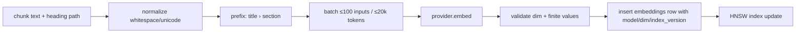

# Embedding and Multimodal Models

**Doc ID:** 33 · **Status:** Approved · **Area:** AI / Retrieval
**Depends on:** [29](29-GEMINI-PRIMARY-INTEGRATION.md) · **Related:** [37](../06-knowledge-and-rag/37-CHUNKING-AND-METADATA-EXTRACTION.md), [38](../06-knowledge-and-rag/38-VECTOR-SEARCH-AND-HYBRID-RETRIEVAL.md), [49](../08-visual-and-ghost-cursor/49-VISUAL-CONTEXT-ENGINE.md)

---

## 1. Purpose

Specify embedding generation, dimension/index versioning, batching, multimodal handling, and the rules that keep
vector search accurate and comparable over time.

## 2. Embedding model choice

| Property | Decision |
|---|---|
| Provider | Gemini (`gemini-embedding-001` / successor in registry) |
| Dimensions | **768 default**; 1536/3072 available via `output_dimensionality` |
| Task types | `RETRIEVAL_DOCUMENT` for chunks, `RETRIEVAL_QUERY` for queries, `SEMANTIC_SIMILARITY` for dedupe |
| Similarity | cosine (`vector_cosine_ops`) |
| Normalization | unit-normalized at write time; store as-is |
| Fallback | none in v1 (a second model requires a separate index version) |

Why 768: storage and HNSW build time dominate at scale (doc 15 §9); MRL truncation keeps most quality. The
choice is validated against the retrieval eval (doc 42) and revisited if recall drops >3 points versus 1536.

## 3. Pipeline



- **Input composition:** `"{document_title} › {section_path} \n\n {chunk_text}"`. Titles improve short-chunk
  recall; they are not stored in the vector separately.
- **Ordering:** batch boundaries never split a chunk.
- **Retries:** per batch, exponential backoff; a permanently failing batch marks the job `embedding` failed with
  the batch range, not the whole document.
- **Idempotency:** a chunk is embedded once per `(model, dim, index_version)`; a unique constraint enforces it.

## 4. Storage and indexing

```sql
create table embeddings (
  id uuid primary key,
  chunk_id uuid not null references document_chunks(id) on delete cascade,
  organization_id text not null,
  model text not null,
  dim integer not null,
  index_version integer not null,
  embedding vector(768) not null,
  created_at timestamptz not null default now(),
  unique (chunk_id, model, index_version)
);
create index idx_embeddings_iv1 on embeddings
  using hnsw (embedding vector_cosine_ops) with (m = 16, ef_construction = 64)
  where index_version = 1;
```

- One HNSW index per active `index_version` (partial index), so a re-embed can run in parallel.
- `ef_search` is set per query (default 40; higher for deep recall in evaluation).
- Large tenants: partition `embeddings` by `organization_id` hash at > 50M rows, documented in doc 38 §10.

## 5. Index versioning and migration

| Change | Procedure |
|---|---|
| Embedding model upgrade | new `index_version`; dual-write embeddings; shadow retrieval eval; switch reads; drop old after 14 d |
| Dimension change | new index version + column type or parallel table; never mix dims |
| Chunking strategy change | new `document_version` + re-chunk + re-embed under a new index version |
| Normalization/task-type change | treated as a model change (new index version) |

Reads always specify the active `index_version`; a query cannot see stale vectors. A background job reports
coverage: `chunks_with_vector / chunks` per index version.

## 6. Query embedding

- Cached in Redis by `sha256(model|dim|task|query)` for 10 minutes.
- Query rewriting happens **before** embedding (doc 38 §4); the rewritten query is embedded, and the original is
  kept for lexical search.
- Batch queries within one request are embedded together (e.g. multi-question evaluation runs).

## 7. Multimodal handling

| Modality | Handling |
|---|---|
| Images in documents | Extracted as assets; captions/alt text (if present) become text; optional vision-generated description stored as chunk metadata, never as a substitute for the original |
| Screenshots | Sent inline to a vision model for the active turn; not embedded by default |
| Tables | Serialized to markdown in the chunk; optionally a summary chunk (doc 37) |
| Audio/video | Not ingested in v1; transcript ingestion is future work |
| PDF pages as images (scanned) | OCR path (doc 36 §8); text is embedded, page image retained for citation |

**Rule:** embeddings represent text. Visual similarity search is out of scope for v1; do not silently embed
image bytes with a text model.

## 8. Quality controls

- Zero-vector / non-finite detection before insert.
- Duplicate detection: near-duplicate chunks (cosine > 0.98 within the same document) are merged or flagged.
- Language handling: embedding models are multilingual; chunk metadata records the detected language and the
  retrieval eval tracks per-language recall.
- Short chunks (< 40 tokens) are merged with a neighbor during chunking rather than embedded alone.

## 9. Cost and throughput

| Observation | Value |
|---|---|
| Batch size | 100 inputs or 20k tokens |
| Throughput target | ≥ 200 chunks/min/worker (provider-dependent) |
| Cost per 1k pages | ≤ $0.15 (target, doc 66) |
| Re-embedding 1M chunks | planned as a background job with rate limiting, never blocking ingestion |

## 10. Failure scenarios

| Scenario | Behavior |
|---|---|
| Provider 429 | backoff with jitter; job resumes at the failed batch |
| Provider 5xx | retries; after max attempts job `failed` at `embedding` stage |
| Dimension mismatch | reject the batch; alert; never insert |
| Partial batch failure | only the failed sub-batch is retried |
| Index build failure | index version marked `error`; reads stay on the previous version |
| Duplicate insert | unique constraint → skip |
| Model deprecation | registry disable + migration plan; no silent switch |

## 11. Testing

- Dimension and normalization assertions on fixtures.
- Determinism: same input → same vector (provider permitting) within tolerance.
- Idempotency: re-running a job inserts zero duplicates.
- Coverage job: detects chunks missing vectors.
- Retrieval sanity: known query returns the expected chunk in top-3 on a 50-doc fixture.
- Re-embed migration test: dual index, switch, rollback.

## 12. Acceptance criteria

- [ ] Every chunk in an active index version has exactly one embedding row.
- [ ] No query reads across index versions.
- [ ] Model/dimension changes always create a new index version with a documented cutover.
- [ ] Vector length matches the schema column and registry config.
- [ ] Ingestion reports embedding coverage per source.

## 13. Related documents

[29](29-GEMINI-PRIMARY-INTEGRATION.md) · [34](34-AI-EVALUATION-AND-COST-MANAGEMENT.md) ·
[37](../06-knowledge-and-rag/37-CHUNKING-AND-METADATA-EXTRACTION.md) ·
[38](../06-knowledge-and-rag/38-VECTOR-SEARCH-AND-HYBRID-RETRIEVAL.md) ·
[42](../06-knowledge-and-rag/42-RAG-EVALUATION-AND-QUALITY.md) ·
[49](../08-visual-and-ghost-cursor/49-VISUAL-CONTEXT-ENGINE.md)

## 14. References

- Gemini embeddings — https://ai.google.dev/gemini-api/docs/embeddings
- MRL / output dimensionality — same page, "output_dimensionality"
- pgvector HNSW — https://github.com/pgvector/pgvector#hnsw
