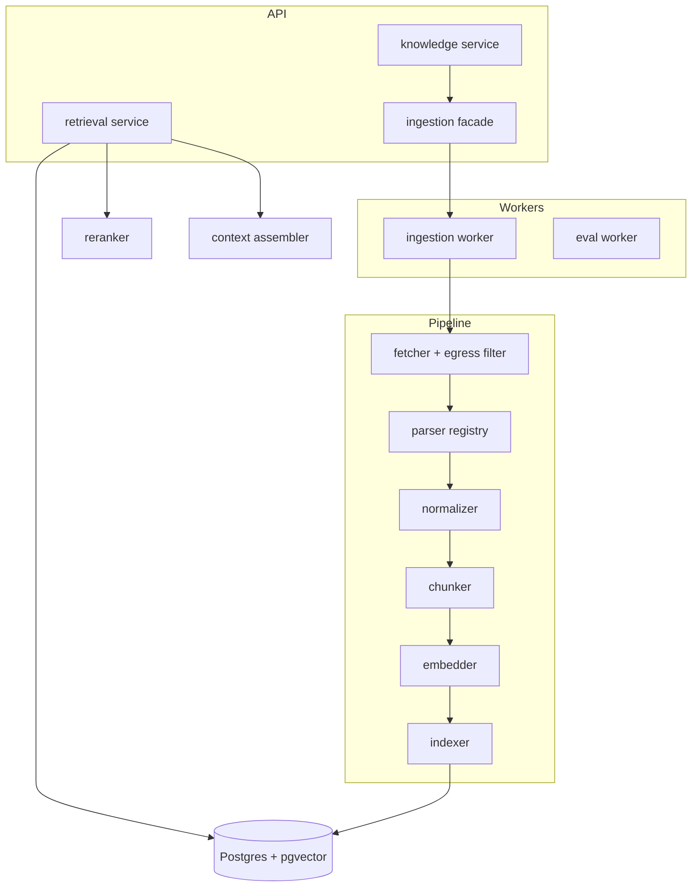
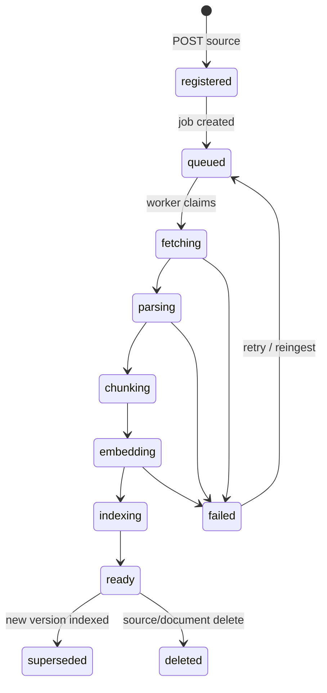

# Knowledge Engine Architecture

**Doc ID:** 35 · **Status:** Approved · **Area:** Knowledge
**Depends on:** [16](../03-database-and-identity/16-DATABASE-SCHEMA-AND-RELATIONSHIPS.md) · **Related:** [36](36-DOCUMENT-INGESTION-AND-PARSING.md), [37](37-CHUNKING-AND-METADATA-EXTRACTION.md), [38](38-VECTOR-SEARCH-AND-HYBRID-RETRIEVAL.md), [41](41-KNOWLEDGE-PERMISSIONS-AND-TENANT-ISOLATION.md)

---

## 1. Purpose

Define the knowledge subsystem as a platform service independent of chat: sources, ingestion, versioning,
retrieval, and permissions. The knowledge agent is a consumer; ingestion and retrieval must work headless.

## 2. Component map



## 3. Domain objects

| Object | Meaning | Example |
|---|---|---|
| Knowledge base | Embedding model + index version boundary | "Acme Product Docs" |
| Collection | Retrieval unit with ACL | "Public help center", "Internal runbooks" |
| Source | Where content comes from | 40 PDFs, a sitemap, a GitHub repo |
| Document | One logical item | "pricing.pdf" |
| Document version | Immutable content snapshot | v3, hash `a1b2…` |
| Chunk | Retrieval unit | §"Starter plan", 412 tokens |
| Embedding | Vector for a chunk under a model+version | 768 dims |

**Why this hierarchy:** collections let one agent cite public docs while another retrieves internal runbooks;
versions make answers reproducible; chunks make citations precise; index versions make model upgrades safe.

## 4. Lifecycle



Every transition writes `ingestion_jobs.status` + `stage` and a `stats` snapshot (pages, chunks, tokens).

## 5. Data ownership and scale

| Table | Owner | Growth | Notes |
|---|---|---|---|
| `knowledge_bases` | knowledge | low | embedding model/dim/index version |
| `knowledge_collections` | knowledge | low | ACL lives here |
| `knowledge_sources` | knowledge | low | config, credentials ref |
| `documents` | knowledge | medium | current version pointer |
| `document_versions` | ingestion | medium | immutable, content hash unique |
| `document_chunks` | chunking | **high** | text + tsvector + section path |
| `embeddings` | embedding | **high** | vector + model + index version |
| `ingestion_jobs` | ingestion | medium | 30 d retention |

## 6. Public interfaces

```
POST   /v1/knowledge-bases
POST   /v1/knowledge-bases/{id}/collections
POST   /v1/collections/{id}/sources
POST   /v1/sources/{id}/reingest
GET    /v1/sources/{id}/documents
DELETE /v1/documents/{id}
GET    /v1/ingestion-jobs/{id}
POST   /v1/knowledge/search            # debug/playground
```

Service interface (internal):

```python
class KnowledgeService:
    async def create_source(ctx, kb_id, input: SourceInput) -> Source: ...
    async def enqueue_ingestion(ctx, source_id) -> IngestionJob: ...
    async def reprocess(ctx, source_id, *, force: bool = False) -> IngestionJob: ...
    async def delete_document(ctx, document_id) -> None: ...

class RetrievalService:
    async def search(ctx, query, *, collections, k=20, filters=None) -> RetrievalResult: ...
```

## 7. Coupling rules

- Knowledge never imports orchestration or conversations.
- Retrieval never writes documents; it reads and emits `retrieval_events`.
- The knowledge agent calls retrieval and formats evidence; it does not query `document_chunks` directly.
- Ingestion is the only writer of chunks/embeddings (plus retrieval's cache).

## 8. Consistency model

- A document is visible to retrieval only when `status='indexed'` **and** all its chunks have embeddings for the
  active index version.
- Partial ingestion is never searchable: indexing is transactional per document version (chunks + embeddings in
  one transaction where feasible; otherwise a `ready` flag gates retrieval).
- Deletion removes vectors in the same transaction as chunk deletion; storage cleanup follows asynchronously.

## 9. Failure and recovery

| Failure | Behavior |
|---|---|
| Fetch failure | job failed with `SOURCE_UNREACHABLE`; source status `failed` with reason |
| Parse failure | `PARSE_ERROR`, document version `parse_status=failed`, no chunks |
| Embedding quota | job stays at `embedding`, retried with backoff, resumable |
| Worker crash | job reclaimed; already-indexed chunks skipped (idempotent by hash) |
| Index version error | reads remain on previous version |
| Storage delete failure | retried; document invisible immediately |

## 10. Security and isolation

- Every object carries `organization_id`; all queries filter by it (doc 19/41).
- Collection ACLs are applied in the retrieval SQL, not after.
- Source credentials are encrypted (`tool_credentials`/`oauth_connections`), never returned.
- Fetched content is untrusted: sanitized, fenced, and never executed (doc 32/40).

## 11. Observability

Metrics: sources by status, documents indexed/day, chunks/embeddings coverage, stage durations, failure codes,
retrieval latency/recall proxies, citation rate. Traces: `ingestion.job` spans per stage; `retrieval.search`
spans with candidate counts and filter time.

## 12. Acceptance criteria

- [ ] Ingestion works with no conversation/agent present.
- [ ] Retrieval never returns chunks from a non-indexed or other-tenant document.
- [ ] One source can be reprocessed without touching others.
- [ ] Document versions are immutable and reproducible by hash.
- [ ] Deleting a document makes it unsearchable immediately and removes bytes within 24 h.

## 13. Related documents

[36](36-DOCUMENT-INGESTION-AND-PARSING.md) · [37](37-CHUNKING-AND-METADATA-EXTRACTION.md) ·
[38](38-VECTOR-SEARCH-AND-HYBRID-RETRIEVAL.md) · [39](39-RERANKING-CITATIONS-AND-GROUNDED-ANSWERS.md) ·
[40](40-KNOWLEDGE-SOURCE-CONNECTORS.md) · [41](41-KNOWLEDGE-PERMISSIONS-AND-TENANT-ISOLATION.md) ·
[42](42-RAG-EVALUATION-AND-QUALITY.md)
