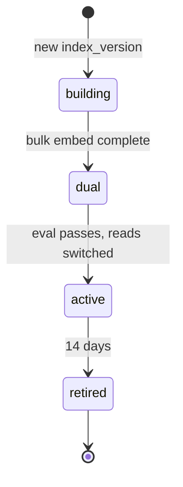

# Vector Search and Hybrid Retrieval

**Doc ID:** 38 · **Status:** Approved (normative) · **Area:** Retrieval
**Depends on:** [37](37-CHUNKING-AND-METADATA-EXTRACTION.md), [33](../05-ai-and-model-infrastructure/33-EMBEDDING-AND-MULTIMODAL-MODELS.md) · **Related:** [39](39-RERANKING-CITATIONS-AND-GROUNDED-ANSWERS.md), [41](41-KNOWLEDGE-PERMISSIONS-AND-TENANT-ISOLATION.md), [65](../11-quality-security-and-operations/65-PERFORMANCE-AND-SCALABILITY.md)

---

## 1. Purpose

Specify how a query becomes ranked evidence: query processing, candidate generation (vector + lexical),
fusion, filtering, expansion, thresholds, and performance/scaling rules.

## 2. Pipeline

```mermaid
flowchart LR
  Q[User query + context] --> N[normalize]
  N --> RW[query rewrite (optional, text.fast)]
  RW --> E[embed rewritten query]
  RW --> L[lexical terms]
  E --> V[vector candidates k=60]
  L --> F[FTS candidates k=60]
  V --> FU[RRF fusion]
  F --> FU
  FU --> D[dedupe by document+section]
  D --> R[rerank top 30 → top k]
  R --> T[threshold + diversity]
  T --> O[RetrievalResult]
```

Filters (`organization_id`, collection ACL, language, doc_type, recency) are applied **inside** both SQL
queries, before ranking.

## 3. Query processing

| Step | Rule |
|---|---|
| Normalize | trim, collapse whitespace, strip control chars, cap length 1,000 chars |
| Rewrite | one fast-model call: expand acronyms, resolve pronouns from the last turn, produce 1–3 sub-queries; **cached** by hash |
| Lexical terms | `websearch_to_tsquery('english', terms)`; preserve identifiers/SKUs/error codes verbatim |
| Embedding | rewritten primary query; `RETRIEVAL_QUERY` task type |
| Fallback | if rewriting fails → use the original query; record `rewrite_degraded` |

Rewriting must never introduce facts (it may only rephrase/expand), and its output is not shown to the user.

## 4. Candidate SQL

```sql
-- vector
with v as (
  select c.id, c.document_id, c.document_version_id, c.collection_id,
         1 - (e.embedding <=> :qvec) as score
  from embeddings e
  join document_chunks c on c.id = e.chunk_id
  join knowledge_collections col on col.id = c.collection_id
  where e.index_version = :index_version
    and e.organization_id = :org_id
    and c.collection_id = any(:allowed_collections)
    and (:language is null or c.metadata->>'language' = :language)
  order by e.embedding <=> :qvec
  limit :k_vector              -- 60
),
-- lexical
l as (
  select c.id, c.document_id, c.document_version_id, c.collection_id,
         ts_rank_cd(c.content_tsv, :tsq) as score
  from document_chunks c
  where c.organization_id = :org_id
    and c.collection_id = any(:allowed_collections)
    and c.content_tsv @@ :tsq
  order by score desc
  limit :k_lexical             -- 60
)
select * from v union all select * from l;
```

Notes:
- `1 - (embedding <=> q)` is cosine similarity for normalized vectors.
- The HNSW index is partial (`where index_version = :active`); Postgres may still need a filter on
  `organization_id` — acceptable because the index version partitions the data and large tenants get dedicated
  index versions/partitions (§10).
- `ef_search` is set per transaction (`SET LOCAL hnsw.ef_search = 40`).

## 5. Fusion (RRF)

```
rrf_score(d) = Σ_over_lists  w_list / (k + rank_list(d))        k = 60
w_vector = 0.6, w_lexical = 0.4   (configurable per collection)
```

- Fusion is computed in SQL when candidate counts are large; otherwise in application code over the two lists.
- Dedupe key: `(document_id, section_path, page_from)` — avoids five near-identical chunks from one table
  dominating.
- Diversity: max 3 chunks per document unless only one document matched.
- Optional recency boost: `× (1 + 0.15 * exp(-age_days / 180))` when the collection enables it; recorded in the
  score breakdown.

## 6. Thresholds

| Signal | Default | Behavior |
|---|---|---|
| Min vector similarity | 0.25 | candidates below are dropped |
| Min lexical rank | any | kept if it matches an exact term |
| Min rerank score | 0.30 (calibrated) | below → excluded from evidence |
| Insufficient evidence | no chunk above threshold | return `grounded=false` |
| Max evidence chunks | 10 | context budget |

Thresholds are per-collection config, evaluated in doc 42; never tuned per query at runtime.

## 7. Context assembly

1. Sort by final score.
2. Expand parents (doc 37 §6) until 60% of the evidence budget is used.
3. Render fenced evidence blocks with ids, titles, pages, sections (doc 32 §6).
4. If over budget, drop the lowest-scored **whole** chunk.
5. Record `evidence_ids`, scores, and token counts on the run.

## 8. Retrieval modes

| Mode | When | Behavior |
|---|---|---|
| `hybrid` (default) | normal queries | vector + lexical + rerank |
| `lexical_only` | embedding provider down | FTS only, `RETRIEVAL_DEGRADED` warning |
| `vector_only` | tsquery yields nothing | vector only, no warning |
| `metadata_only` | explicit filters without query | filtered list by recency |
| `multi_query` | complex questions | 2–3 rewrites, fused, deduped |

## 9. Index version cutover



- During `dual`, writes go to both versions; reads use `active` only.
- Cutover is a config pointer (`knowledge_bases.index_version`), reversible in seconds.
- Old vectors are deleted after the retention window.

## 10. Performance and scaling

| Data size | Approach |
|---|---|
| < 1M chunks/tenant | single HNSW index per version |
| 1–10M | `organization_id`-leading partition of `embeddings`; per-partition HNSW |
| > 10M | dedicated index version per large tenant + periodic `REINDEX CONCURRENTLY` |
| Query budget | p95 ≤ 350 ms (vector+FTS+filter+rerank) |

Techniques: raise `ef_search` only for evaluation; cap candidate k; avoid `OFFSET`; precompute ACL collection
lists per session; cache query embeddings and rewrites; use `EXPLAIN (ANALYZE, BUFFERS)` in CI for the hot query.

## 11. Failure scenarios

| Scenario | Behavior |
|---|---|
| Embedding service down | lexical-only + degraded flag |
| HNSW index missing/corrupt | fall back to exact scan under a size cap; alert |
| Query rewrite fails | use original query |
| No candidates | `grounded=false` with "no matching documentation" |
| All candidates below threshold | insufficient evidence, never low-confidence guessing |
| Cross-tenant filter bug | impossible by construction; tests assert zero rows |

## 12. Observability

Per query: candidate counts (vector/lexical/fused), filter selectivity, rewrite used, rerank latency, final
scores, evidence token count, degraded flags. Metrics: p50/p95 latency, zero-result rate, mean top score,
citation rate. Alerts: zero-result rate > 25% for an app, p95 > 600 ms, degraded retrieval > 1%.

## 13. Acceptance criteria

- [ ] Tenant/ACL filters are in SQL, not post-filters.
- [ ] Fusion is deterministic and reproducible.
- [ ] Thresholds are configuration, evaluated per collection.
- [ ] No answer receives evidence that failed the threshold.
- [ ] Query latency meets the budget at 1M chunks.

## 14. Related documents

[33](../05-ai-and-model-infrastructure/33-EMBEDDING-AND-MULTIMODAL-MODELS.md) · [37](37-CHUNKING-AND-METADATA-EXTRACTION.md) ·
[39](39-RERANKING-CITATIONS-AND-GROUNDED-ANSWERS.md) · [41](41-KNOWLEDGE-PERMISSIONS-AND-TENANT-ISOLATION.md) ·
[42](42-RAG-EVALUATION-AND-QUALITY.md) · [65](../11-quality-security-and-operations/65-PERFORMANCE-AND-SCALABILITY.md)

## 15. References

- pgvector distance operators — https://github.com/pgvector/pgvector#querying
- Reciprocal Rank Fusion — Cormack et al., 2009
- PostgreSQL full-text search — https://www.postgresql.org/docs/current/textsearch.html
