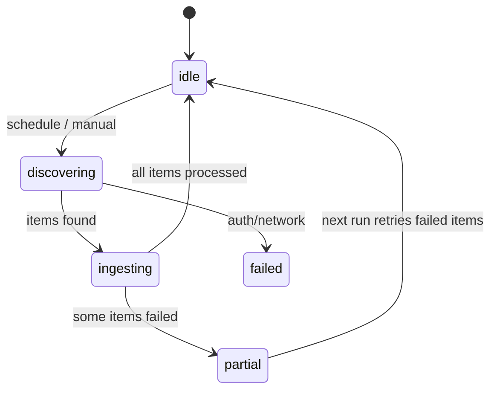

# Knowledge Source Connectors

**Doc ID:** 40 · **Status:** Approved · **Area:** Knowledge
**Depends on:** [36](36-DOCUMENT-INGESTION-AND-PARSING.md) · **Related:** [20](../03-database-and-identity/20-STORAGE-AND-FILE-LIFECYCLE.md), [63](../11-quality-security-and-operations/63-SECURITY-THREAT-MODEL.md), [41](41-KNOWLEDGE-PERMISSIONS-AND-TENANT-ISOLATION.md)

---

## 1. Purpose

Define the connector framework: interfaces, per-connector behavior, credentials, sync semantics, egress
controls, and the SSRF/abuse defenses that make fetching arbitrary URLs safe.

## 2. Connector interface

```python
class Connector(Protocol):
    type: SourceType                                    # file, url, sitemap, github, openapi, ...
    async def validate(self, config: dict, ctx: TenantContext) -> ValidationResult: ...
    async def discover(self, config: dict, cursor: str | None) -> DiscoveryPage: ...   # items to ingest
    async def fetch(self, item: DiscoveredItem) -> FetchedDocument: ...                # bytes + metadata
    async def health(self, config: dict) -> ConnectorHealth: ...
```

Each connector: own module, contract tests, deterministic pagination cursor, and a documented rate limit.

## 3. Connector catalogue

| Connector | Discovery | Fetch | Sync | Notes |
|---|---|---|---|---|
| `file` | selected `file_id` | storage download | manual / on upload | 50 MB cap |
| `url` | the URL itself | HTTP GET | manual or daily (ETag) | one document |
| `sitemap` | `sitemap.xml` (incl. index) | each URL | daily/weekly | 200 pages default cap |
| `github` | repo tree via API | raw file contents | on push (webhook) or daily | md/adoc/txt; branch pinned |
| `openapi` | spec URL/file | fetch spec | on change | one doc per operation |
| `notion` (future) | database/pages API | page blocks | incremental by `last_edited_time` | requires OAuth |
| `gdrive` (future) | drive listing | export as PDF/DOCX | delta token | requires OAuth |
| `confluence` (future) | space pages | storage format → HTML | incremental | requires OAuth |

## 4. Configuration examples

```json
// sitemap
{ "url": "https://acme.com/sitemap.xml", "include": ["/docs/*"], "exclude": ["/blog/*"],
  "max_pages": 200, "respect_robots": true, "schedule": "daily" }

// github
{ "repo": "acme/docs", "ref": "main", "paths": ["docs/**/*.md"], "credential_id": "cred_01H…" }

// openapi
{ "url": "https://api.acme.com/openapi.json", "include_tags": ["projects","billing"] }
```

## 5. Egress and SSRF controls (mandatory)

```
1. Parse URL; require https (http only if explicitly enabled).
2. Reject credentials in URL, non-standard ports (allow 443/80 only).
3. Resolve DNS (A/AAAA). Reject if any address is:
   loopback, private (RFC1918), link-local (169.254/fe80), CGNAT (100.64/10),
   multicast, reserved, unspecified, or cloud metadata endpoints.
4. Pin the resolved IP for the connection (prevents DNS rebinding); set Host header from the URL.
5. Follow ≤ 3 redirects; re-run steps 1–4 on each hop.
6. Enforce connect/read/total timeouts and a byte cap (stream, abort over cap).
7. Sniff content type from bytes; reject mismatches with the allowlist.
8. Log the final URL + resolved IP (hashed where required) for audit.
```

Additional controls: egress proxy with an allowlist in production (optional but recommended); no `file://`,
`gopher://`, `ftp://`; no unix sockets; block IPv6-mapped IPv4 forms; deny `.internal`, `.local` hostnames unless
explicitly allowed per org for private deployments.

## 6. Credentials

| Mechanism | Storage |
|---|---|
| API token (GitHub, custom) | `tool_credentials.ciphertext` (AES-GCM, key from env/KMS) |
| OAuth (Notion/Drive/Confluence) | `oauth_connections.ciphertext` + refresh token + expiry |
| Basic auth (rare) | encrypted blob; never logged |
| mTLS | not supported in v1 |

Rules: credentials are scoped to one source/integration; never returned by any endpoint; used only by the
ingestion worker; rotated via a documented flow; revoked credentials mark the source `failed` with a clear
reason.

## 7. Sync semantics



- Discovery produces stable `external_id` per item (URL, repo path, vendor id) so re-syncs map to the same
  document.
- Changed content (hash differs) → new version; unchanged → no-op (no embedding cost).
- Deleted upstream items → document marked `status=deleted` **only** if the connector is authoritative and
  `delete_missing=true` (default false; safer for partial API outages).
- Sync is incremental where the provider supports a cursor/delta; otherwise full listing with hashes.

## 8. Rate limits and backoff

| Provider | Limit handling |
|---|---|
| Generic HTTP | ≤ 2 concurrent per host, 1 req/s default |
| GitHub API | respect 60/h unauthenticated, 5,000/h authenticated; check `X-RateLimit-Remaining` |
| Notion/Drive/Confluence | provider-specific; backoff on 429 with `Retry-After` |
| Own workers | per-org concurrency cap; global egress semaphore |

## 9. Failure handling

| Failure | Behavior |
|---|---|
| 401/403 | source `failed` with `CREDENTIAL_INVALID`; no retry until fixed |
| 404 on item | mark item missing; keep existing document unless authoritative delete |
| 429 | backoff, resume from cursor |
| 5xx | retry with backoff (≤3), then partial |
| Timeout | retry once, then item failed |
| Size cap exceeded | item failed `FILE_TOO_LARGE`, others continue |
| Blocked by SSRF filter | item failed `EGRESS_BLOCKED`, security log |

## 10. Testing

- SSRF corpus: `127.0.0.1`, `[::1]`, `169.254.169.254`, `10.0.0.1`, `192.168.1.1`, `100.64.0.1`, `0.0.0.0`,
  `localhost`, decimal/octal IP encodings, redirect chains to metadata, DNS rebinding simulation.
- Connector contract tests per type: discovery pagination, incremental sync, hash no-op, delete semantics.
- Credential encryption round-trip and non-exposure in API responses.
- Rate-limit/backoff with a fake clock.

## 11. Acceptance criteria

- [ ] All egress goes through one filter; no connector calls `httpx` directly.
- [ ] SSRF corpus is blocked with `EGRESS_BLOCKED`.
- [ ] Re-sync of unchanged content costs zero embeddings.
- [ ] Deleted credentials surface a clear, actionable failure.
- [ ] Every connector has contract tests and documented limits.

## 12. Related documents

[20](../03-database-and-identity/20-STORAGE-AND-FILE-LIFECYCLE.md) · [36](36-DOCUMENT-INGESTION-AND-PARSING.md) ·
[41](41-KNOWLEDGE-PERMISSIONS-AND-TENANT-ISOLATION.md) · [57](../09-sdk-and-integrations/57-MCP-WEBHOOKS-AND-EXTERNAL-INTEGRATIONS.md) ·
[63](../11-quality-security-and-operations/63-SECURITY-THREAT-MODEL.md)
