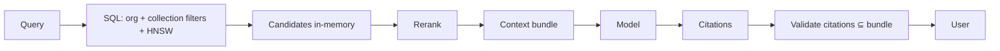

# Knowledge Permissions and Tenant Isolation

**Doc ID:** 41 · **Status:** Approved (normative) · **Area:** Knowledge / Security
**Depends on:** [19](../03-database-and-identity/19-SUPABASE-RLS-AND-DATABASE-SECURITY.md), [38](38-VECTOR-SEARCH-AND-HYBRID-RETRIEVAL.md) · **Related:** [18](../03-database-and-identity/18-TENANCY-RBAC-AND-AUTHORIZATION.md), [63](../11-quality-security-and-operations/63-SECURITY-THREAT-MODEL.md)

---

## 1. Purpose

Define who can retrieve which chunks, how that is enforced, and how leakage is prevented and tested. For a RAG
platform, retrieval is the primary exfiltration surface.

## 2. Two-layer model

| Layer | Enforces | Applies to |
|---|---|---|
| Tenant boundary | `organization_id` | every query, every path |
| Collection ACL | who inside the tenant may see a collection | end users and org members |

A third, optional layer exists for **document-level** restrictions (future): `documents.acl` JSONB, evaluated in
the same SQL. v1 uses collection-level ACL only.

## 3. Collection access scopes

| Scope | Visible to |
|---|---|
| `organization` | all active members of the org; all end users of apps bound to the collection |
| `application` | only sessions of the bound application |
| `restricted` | roles listed in `acl.roles` and/or user ids in `acl.user_ids`; for end users, tags in `acl.end_user_tags` matched against `application_sessions.end_user_meta.tags` |

```json
{ "roles": ["owner","admin","developer"],
  "user_ids": ["user_2x…"],
  "end_user_tags": ["internal","beta"] }
```

Deny wins: if an ACL names a role in both allow and deny lists, deny applies (v1 has no deny list; absence is
denial).

## 4. Resolving allowed collections

```python
async def allowed_collections(ctx) -> list[UUID]:
    # org members: role-based
    rows = await repo.collections_for_org(ctx.organization_id)
    return [c.id for c in rows if c.access_scope == "organization"
            or (c.access_scope == "application" and c.application_id == ctx.application_id)
            or (c.access_scope == "restricted" and ctx.role in c.acl.get("roles", [])
                or ctx.user_id in c.acl.get("user_ids", []))]
```

For SDK sessions, the same function with `ctx.role = "end_user"`, `ctx.application_id`, and
`ctx.end_user_tags`. The resulting list is passed as a bind parameter to the retrieval SQL — it is never
interpolated, and an empty list short-circuits to "no evidence" rather than "no filter".

## 5. Where filtering happens



- Filtering **before** ranking: unauthorized chunks never enter the candidate set.
- No post-filtering of retrieved content as the primary control (it would already have crossed into logs/LLM).
- The model never receives a document id that the actor cannot access.

## 6. RLS interaction

- User-path retrieval via PostgREST is covered by RLS (`chunks_select` with ACL subquery, doc 19 §4.4).
- Worker-path retrieval uses the privileged role and **must** pass `allowed_collections`; the retrieval
  repository asserts it is non-None (raises in dev/test).
- Both paths share the same SQL predicate builder to avoid drift.

## 7. Leakage vectors and controls

| Vector | Control |
|---|---|
| Candidate leakage via score side-channels | unauthorized chunks excluded pre-ranking; result counts are not exposed |
| Citation id guessing | citations must be in the run's evidence set (doc 39 §5) |
| Error messages | `NOT_FOUND`, never "collection exists but forbidden" |
| Aggregations/analytics | counts scoped to allowed collections |
| Eval/debug endpoints | require `knowledge.read` + same ACL resolution |
| Export | `analyst+`, audited, scoped |
| Cache keys | include org + allowed-collection hash (prevents cross-actor cache reuse) |
| Playground search | uses the requester's context, not the app's |
| Embedding cache | keyed by org + model + query hash, never shared across orgs |

## 8. Change propagation

| Change | Effect |
|---|---|
| Collection ACL updated | next request recomputes; cached allowed lists invalidated by version bump |
| Agent's collections changed | snapshotted per session at creation (history unaffected) |
| Document moved between collections | retrieval uses current collection; citations to old chunks remain valid for stored messages |
| Member role changed | recomputed per request |
| End-user tags changed | session metadata updated on refresh; not retroactive to running runs |

## 9. Adversarial tests (required)

| Test | Expected |
|---|---|
| Org A searches a token that exists only in Org B | zero results |
| Org A requests a citation id from Org B | rejected; response validation error |
| `restricted` collection, role not allowed | zero results |
| `application` collection, session of a different app | zero results |
| Empty allowed list | zero results, no SQL without filter |
| Playground with a restricted user | same restriction as production |
| Cached query from an authorized user served to an unauthorized one | cache key mismatch → no reuse |
| Direct DB query as `authenticated` without JWT claims | zero rows |
| Retrieval repository called without `allowed_collections` | assertion error in test |

## 10. Audit and monitoring

- `retrieval_events` records org, collections count, candidate counts, and whether any filter dropped everything.
- Security-relevant events (citation validation failure, empty-allowed-list short circuit, blocked cross-tenant
  probe) write `audit_events` with `action=security.*`.
- Alert on any citation validation failure that references a chunk outside the run's org.

## 11. Failure scenarios

| Scenario | Behavior |
|---|---|
| ACL resolution error | deny (empty list), log; never fall back to "all collections" |
| Stale cache with old ACL | short TTL (60 s) + version-keyed invalidation |
| Collection deleted mid-run | retrieval returns the earlier snapshot; next run excludes it |
| Misconfigured collection scope | default is `restricted`, not `organization` |

## 12. Acceptance criteria

- [ ] No retrieval code path can execute without an org and an allowed-collection list.
- [ ] Cross-tenant and cross-ACL probes return nothing and are audited.
- [ ] Cache keys include tenant + ACL scope.
- [ ] A citation that was not retrieved can never reach a user.
- [ ] Tests cover every row in §9.

## 13. Related documents

[18](../03-database-and-identity/18-TENANCY-RBAC-AND-AUTHORIZATION.md) ·
[19](../03-database-and-identity/19-SUPABASE-RLS-AND-DATABASE-SECURITY.md) · [38](38-VECTOR-SEARCH-AND-HYBRID-RETRIEVAL.md) ·
[39](39-RERANKING-CITATIONS-AND-GROUNDED-ANSWERS.md) · [63](../11-quality-security-and-operations/63-SECURITY-THREAT-MODEL.md)
