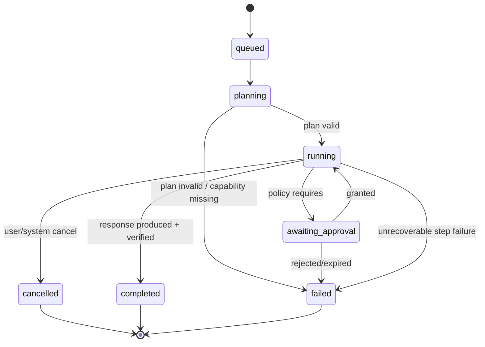

# Agent Runtime and Orchestration

**Doc ID:** 43 · **Status:** Approved (normative) · **Area:** Agents
**Depends on:** [12](../02-system-architecture/12-SERVICE-BOUNDARIES-AND-MODULE-MAP.md), [28](../05-ai-and-model-infrastructure/28-AI-PROVIDER-ABSTRACTION.md) · **Related:** [44](44-SPECIALIZED-AGENT-ARCHITECTURE.md), [47](47-APPROVALS-POLICY-AND-SAFE-EXECUTION.md), [48](48-AGENT-MEMORY-AND-EXECUTION-TRACES.md)

---

## 1. Purpose

Define the runtime that turns a user request into a planned, policy-checked, verified outcome: run model, state
machine, orchestration loop, contracts, persistence, resumption, cancellation, and limits.

## 2. Run model

```text
AgentRun
  id, org, application, session?, agent, agent_version, trigger
  status, intent, plan, current_step_index
  input_context, output, provider, model, fallback_used
  tokens, cost, error_code, timestamps
AgentRunStep
  run, step_index, kind, status, input, output, provider, model, latency, error
```

A run is **the** audit unit: one user request (or one workflow step) → one run → ordered steps → tool
invocations → verification.

## 3. State machine



Transitions are written before the side effect they authorize; a resumed run re-reads the last persisted step.

## 4. Execution loop

```python
async def execute(run_id):
    run = await repo.load_for_update(run_id)
    if run.status in TERMINAL: return
    ctx = await build_context(run)                 # agent_version, prompt, tools, collections, policy

    if not run.intent:
        intent = await classify(ctx)               # text.fast + structured
        await steps.append(run, "intent", intent)  # persist
        if intent.needs_clarification: return await finish_clarifying(run, intent)

    if not run.plan:
        plan = await plan_steps(ctx, intent)       # bounded: <= agent.max_steps
        validate_plan(plan, ctx.allowed_tools)     # unknown tool => fail before any action
        await steps.append(run, "plan", plan)

    for step in run.plan[runs.current_step_index:]:
        if await is_cancelled(run): return await cancel(run)
        result = await dispatch(step, ctx)         # vision | knowledge | guide | tool | verify
        await steps.append(run, step.kind, result)
        if result.requires_approval:
            await pause_for_approval(run, step, result)
            return                                  # resumed by approval webhook
        if result.failed and not step.optional:
            return await fail(run, result.error)

    await finish(run, output=compose_response(run))
```

Invariants:
- Plan validation happens **before** any step executes (unknown tool, unauthorized agent, over-limit steps).
- Each step's output is persisted before the next step starts.
- `finish` writes the assistant message, usage, and terminal status in one transaction.

## 5. Intent taxonomy

| Intent | Routes to | Example |
|---|---|---|
| `knowledge_query` | Knowledge agent | "What's in the Starter plan?" |
| `screen_query` | Vision agent | "What does this chart mean?" |
| `guide_request` | Guide agent | "Show me how to invite someone" |
| `action_request` | Action agent | "Create a project called X" |
| `workflow_request` | Workflow agent | "Create a project and invite Sam" |
| `chitchat` | Direct response (no tools) | "Thanks!" |
| `unsupported` | Refusal with capability explanation | "Book me a flight" |

Classification returns `{intent, confidence, requires_knowledge, rationale}` validated against a schema. Low
confidence (< 0.55) → ask one clarifying question rather than guessing, or default to knowledge when knowledge
is available and the request is a question.

## 6. Plan contract

```json
{
  "steps": [
    { "kind": "knowledge", "query": "Starter plan limits", "collections": ["col_01H…"], "optional": false },
    { "kind": "tool", "tool": "projects_create",
      "args": { "name": "Website Redesign" }, "expected_effect": "project created" },
    { "kind": "verify", "tool": "projects_get", "args": { "name": "Website Redesign" } }
  ],
  "final_response_style": "concise"
}
```

Rules: ≤ `agent_version.max_steps`; tool steps must name a tool bound to the agent version; a `tool` step with
`side_effect != read` must be followed by a `verify` step (enforced by the validator; the runtime inserts one if
the model omits it); no step may reference another tenant's resource.

## 7. Sync vs async execution

| Path | Trigger | Execution |
|---|---|---|
| Fast answer | knowledge/chitchat, no tools | streamed in the API process within the request (budget 20 s) |
| Standard run | any tool, vision, guide, multi-step | worker, streamed via `session_events` |
| Workflow | published workflow | worker + `workflow_runs` |

Both persist the same run/step rows; the trace UI does not care which path executed it.

## 8. Context construction

`build_context` loads (with Redis caching where safe): agent version, active prompt version, bound tools +
schemas, knowledge collections snapshot, policy set, application capture config, session state, visual context
reference. Missing/corrupt config fails the run with a configuration error before any model call.

## 9. Concurrency and limits

| Limit | Default |
|---|---|
| Steps per run | agent `max_steps` (≤ 25) |
| Concurrent runs per session | 1 (queue ≤ 3) |
| Concurrent runs per org | plan-based |
| Wall-clock per run | 120 s (workflows 15 min) |
| Model calls per run | 12 |
| Tool calls per run | 8 |
| Tokens per run | 120k input / 16k output |

Exceeding a limit fails the run with an explicit code (`RUN_TIMEOUT`, `RUN_LIMIT_EXCEEDED`) rather than
truncating silently.

## 10. Resumption

- A worker that dies leaves `run.status=running` and a stale heartbeat → reaper requeues.
- On resume, the loop starts at `current_step_index`; completed steps are not repeated.
- Step execution must be idempotent by `(run_id, step_index)`; a step already `succeeded` is skipped.
- Approvals that were pending are re-checked (still valid, not expired) before continuing.

## 11. Cancellation

Set `cancel_requested_at` + publish control message; the loop checks at step boundaries and before each side
effect; the run ends `cancelled` with partial output preserved and clearly labeled.

## 12. Failure taxonomy

| Code | Cause | User message |
|---|---|---|
| `AGENT_NOT_PUBLISHED` | No active version | "This assistant isn't available yet." |
| `CAPABILITY_UNAVAILABLE` | Required capability missing | "I can't read the screen right now." |
| `PLAN_INVALID` | Model plan unusable twice | "I couldn't work out the steps for that." |
| `RUN_LIMIT_EXCEEDED` | Step/tool/token cap | "That request needs more steps than allowed." |
| `TOOL_DENIED_BY_POLICY` | Policy | "I'm not allowed to do that." |
| `APPROVAL_EXPIRED` | Approval TTL | "That confirmation expired — ask again." |
| `TOOL_VERIFICATION_FAILED` | Effect not confirmed | "I couldn't confirm that it worked." |
| `RUN_TIMEOUT` | Wall clock | "That took too long." |

## 13. Observability

Trace = run span with child spans: `classify`, `plan`, `retrieval`, `vision`, `policy`, `approval`, `tool`,
`verify`, `respond`; each carries provider/model/tokens/latency. Metrics: runs/min, success rate, p50/p95
duration, steps per run, approval rate, verification failure rate, cancel rate, cost per run.

## 14. Acceptance criteria

- [ ] No side effect occurs before plan validation and policy decision are persisted.
- [ ] Killing the worker mid-run resumes without duplicate effects.
- [ ] Cancellation prevents the next side effect 100% of the time in tests.
- [ ] Every terminal state has a user-safe message and a trace.
- [ ] Limits are enforced server-side, not by prompt.

## 15. Related documents

[44](44-SPECIALIZED-AGENT-ARCHITECTURE.md) · [45](45-TOOL-REGISTRY-AND-FUNCTION-CALLING.md) ·
[46](46-WORKFLOW-ENGINE-AND-STATE-MACHINE.md) · [47](47-APPROVALS-POLICY-AND-SAFE-EXECUTION.md) ·
[48](48-AGENT-MEMORY-AND-EXECUTION-TRACES.md) · [26](../04-backend-and-api/26-BACKGROUND-JOBS-AND-WORKERS.md)
