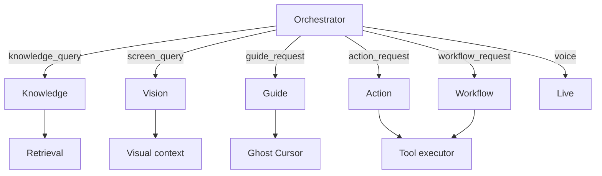

# Specialized Agent Architecture

**Doc ID:** 44 · **Status:** Approved · **Area:** Agents
**Depends on:** [43](43-AGENT-RUNTIME-AND-ORCHESTRATION.md) · **Related:** [45](45-TOOL-REGISTRY-AND-FUNCTION-CALLING.md), [49](../08-visual-and-ghost-cursor/49-VISUAL-CONTEXT-ENGINE.md), [53](../08-visual-and-ghost-cursor/53-VISUAL-GUIDANCE-AND-VERIFICATION.md)

---

## 1. Purpose

Define each specialized agent as a bounded component with explicit inputs, outputs, capabilities, prompts,
failure modes, and limits. "Agent" is a configuration plus a contract, not a personality.

## 2. Common contract

```python
@dataclass
class AgentContext:
    run_id: str; org_id: str; application_id: str
    agent_version: AgentVersion
    prompt: str
    tools: list[ToolSpec]
    collections: list[UUID]
    visual: VisualContext | None
    history: list[Message]
    policy: PolicySummary

class Agent(Protocol):
    name: str
    capabilities: set[Capability]
    async def run(self, ctx: AgentContext, task: TaskSpec) -> AgentResult: ...
```

`AgentResult` = `{output, citations, tool_proposals, guide_plan, usage, flags, error?}`. Agents never execute
tools themselves; they propose, and the runtime/executor acts under policy.

## 3. Orchestrator

| | |
|---|---|
| Role | Classify, plan, dispatch, compose the final response |
| Capabilities | `text.fast` (classify), `text.reasoning` + `structured.json` (plan) |
| Input | User message, session context, visual summary, agent config |
| Output | Plan, final answer, or clarification |
| Limits | 1 classify + 1 plan call, ≤ 2 repair attempts total |
| Failure | `PLAN_INVALID`, `CAPABILITY_UNAVAILABLE` |
| Never | Executes tools; grants permissions; exposes chain-of-thought |

Prompt keys: `orchestrator.classify`, `orchestrator.plan`, `orchestrator.compose`.

## 4. Vision agent

| | |
|---|---|
| Role | Interpret the current screen: layout, key elements, state, anomalies |
| Capabilities | `vision.image`, `structured.json` (+ `text.reasoning` for explanation) |
| Input | Screenshot crop(s), DOM/a11y summary, selected element, route, question |
| Output | `VisionObservation {summary, elements[], state, confidence}` + answer text |
| Limits | ≤ 2 images per call, ≤ 1568 px long edge, 45 s |
| Failure | `CAPABILITY_UNAVAILABLE` if no vision model; never guesses from text |
| Never | Claims an element exists if not in the DOM/a11y tree without labeling it "visual only" |

Resolution rule: DOM/a11y evidence beats pixel inference; disagreement is stated.

## 5. Knowledge agent

| | |
|---|---|
| Role | Retrieve and answer from tenant knowledge with citations |
| Capabilities | `embedding.text` (retrieval), `text.reasoning`, `rerank` (optional) |
| Input | Question, collections, ACL context, optional screen context |
| Output | Answer + citations, or insufficient-evidence response |
| Limits | ≤ 10 evidence chunks, ≤ 2 retrieval hops, 12k evidence tokens |
| Failure | `RETRIEVAL_DEGRADED` (lexical only), `INSUFFICIENT_EVIDENCE` |
| Never | Answers from parametric memory when evidence is missing without labeling it |

## 6. Guide agent

| | |
|---|---|
| Role | Produce a Ghost Cursor plan over real UI targets |
| Capabilities | `text.reasoning` + `structured.json`; visual context optional |
| Input | Task ("invite a teammate"), route, DOM landmark summary, app host targets |
| Output | `GuidePlan {steps: [{target, description, verify}]}` (≤ 8 steps) |
| Target contract | `{targetId?, role?, name?, label?, selector?, text?}` with priority per doc 52 |
| Limits | 8 steps, one target each, no coordinate-only targets unless flagged |
| Failure | `GUIDE_PLAN_INVALID` if < 1 resolvable target |
| Never | Executes actions; promises an action will be performed by the cursor |

## 7. Action agent

| | |
|---|---|
| Role | Map an intent to a validated tool proposal |
| Capabilities | `tools.function_calling`, `text.reasoning`, `structured.json` |
| Input | Intent, allowed tools + schemas, resolved entities, policy summary |
| Output | `ToolCallProposal {tool, args, rationale}` |
| Rules | Args must satisfy schema; entity resolution must be explicit (never invent ids); if the target is ambiguous, ask |
| Limits | 1 proposal per attempt, ≤ 2 attempts, no retries after execution |
| Failure | `TOOL_ARGS_INVALID`, `TOOL_AMBIGUOUS_TARGET` |
| Never | Executes; assumes success; retries a failed side effect |

## 8. Workflow agent

| | |
|---|---|
| Role | Select and parameterize a published workflow, then supervise it |
| Capabilities | `text.reasoning`, `structured.json`, `tools.function_calling` |
| Input | Multi-goal request, available workflows, entity resolution |
| Output | `WorkflowSelection {workflow_id, inputs, order_rationale}` |
| Rules | Cannot invent steps not in the workflow version; step-level policy still applies |
| Failure | `WORKFLOW_NOT_MATCHED`, `WORKFLOW_STEP_FAILED` (runtime reports partial) |

## 9. Live agent

| | |
|---|---|
| Role | Realtime voice conversation with the same tools/knowledge, lower latency |
| Capabilities | `realtime.voice`, `text.fast` |
| Input | Audio stream, session context, visual summary |
| Output | Audio + transcript + optional guide/action proposals |
| Limits | 15 min, 1 active turn, barge-in supported |
| Failure | `CAPABILITY_UNAVAILABLE` → text fallback **offered**, never silent |
| Never | Speaks an action confirmation before execution is verified |

## 10. Composition



One run selects **one primary** agent plus optional supporting steps (e.g. knowledge evidence for an action
rationale). Cross-agent chatter is avoided: the orchestrator sequences steps; agents do not call each other.

## 11. Agent versioning

- Config lives in `agent_versions` (prompt version, model overrides, retrieval config, tool bindings, limits).
- Publishing creates an immutable version; runs reference the version.
- Behavioral changes (prompt, tools, limits) require a new version and an eval run.

## 12. Failure scenarios

| Scenario | Behavior |
|---|---|
| Knowledge agent + empty collections | insufficient evidence, not a hallucination |
| Vision agent + text-only model available | `CAPABILITY_UNAVAILABLE` |
| Action agent + ambiguous entity ("the Acme project" ×3) | ask a disambiguating question |
| Guide agent + target not present | plan rejected or step degrades to `TARGET_MISSING` |
| Workflow agent + step denied by policy | workflow stops, reports which step and why |
| Live agent + provider without realtime | voice disabled with explicit message |

## 13. Acceptance criteria

- [ ] Each agent has a documented input/output contract and limits table.
- [ ] No agent executes tools directly.
- [ ] Vision answers distinguish DOM evidence from pixel inference.
- [ ] Guide plans contain only resolvable target descriptors.
- [ ] Agent config changes create new versions with eval evidence.

## 14. Related documents

[43](43-AGENT-RUNTIME-AND-ORCHESTRATION.md) · [45](45-TOOL-REGISTRY-AND-FUNCTION-CALLING.md) ·
[46](46-WORKFLOW-ENGINE-AND-STATE-MACHINE.md) · [47](47-APPROVALS-POLICY-AND-SAFE-EXECUTION.md) ·
[49](../08-visual-and-ghost-cursor/49-VISUAL-CONTEXT-ENGINE.md) ·
[51](../08-visual-and-ghost-cursor/51-GHOST-CURSOR-ENGINE.md)
