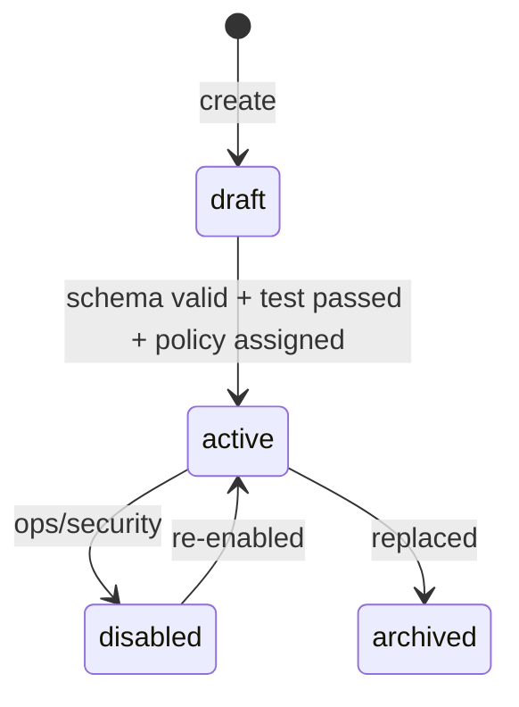
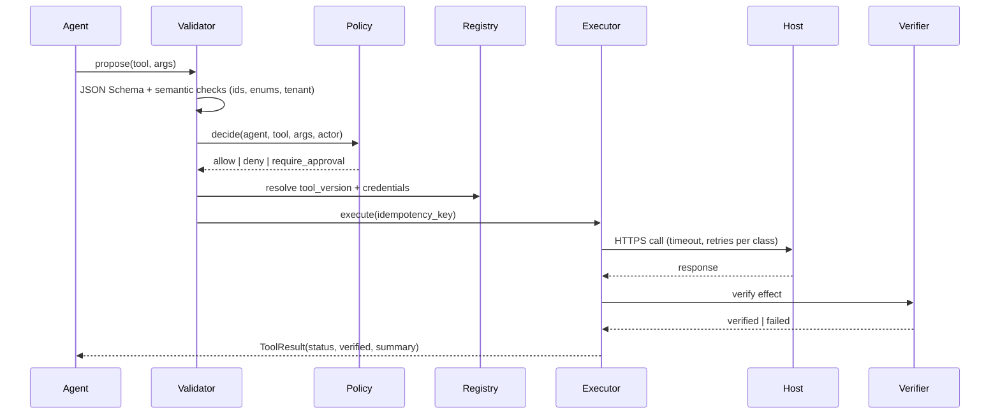

# Tool Registry and Function Calling

**Doc ID:** 45 · **Status:** Approved (normative) · **Area:** Agents
**Depends on:** [44](44-SPECIALIZED-AGENT-ARCHITECTURE.md) · **Related:** [47](47-APPROVALS-POLICY-AND-SAFE-EXECUTION.md), [57](../09-sdk-and-integrations/57-MCP-WEBHOOKS-AND-EXTERNAL-INTEGRATIONS.md), [27](../04-backend-and-api/27-ERROR-HANDLING-AND-RESILIENCE.md)

---

## 1. Purpose

Define how host capabilities become callable tools: registration, schema contract, execution, idempotency,
verification, error mapping, and testing. A tool is a typed, authorized, auditable API call — not a model's
whim.

## 2. Tool anatomy

```json
{
  "name": "projects_create",
  "display_name": "Create project",
  "description": "Creates a project in the customer's workspace. Requires a unique name.",
  "source": "http",
  "side_effect": "write",
  "args_schema": {
    "type": "object",
    "additionalProperties": false,
    "required": ["name"],
    "properties": {
      "name": { "type": "string", "minLength": 1, "maxLength": 120 },
      "description": { "type": "string", "maxLength": 1000 },
      "owner_email": { "type": "string", "format": "email" }
    }
  },
  "http": {
    "method": "POST",
    "url_template": "https://api.acme.com/v1/projects",
    "headers": { "Authorization": "Bearer {{credential}}", "Content-Type": "application/json" },
    "body_template": { "name": "{{name}}", "description": "{{description}}" },
    "timeout_ms": 15000
  },
  "verification": {
    "type": "read_back",
    "method": "GET",
    "url_template": "https://api.acme.com/v1/projects?name={{name}}",
    "expect": { "jsonpath": "$.data[0].name", "equals": "{{name}}" }
  },
  "idempotency": { "mode": "header", "key": "Idempotency-Key" }
}
```

Rules: `additionalProperties: false`; every property has a type and constraints; descriptions are written for
the model (what it does, when to use it, what it returns); no free-form `object` args.

## 3. Side-effect classes

| Class | Meaning | Retry | Approval default |
|---|---|---|---|
| `read` | No state change | yes | no |
| `write` | Mutates tenant data | only with idempotency proof | per policy |
| `external` | Sends email/Slack/webhook, charges, deletes | never | required |

Deletion tools must be `external` (or `write` with a mandatory approval policy) and name their blast radius in
the description.

## 4. Sources

| Source | Execution |
|---|---|
| `http` | Direct call from the executor with tenant credentials |
| `mcp` | MCP client call; tool schema imported from the server (doc 57) |
| `builtin` | Platform tools (e.g. `knowledge_search`, `guide_flow`) — not for host mutation |

Credentials are referenced, never inlined: `tool_credentials` / `oauth_connections` are decrypted at execution
time and injected into the declared header/query/body fields only.

## 5. Registration lifecycle



Publishing requires:
1. Valid JSON Schema (meta-schema validation).
2. A successful dry-run (see §8) against a test endpoint or a recorded fixture.
3. At least one policy row referencing it (explicit `allow` or `require_approval`), otherwise it is unusable
   (deny by default).
4. For `write`/`external`: a verification definition.

## 6. Execution pipeline



Semantic checks beyond the schema: referenced resource ids must belong to the tenant; enums must be from the
allowed set; free-text fields are length-capped; URLs must pass the egress allowlist.

## 7. Idempotency

- Key = `sha256(run_id | step_id | tool_id | normalized_args)`, sent as the configured header/query field.
- The executor also stores `(tool_version_id, idempotency_key)` uniquely; a duplicate invocation returns the
  stored result without a second HTTP call.
- If the host does not support idempotency, the executor refuses automatic retries for that tool
  (`idempotency.mode = "unsupported"`), and policy must require approval for retries.

## 8. Dry run / test endpoint

`POST /v1/tools/{id}/test` executes with `dry_run=true`:

- Validates schema and policy without side effects where the host supports a sandbox/test mode.
- For HTTP tools, performs a `HEAD`/`OPTIONS` reachability check and reports latency/TLS status.
- Never sends production mutations; if the host has no sandbox, the endpoint validates only and says so.

## 9. Verification

| Type | Meaning |
|---|---|
| `read_back` | GET a resource and compare fields |
| `webhook_ack` | wait for a signed event with correlation id (≤ 5 s, optional) |
| `custom` | host-provided endpoint returning `{verified: bool}` |

Verification is **independent of the model**: the executor performs it and records the evidence. A tool whose
response says "created" but whose read-back fails is `TOOL_VERIFICATION_FAILED`.

## 10. Error mapping

| Condition | Code | Retry |
|---|---|---|
| Schema violation | `TOOL_ARGS_INVALID` 422 | no |
| Policy deny | `TOOL_DENIED_BY_POLICY` 403 | no |
| Approval missing/expired | `APPROVAL_REQUIRED` / `APPROVAL_EXPIRED` 409 | no |
| Host 4xx | `TOOL_UPSTREAM_ERROR` 502 (with host status in logs) | no |
| Host 5xx | `TOOL_UPSTREAM_ERROR` | only if idempotent |
| Timeout | `TOOL_UPSTREAM_TIMEOUT` 504 | only if idempotent |
| Verification failed | `TOOL_VERIFICATION_FAILED` 502 | no |
| Credential missing/expired | `TOOL_CREDENTIAL_INVALID` 500 | no |

## 11. Limits

| Limit | Value |
|---|---|
| Args size | ≤ 16 KB |
| Response size | ≤ 256 KB (truncate with flag) |
| Timeout | 15 s default, max 120 s |
| Calls per run | 8 |
| Concurrent calls per tool | 4 |
| Response logging | redacted; never full bodies at INFO |

## 12. Security

- Tools can only call allowlisted hosts (per application); the executor is the only egress path for tools.
- Credentials are decrypted in memory, never logged, never returned.
- Tool output is untrusted: labeled and fenced when fed to a model (doc 32 §7).
- A tool cannot be invoked by a model without a policy row and (for side effects) an approval where configured.
- SSRF rules from doc 40 apply to tool URLs too.

## 13. Testing

| Test | Assertion |
|---|---|
| Schema validation | invalid args rejected before any call |
| Idempotency | duplicate key → one HTTP call |
| Policy deny | no HTTP call |
| Approval required | no call until granted; rejected → no call |
| Verification | failed read-back → run fails |
| Timeout/5xx | no retry for `external`; retry only if idempotent |
| Credential rotation | new credential used on next call |
| SSRF | private IP URL rejected |
| Dry run | no mutation observed by the fake host |

## 14. Acceptance criteria

- [ ] Every tool has a strict schema, a side-effect class, and a policy row.
- [ ] No tool executes before validation + policy + (if required) approval.
- [ ] Duplicate invocations never duplicate effects.
- [ ] Verification is executed and recorded for every side effect.
- [ ] Tool output never becomes instructions.

## 15. Related documents

[44](44-SPECIALIZED-AGENT-ARCHITECTURE.md) · [47](47-APPROVALS-POLICY-AND-SAFE-EXECUTION.md) ·
[57](../09-sdk-and-integrations/57-MCP-WEBHOOKS-AND-EXTERNAL-INTEGRATIONS.md) ·
[27](../04-backend-and-api/27-ERROR-HANDLING-AND-RESILIENCE.md) ·
[63](../11-quality-security-and-operations/63-SECURITY-THREAT-MODEL.md)

## 16. References

- JSON Schema 2020-12 — https://json-schema.org/draft/2020-12/schema
- Function calling — https://ai.google.dev/gemini-api/docs/function-calling
- Idempotency-Key header convention — https://datatracker.ietf.org/doc/draft-ietf-httpapi-idempotency-key-header/
