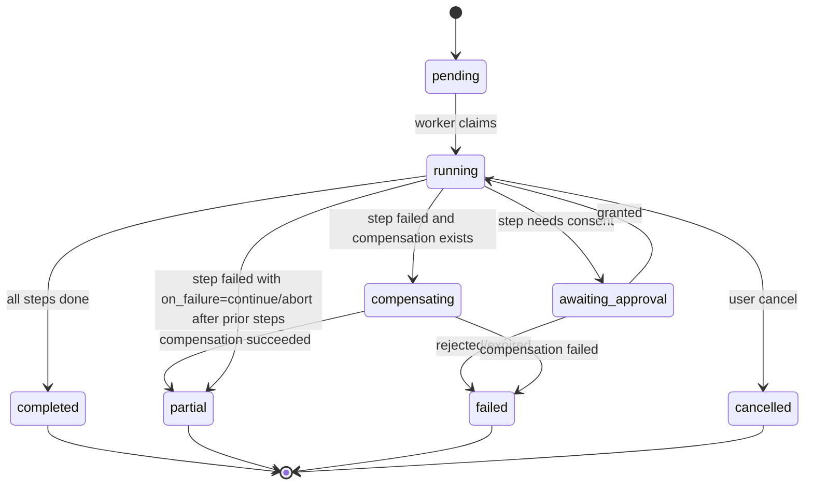

# Workflow Engine and State Machine

**Doc ID:** 46 · **Status:** Approved · **Area:** Agents
**Depends on:** [45](45-TOOL-REGISTRY-AND-FUNCTION-CALLING.md) · **Related:** [43](43-AGENT-RUNTIME-AND-ORCHESTRATION.md), [47](47-APPROVALS-POLICY-AND-SAFE-EXECUTION.md), [26](../04-backend-and-api/26-BACKGROUND-JOBS-AND-WORKERS.md)

---

## 1. Purpose

Define multi-step execution: workflow definitions, step semantics, state persistence, approvals, partial
failure, compensation, and resumption. Workflows exist so that "create a project and invite Sam" is auditable,
not a long prompt.

## 2. Definition model

```json
{
  "key": "create_project_and_invite",
  "name": "Create project and invite teammate",
  "version": 3,
  "inputs": {
    "project_name": { "type": "string", "required": true, "maxLength": 120 },
    "teammate_email": { "type": "string", "required": true, "format": "email" }
  },
  "steps": [
    { "key": "create_project", "kind": "tool", "tool": "projects_create",
      "args": { "name": "{{inputs.project_name}}" },
      "on_failure": "abort",
      "compensation": { "tool": "projects_delete", "args": { "id": "{{steps.create_project.output.id}}" } } },
    { "key": "invite", "kind": "tool", "tool": "team_invite",
      "args": { "email": "{{inputs.teammate_email}}", "project_id": "{{steps.create_project.output.id}}" },
      "on_failure": "abort" },
    { "key": "verify_membership", "kind": "tool", "tool": "team_get_member",
      "args": { "email": "{{inputs.teammate_email}}" }, "on_failure": "continue" }
  ],
  "final_response": "Created {{steps.create_project.output.name}} and invited {{inputs.teammate_email}}."
}
```

Templates are a restricted expression language: `inputs.*`, `steps.<key>.output.*`, literals, equality checks.
No function calls, no eval, no environment access.

## 3. Step kinds

| Kind | Behavior |
|---|---|
| `tool` | Policy → approval → execute → verify (side effects) |
| `agent` | Invoke a specialized agent for a sub-task (e.g. knowledge lookup) |
| `guide` | Emit a guide plan and wait for completion events (bounded) |
| `approval` | Explicit human gate (even if the tool policy would allow) |
| `delay` | Wait until a timestamp or duration (bounded, ≤ 24 h) |

## 4. State machine



`partial` is a first-class outcome: earlier steps are committed and reported, never silently rolled back unless
compensation is declared and successful.

## 5. Execution

```python
async def run_workflow(wf_run_id):
    wf = load(wf_run_id)                      # workflow_version, inputs, current_step_index
    while wf.current_step_index < len(steps):
        step = steps[wf.current_step_index]
        if cancelled(wf): return finish(wf, "cancelled")
        outcome = await execute_step(step, wf.context)
        persist_step(wf, step, outcome)       # before advancing
        if outcome.requires_approval:
            return pause(wf, step)            # resumed by approval decision
        if outcome.failed:
            return await handle_failure(wf, step, outcome)
        wf.context.steps[step.key] = outcome
        wf.current_step_index += 1
    return finish(wf, "completed")
```

Each `workflow_runs` row stores `context` (inputs + step outputs) so a resumed worker needs no in-memory state.
Step outputs are size-capped (16 KB) and stored by key.

## 6. Failure handling

| `on_failure` | Behavior |
|---|---|
| `abort` (default) | stop; status `failed` or `partial` if prior steps committed; optionally compensate |
| `continue` | record the failure, continue; final status `partial` if any step failed |
| `compensate` | run declared compensation for the failed step, then for prior steps in reverse order, then `partial`/`failed` |

Compensation rules:
- Only declared, side-effecting steps can be compensated.
- Compensation itself is policy-checked and idempotent.
- If compensation fails, status `failed` with `compensation_failed` and an incident flag; never claim clean state.

## 7. Approvals inside workflows

- Approval is per step, bound to frozen args, with its own TTL.
- A workflow can require `approval` even when the tool policy is `allow` (defense in depth).
- Approving step 2 does not imply step 3; each is explicit unless a policy declares a batch scope (v1: no
  batching).
- If an approval expires, the workflow pauses at `failed: APPROVAL_EXPIRED` and can be resumed by re-running
  the step (new approval).

## 8. Concurrency and ordering

- Steps execute strictly in order; parallel steps are not supported in v1 (they complicate compensation).
- One active workflow run per session; a second request is queued.
- Long delays are implemented as `run_after` on the job, not a sleeping worker.

## 9. Limits

| Limit | Value |
|---|---|
| Steps per workflow | 12 |
| Workflow wall clock | 15 min (excludes `delay`) |
| Inputs size | 8 KB |
| Context size | 64 KB |
| Concurrent runs per org | plan-based |

## 10. Failure scenarios

| Scenario | Result |
|---|---|
| Step 2 fails after step 1 committed | `partial`, step 1 reported, compensation offered if declared |
| Worker crash at step 3 | resume at step 3; steps 1–2 not repeated |
| Approval rejected at step 2 | `failed` with `approval_rejected`; step 1 remains |
| Tool verification fails | treated as step failure; no claim of success |
| Policy denies step 3 | `failed` with the policy reason; prior steps remain |
| Cancel during compensation | compensation continues (never leave a half-undo), then `cancelled` |
| Input missing at run start | `VALIDATION_ERROR` before any step |

## 11. Observability

- One span per workflow run and per step; child spans link to tool invocations and approvals.
- Metrics: runs by status, step failure rate by tool, compensation rate, approval latency, partial rate.
- Studio shows a per-step timeline with args, results, verification, and policy decisions.

## 12. Testing

- Happy path: 3 steps, all verified, `completed`.
- Failure at step 2 with `abort` → `partial`, step 1 persisted.
- Failure with `compensate` → compensation called once per committed step, reverse order.
- Resume after kill between steps → no duplicate tool call.
- Approval expiry mid-workflow → `failed`, resumable.
- Template injection attempt in inputs (`{{steps.x.output}}`) → treated as a literal string, not evaluated.

## 13. Acceptance criteria

- [ ] Every step is policy-checked independently.
- [ ] State survives worker restarts.
- [ ] Partial completion is reported explicitly, never as success.
- [ ] Compensation is idempotent and auditable.
- [ ] Templates cannot execute arbitrary expressions.

## 14. Related documents

[43](43-AGENT-RUNTIME-AND-ORCHESTRATION.md) · [45](45-TOOL-REGISTRY-AND-FUNCTION-CALLING.md) ·
[47](47-APPROVALS-POLICY-AND-SAFE-EXECUTION.md) · [48](48-AGENT-MEMORY-AND-EXECUTION-TRACES.md) ·
[26](../04-backend-and-api/26-BACKGROUND-JOBS-AND-WORKERS.md)
