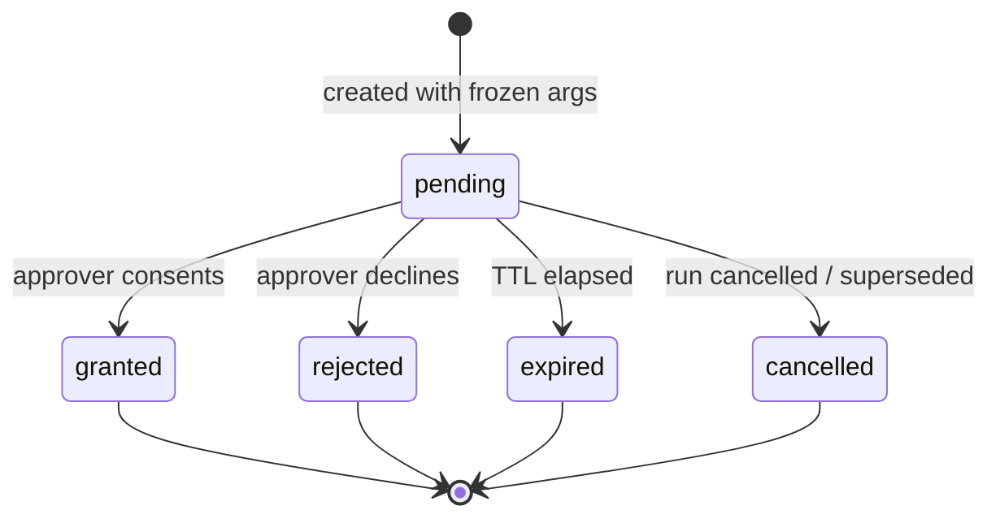

# Approvals, Policy, and Safe Execution

**Doc ID:** 47 · **Status:** Approved (normative) · **Area:** Agents / Security
**Depends on:** [45](45-TOOL-REGISTRY-AND-FUNCTION-CALLING.md) · **Related:** [18](../03-database-and-identity/18-TENANCY-RBAC-AND-AUTHORIZATION.md), [63](../11-quality-security-and-operations/63-SECURITY-THREAT-MODEL.md), [46](46-WORKFLOW-ENGINE-AND-STATE-MACHINE.md)

---

## 1. Purpose

Define who may do what, when a human must consent, how consent is bound to an action, and how the platform
guarantees that no unapproved side effect occurs. The model proposes; the policy engine decides; the executor
acts; the verifier confirms.

## 2. Decision inputs

```
decide(agent_version, tool_version, args, actor, organization_policy, context) -> Decision
```

| Input | Source |
|---|---|
| Agent | `agent_versions` (kind, max_steps, tool bindings) |
| Tool | `tool_versions` (side_effect, schema) |
| Args | validated JSON |
| Actor | end user (session) or org member (role) |
| Org policy | `agent_policies` rows, ordered by priority |
| Context | environment (test/live), resource state, recent failures |

## 3. Policy model

```json
{
  "agent_id": "agt_01H…",
  "tool_id": "tol_01H…",
  "effect": "require_approval",
  "conditions": {
    "max_amount": 500,
    "allowed_roles": ["owner","admin"],
    "arg_must_match": { "environment": "test" },
    "rate": { "max_per_hour": 10 }
  },
  "priority": 100
}
```

Evaluation order: highest `priority` first; first match wins; **no match ⇒ deny** (`default_deny`).
`tool_id = null` applies to all tools for the agent. Conflicting rows are a configuration error surfaced in
Studio (`POLICY_CONFLICT`).

## 4. Decision values

| Decision | Meaning | Next |
|---|---|---|
| `allow` | Execute now | Executor |
| `require_approval` | Needs human consent | Approval service → executor |
| `deny` | Never | Run records `policy_denied`; user told why (safe reason) |

The decision, matched policy id, and reason code are persisted in `policy_decisions` **before** any execution.

## 5. Approval lifecycle



| Property | Rule |
|---|---|
| Frozen args | `args_snapshot` captured at request time; the executor uses that snapshot, not a re-serialization |
| TTL | 10 min default (1–60 configurable) |
| Approver | end user of the same session, or an org member whose role satisfies the policy |
| Binding | approval id ↔ run/step/invocation; a different invocation requires a new approval |
| Change detection | any arg change after approval invalidates it (`APPROVAL_STALE`) |
| Single use | consumed exactly once |

## 6. What always requires approval (regardless of policy)

- Deletion or archival of tenant data.
- Sending external communications (email, Slack message, webhook to a customer).
- Payments, refunds, subscription changes.
- Permission/role changes.
- Data export outside the tenant.
- Any tool marked `side_effect = "external"`.

Policy may require approval for more; it can never waive these.

## 7. Execution guard sequence

```python
assert args_valid(args)
decision = policy.decide(...); persist(decision)
if decision == "deny": raise ToolDeniedByPolicy
if decision == "require_approval":
    approval = approvals.request(run, step, tool, args, ttl)
    await notify_user(approval)
    return Paused
    # resume:
    if not approvals.is_granted(approval, args): raise ApprovalStale/Expired
if breaker.is_open(tool): raise ToolUnavailable
result = executor.execute(tool, args, idempotency_key)
verification = verifier.verify(tool, args, result)
if not verification.ok: raise ToolVerificationFailed
```

No code path bypasses this sequence; the executor is not exposed to agents directly.

## 8. Safety invariants

1. **No side effect without a persisted policy decision.**
2. **No side effect without a consumed approval when required.**
3. **No retry after the request reached the host** (idempotency key or refuse).
4. **No success claim without verification.**
5. **No cross-tenant resource id** in args (validated against resolved context).
6. **No model-authored permission**: policy is evaluated server-side from stored config.
7. **No hidden execution**: every invocation is visible in the trace and audit.

## 9. Consent UX contract

The approval shown to a user must contain: tool display name, human summary, exact key fields (name, amount,
recipient, record), side-effect class, and what will be verified. It must not contain raw JSON, internal ids, or
model rationale text that could be manipulated. Declining is always available and never retried automatically.

## 10. Rate limits and abuse

| Control | Value |
|---|---|
| Approvals per run | 8 |
| Approval requests per session/hour | 30 |
| Repeated denials | after 3, the agent offers guidance instead of proposing again |
| Tool calls per org/hour | plan-based; exceeding → `RATE_LIMITED` |
| Destructive tools per hour | stricter per-app cap |

## 11. Audit

Every decision, approval, execution, and verification writes:

```
audit_events(action='tool.invocation.succeeded'|'policy.denied'|'approval.granted'|...,
 actor_type, actor_id, resource_type='tool_invocation', resource_id, before/after summary, request_id)
```

Retention: 1 year minimum; exportable.

## 12. Failure scenarios

| Scenario | Result |
|---|---|
| Approval granted, args changed | `APPROVAL_STALE`, no execution |
| Approval granted, run cancelled | approval cancelled, no execution |
| Policy config changed between proposal and execution | re-evaluate at execution time; new decision wins |
| Approver loses role mid-flight | decision re-checked; deny |
| Host returns success but verification fails | run `failed_verification`; user told it is unconfirmed |
| Two identical requests concurrently | idempotency key collapses to one execution |
| Model proposes an unbound tool | plan validation rejects before policy |

## 13. Testing

- Policy matrix: allow/deny/require across roles, amounts, environments.
- Default deny with no policy row.
- Approval TTL, rejection, stale args, double-consume.
- Invariant tests 1–7 with fault injection (skip policy, skip approval, retry after host success).
- Audit completeness: every execution has a decision and (if required) an approval.

## 14. Acceptance criteria

- [ ] Default deny is observable in a test with zero policies.
- [ ] Approval binds to frozen args and cannot be reused.
- [ ] Destructive/external actions always require consent.
- [ ] Verification is mandatory for side effects.
- [ ] Audit records reconstruct any action end-to-end.

## 15. Related documents

[45](45-TOOL-REGISTRY-AND-FUNCTION-CALLING.md) · [46](46-WORKFLOW-ENGINE-AND-STATE-MACHINE.md) ·
[43](43-AGENT-RUNTIME-AND-ORCHESTRATION.md) · [18](../03-database-and-identity/18-TENANCY-RBAC-AND-AUTHORIZATION.md) ·
[63](../11-quality-security-and-operations/63-SECURITY-THREAT-MODEL.md)
