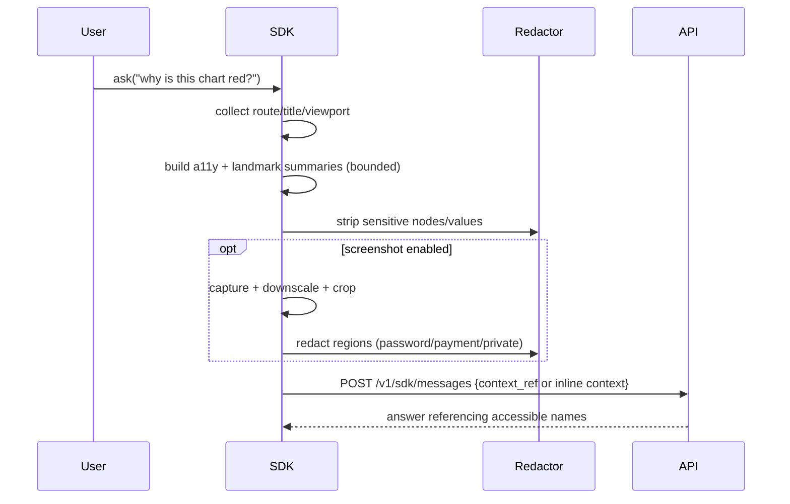

# Visual Context Engine

**Doc ID:** 49 · **Status:** Approved · **Area:** Visual
**Depends on:** [54](../09-sdk-and-integrations/54-JAVASCRIPT-AND-REACT-SDK.md) · **Related:** [50](50-DOM-AND-ACCESSIBILITY-INSPECTION.md), [32](../05-ai-and-model-infrastructure/32-PROMPT-AND-CONTEXT-MANAGEMENT.md), [63](../11-quality-security-and-operations/63-SECURITY-THREAT-MODEL.md)

---

## 1. Purpose

Define what "the current screen" means to VISTRA: which signals are collected, how they are redacted,
normalized, bounded, and transmitted, and what the model receives. This is the difference between contextual
answers and guessing.

## 2. Signal inventory

| Signal | Source | Default | Budget |
|---|---|---|---|
| Route / URL path | `location` | on | 200 chars (query stripped unless allowed) |
| Page title | `document.title` | on | 120 chars |
| Viewport (w,h,dpr, zoom) | `window` | on | — |
| Scroll position | `window`/containers | on | — |
| Accessibility summary | computed tree | on | ≤ 12 KB |
| DOM landmark summary | semantic elements | on | ≤ 8 KB |
| Selected element | user selection | on | ≤ 2 KB |
| Screenshot / crop | canvas capture | **off** | ≤ 300 KB JPEG |
| Host-declared context | `vistra.setContext()` | on | ≤ 2 KB |
| App state hints | host callback | off | ≤ 2 KB |

Total serialized payload cap: **24 KB** (excluding screenshot). Exceeding it triggers deterministic trimming
(doc §7), not silent truncation.

## 3. Collectors

```
VisualContextEngine
  ├─ RouteCollector        location, history changes
  ├─ TitleCollector        document.title + og:title
  ├─ ViewportCollector     size, dpr, scroll
  ├─ A11yCollector         role/name tree (doc 50)
  ├─ LandmarkCollector     header/nav/main/form/dialog/table
  ├─ SelectionCollector    current or last selected element
  ├─ ScreenshotCollector   opt-in capture + crop
  ├─ HostContextCollector  host-provided state
  └─ Redactor              strips sensitive nodes/values
```

Each collector implements `collect(): Promise<Partial<VisualContext>>`, is independently testable, and can be
disabled by config. A failing collector yields `null` plus a warning; it never blocks the request.

## 4. Capture pipeline



Large screenshots are uploaded via `POST /v1/sdk/context` (returns `snapshot_id`), and the message references
the id — keeping the chat request small.

## 5. Redaction (mandatory, client-side)

| Target | Action |
|---|---|
| `input[type=password]` | remove node entirely |
| `input[autocomplete^=cc-]`, card fields | remove node + value |
| `input[type=hidden]` with token-like names | remove |
| `[data-vistra-private]` | remove subtree |
| `[data-vistra-ignore]` | exclude from summaries |
| Elements with `aria-hidden="true"` | excluded from a11y summary |
| Text matching configured patterns (emails, phones, ids) | masked when org enables PII redaction |
| Screenshot regions covering the above | filled with an opaque rectangle |
| URL query params | stripped unless host allowlists them |

**Server-side redaction is not a substitute.** Sensitive values must never leave the browser. The API also
re-runs redaction on receipts as defense in depth.

## 6. Serialization format

```json
{
  "route": "/analytics/churn",
  "title": "Churn analytics — Acme",
  "viewport": { "w": 1440, "h": 900, "dpr": 2, "zoom": 1 },
  "scroll": { "y": 480, "containers": [{ "sel": "[data-panel=chart]", "y": 120 }] },
  "landmarks": [
    { "role": "navigation", "name": "Main", "items": ["Dashboard","Projects","Team"] },
    { "role": "main", "name": "", "children": 12 }
  ],
  "a11y": [
    { "role": "heading", "name": "Churn risk", "level": 1 },
    { "role": "img", "name": "Churn risk by cohort", "bbox": [320,210,760,380] },
    { "role": "button", "name": "Export CSV", "state": { "disabled": false } }
  ],
  "selection": { "role": "img", "name": "Churn risk by cohort", "text": null, "bbox": [320,210,760,380] },
  "host": { "plan": "growth", "currentProject": "Website Redesign" },
  "capture_limited": [],
  "generated_at": "2026-11-14T10:00:00Z"
}
```

Notes: `bbox` is in CSS pixels relative to the viewport; `capture_limited` lists reasons
(`cross_origin_iframe`, `canvas_tainted`, `screenshot_disabled`, `size_truncated`).

## 7. Bounding and trimming

Priority when over budget: 1) selected element, 2) landmarks + headings, 3) interactive elements in the viewport,
4) form labels, 5) static text. Trimming removes lowest-priority nodes whole and records
`size_truncated: true` with counts. Deterministic ordering (document order) so results are reproducible.

## 8. Cross-origin and limitations

| Case | Behavior |
|---|---|
| Same-origin iframe | collected, namespaced by frame path |
| Cross-origin iframe | **not** inspected; `capture_limited: ["cross_origin_iframe"]` |
| Shadow DOM (open) | traversed |
| Shadow DOM (closed) | not accessible; limitation reported |
| Canvas/WebGL | no DOM text; optional screenshot only |
| `<video>` | no content; metadata only |
| Cross-origin images | bbox/alt text only; screenshot may taint canvas → skipped |

The SDK never claims completeness it does not have. The UI may show "some parts of this screen can't be read".

## 9. Screenshot rules

- Opt-in per application (`capture_config.screenshot = true`) and per org plan.
- Rendered via `html-to-image`-style capture or the host's own snapshot API where available; never a
  screen-recording API.
- Downscale to max 1568 px long edge, JPEG quality 0.7; crop to the selected element when available
  (element crop preferred over full page).
- Password/payment/private regions filled before capture when detectable; otherwise the whole screenshot is
  withheld for pages containing such fields (conservative default).
- Stored as `screenshots/{org}/{session}/{snapshot}.jpg` with 7-day retention unless configured otherwise.
- Never used for training.

## 10. Timing and freshness

- Context is collected at send time, not cached across turns (stale context is worse than none).
- A snapshot older than 60 s is not reused for a new message.
- Route changes invalidate the previous snapshot; the engine re-collects.
- The trace records `context_age_ms`.

## 11. Failure scenarios

| Scenario | Behavior |
|---|---|
| Collector throws | that signal is null; `capture_limited` notes it |
| Page too large | trimmed with counts |
| Screenshot blocked (CSP/taint) | text-only context, explicit limitation |
| DOM mutating during collection | read in one pass; note `dom_unstable` if mutations > 50 during capture |
| Sensitive field not recognized | conservative: screenshot withheld if any password/cc field exists |

## 12. Security and privacy

- Capture scope is configured by the customer's developers, shown in Studio, and auditable.
- End-user notice is the host's responsibility; the SDK exposes `vistra.setConsent()` to gate capture.
- No keylogging, no form-value capture, no clipboard reads.
- Context is tenant-scoped and retained per doc 24 §10.
- All context is treated as untrusted input by the model (doc 32 §7).

## 13. Testing

- Fixture pages: form-heavy, chart canvas, nested iframes, shadow DOM, 5k nodes, password fields.
- Redaction: assert absence of password values and `data-vistra-private` text in serialized JSON.
- Budget: payload ≤ 24 KB on all fixtures; trimming deterministic.
- Performance: capture ≤ 50 ms on a 5k-node page.
- Cross-origin: limitation flags set, no frame content.

## 14. Acceptance criteria

- [ ] No sensitive value can appear in a context payload (test-asserted).
- [ ] Every capture states its limitations.
- [ ] Context is bounded and deterministically trimmed.
- [ ] Screenshot capture is off by default and cropped when possible.
- [ ] The model receives accessible names that match the DOM.

## 15. Related documents

[50](50-DOM-AND-ACCESSIBILITY-INSPECTION.md) · [51](51-GHOST-CURSOR-ENGINE.md) ·
[54](../09-sdk-and-integrations/54-JAVASCRIPT-AND-REACT-SDK.md) ·
[32](../05-ai-and-model-infrastructure/32-PROMPT-AND-CONTEXT-MANAGEMENT.md) ·
[63](../11-quality-security-and-operations/63-SECURITY-THREAT-MODEL.md)
