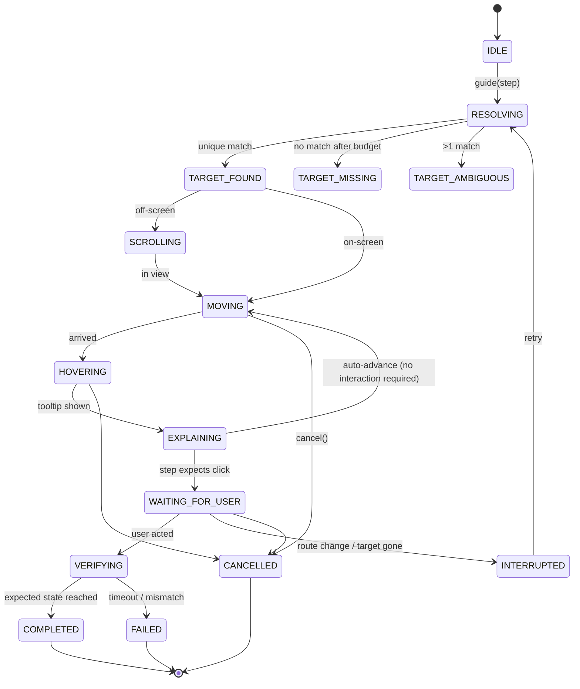

# Ghost Cursor Engine

**Doc ID:** 51 · **Status:** Approved (normative) · **Area:** Visual / DX
**Depends on:** [50](50-DOM-AND-ACCESSIBILITY-INSPECTION.md) · **Related:** [52](52-GHOST-CURSOR-MOTION-AND-TARGET-RESOLUTION.md), [53](53-VISUAL-GUIDANCE-AND-VERIFICATION.md), [55](../09-sdk-and-integrations/55-WIDGET-AND-EMBEDDING-ARCHITECTURE.md)

---

## 1. Purpose

Specify the standalone Ghost Cursor package: visual system, state machine, public API, lifecycle, styling
isolation, accessibility, and the boundary between guidance and execution. It must be a real product component,
not a decorative dot.

## 2. Package layout

```
packages/ghost-cursor/
  src/
    core/
      GhostCursor.ts          # public class/controller
      CursorStateMachine.ts   # transitions + guards
      MotionEngine.ts         # animation loop, cancellation
      AnimationScheduler.ts   # rAF batching, visibility handling
    targeting/
      TargetResolver.ts       # semantic resolution (doc 52)
      ElementVisibility.ts    # visibility/interactability/obscured
      CoordinateMapper.ts     # viewport/frame/scroll transforms
      Stability.ts
    components/
      CursorPointer.ts        # SVG artwork + hotspot
      CursorTrail.ts
      TargetHighlight.ts      # ring/box/spotlight
      ActionTooltip.ts
      GuideOverlay.ts         # root, shadow DOM
      StepIndicator.ts
    motion/
      bezier.ts  easing.ts  trajectories.ts
    accessibility/
      keyboard.ts  reducedMotion.ts  announcements.ts
    types.ts  styles/  index.ts
  tests/
  package.json
```

**Dependency rule:** zero runtime dependencies; no framework; no imports from `sdk-core`, `widget`, or the API.

## 3. Visual design

| Element | Spec |
|---|---|
| Pointer | Custom SVG arrow, 24×28 CSS px at 1×, filled with a subtle gradient + 1 px light outline for contrast on dark/light UIs |
| Hotspot | `(3.5, 2.5)` from the top-left of the SVG viewBox — the exact point that lands on the target center |
| Shadow | Soft drop shadow (0 2px 8px rgba(0,0,0,.28)); no filter on the target |
| Trail | Optional 3-point fading trail (opacity 0.18→0), disabled by default and under reduced motion |
| Highlight | Rounded rect ring (2 px, brand color) + 12% fill, 6 px radius, animated scale 0.96→1 |
| Focus ring | 2 px offset ring for keyboard focus targets |
| Tooltip | Max 280 px wide, 14 px text, arrow anchored to the cursor; flips when near viewport edges |
| Step indicator | `2 / 5` pill anchored top-center of the overlay, dismissible |
| Colors | Tokenized via CSS custom properties (`--vc-accent`, `--vc-panel`, `--vc-text`) with dark-mode defaults via `prefers-color-scheme` |

All rendering happens inside a single `position: fixed; inset: 0; pointer-events: none; z-index: 2147483000`
shadow root. Interactive children (dismiss button) opt into `pointer-events: auto`.

## 4. State machine



Guards: every transition validates target presence and run ownership. `TARGET_MISSING`, `TARGET_AMBIGUOUS`,
`INTERRUPTED`, `FAILED`, `CANCELLED` are terminal or explicitly recoverable — never silently ignored.

## 5. Public API

```ts
const cursor = createGhostCursor({
  container?: HTMLElement,        // default document.body
  accent?: string,                // CSS color
  trail?: boolean,                // default false
  reducedMotion?: "auto" | "always" | "never",
  onEvent?: (e: CursorEvent) => void,
});

await cursor.guide({
  target: { role: "button", name: "Invite member" },
  title: "Invite your team",
  description: "Select this button to invite a teammate.",
  expect: { click: true },        // wait for a click on the target
  timeoutMs: 15000,
});

await cursor.guideFlow({
  steps: [
    { target: { targetId: "settings" }, description: "Open settings." },
    { target: { role: "button", name: "Team" }, description: "Open team management." },
    { target: { role: "button", name: "Invite member" }, description: "Invite a new member." },
  ],
  onStep: (e) => console.log(e.index, e.status),
});

cursor.highlight({ target: { role: "img", name: "Churn risk by cohort" }, durationMs: 4000 });
cursor.cancel();
cursor.destroy();
```

Events: `flow.started`, `step.resolving`, `step.target_found`, `step.moving`, `step.explaining`,
`step.awaiting_user`, `step.verifying`, `step.completed`, `step.failed` (`reason`, `code`), `flow.completed`,
`flow.cancelled`, `cursor.destroyed`.

Errors: `TARGET_MISSING`, `TARGET_AMBIGUOUS`, `TARGET_NOT_INTERACTABLE`, `TARGET_OBSCURED`, `TARGET_STALE`,
`MOTION_CANCELLED`, `STEP_TIMEOUT`, `VERIFICATION_FAILED`, `INVALID_STEP`.

## 6. Lifecycle and cleanup

- `createGhostCursor` mounts one overlay root and starts a single `requestAnimationFrame` loop only while
  animating (idle = no rAF).
- `destroy()` removes the root, disconnects `MutationObserver`/`ResizeObserver`/`IntersectionObserver`, clears
  timers, cancels rAF, and removes document-level listeners.
- Multiple instances are supported but a second `guide()` on the same instance cancels the first
  (`MOTION_CANCELLED`).
- Host page unload/route change (`pushState`/`popstate`) triggers `INTERRUPTED` and re-resolution or abort.

## 7. Styling isolation

- Shadow DOM root with `:host { all: initial; }` and scoped styles; no global selectors.
- No `!important` applied to host elements; the highlight is drawn in the overlay, not by styling the target
  (except an optional class-based fallback that is documented and opt-in).
- Fonts: system stack only; no font loading.
- Z-index is configurable; default is above common modals but below browser UI.
- Print and `visibilitychange` hide the overlay.

## 8. Accessibility

| Requirement | Implementation |
|---|---|
| Reduced motion | `prefers-reduced-motion: reduce` → no travel animation; instant highlight + tooltip; state events unchanged |
| Keyboard | `Esc` cancels; optional `Tab` focuses the target (never steals focus automatically) |
| Screen readers | Overlay is `aria-hidden="true"`; guidance is mirrored into a visually-hidden `aria-live="polite"` region with step text |
| Contrast | Highlight/tooltip meet 4.5:1 against both light and dark targets |
| Motion safety | No flashing; max 1 traversal per step; travel duration ≤ 900 ms |
| Alternative | Every guide flow can be consumed as a text list (`cursor.getStepList()`), used by the widget's accessible fallback |

## 9. Guide Mode vs Do Mode

| | Guide | Do |
|---|---|---|
| Effect | Visual only | Executes a tool through policy/approval |
| API | `cursor.guide`, `guideFlow`, `highlight` | Backend action agent + `vistra.act()` (doc 54) |
| Verification | DOM/route state after user action | Server-side read-back |
| Completion claim | "step completed" | "action verified" |

The cursor package **cannot** execute actions. It has no network access and no tool client.

## 10. Performance

| Constraint | Budget |
|---|---|
| Initial mount | ≤ 8 ms |
| Travel animation | 60 fps, ≤ 8 ms/frame main thread |
| DOM query per step | ≤ 3 ms typical |
| Memory | no retained nodes after `destroy()` |
| Observer overhead | coalesced to ≤ 1 callback per frame |

Transforms are GPU-friendly (`translate3d`); no layout-triggering properties are animated.

## 11. Failure scenarios

| Scenario | Behavior |
|---|---|
| Target missing | `TARGET_MISSING`, text fallback, flow continues or aborts per config |
| Two matches | `TARGET_AMBIGUOUS`, no movement |
| Target behind modal | `TARGET_OBSCURED` |
| Target removed mid-move | re-resolve once; then `TARGET_STALE` |
| User navigates away | `INTERRUPTED`, flow cancelled |
| Tab backgrounded | pause rAF; resume on visibility |
| Host removes the container | graceful destroy with event |

## 12. Testing

- Unit: state machine transitions, resolver integration, coordinate mapping with scroll/zoom.
- Visual: snapshot of pointer, highlight, tooltip at 3 sizes.
- Behavioral (Playwright): guide to a real button, click, assert the flow advances; missing target; ambiguity;
  nested scroll; reduced motion; cancel; destroy removes all nodes.
- Performance: frame budget test in CI with a synthetic page.

## 13. Acceptance criteria

- [ ] The package has no runtime dependencies and no framework coupling.
- [ ] All terminal states are reachable and tested.
- [ ] Motion is cancellable within one frame.
- [ ] Reduced motion still delivers guidance.
- [ ] `destroy()` leaves no observers, listeners, or nodes.

## 14. Related documents

[50](50-DOM-AND-ACCESSIBILITY-INSPECTION.md) · [52](52-GHOST-CURSOR-MOTION-AND-TARGET-RESOLUTION.md) ·
[53](53-VISUAL-GUIDANCE-AND-VERIFICATION.md) · [54](../09-sdk-and-integrations/54-JAVASCRIPT-AND-REACT-SDK.md) ·
[55](../09-sdk-and-integrations/55-WIDGET-AND-EMBEDDING-ARCHITECTURE.md)
