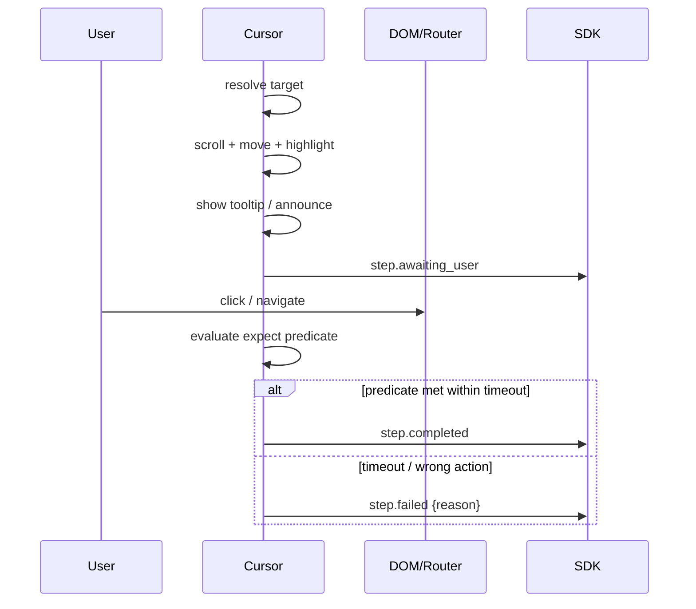

# Visual Guidance and Verification

**Doc ID:** 53 · **Status:** Approved · **Area:** Visual
**Depends on:** [51](51-GHOST-CURSOR-ENGINE.md), [52](52-GHOST-CURSOR-MOTION-AND-TARGET-RESOLUTION.md) · **Related:** [44](../07-agents-and-execution/44-SPECIALIZED-AGENT-ARCHITECTURE.md), [47](../07-agents-and-execution/47-APPROVALS-POLICY-AND-SAFE-EXECUTION.md)

---

## 1. Purpose

Define how a guide plan becomes a completed walkthrough: step semantics, expected-state verification, user
interaction handling, telemetry, and the line between "the user did it" and "the system did it".

## 2. Guide plan contract

```json
{
  "flow_id": "gdf_01H…",
  "title": "Invite a teammate",
  "steps": [
    {
      "index": 0,
      "description": "Open the Team page from the sidebar.",
      "target": { "targetId": "nav-team", "role": "link", "name": "Team" },
      "expect": { "click": true, "route_changes_to": "/settings/team" },
      "timeout_ms": 20000
    },
    {
      "index": 1,
      "description": "Select 'Invite member'.",
      "target": { "role": "button", "name": "Invite member" },
      "expect": { "click": true, "dom_appears": { "role": "dialog", "name": "Invite member" } }
    }
  ],
  "on_failure": "abort"
}
```

`expect` is a declarative predicate evaluated in the browser (click, route change, element appears/disappears,
value change). It is **guidance verification**, not business verification.

## 3. Step lifecycle



## 4. Verification predicates

| Predicate | Evaluation |
|---|---|
| `click` | a click event on the target (or a descendant) occurred after the step started |
| `route_changes_to` | `location.pathname` matches (supports prefix + param patterns) |
| `dom_appears` | role+name element exists within the timeout (MutationObserver) |
| `dom_disappears` | target or specified element removed |
| `value_changes` | form field value differs from the captured value (never transmitted) |
| `custom` | host-provided callback returns boolean (SDK `onVerify`) |

Rules: predicates are evaluated locally; results (boolean + predicate id) are reported to the API. No form
values or page text are sent for verification. A predicate that cannot be evaluated → `VERIFICATION_UNAVAILABLE`
(warn, don't block the flow unless `required: true`).

## 5. Wrong action handling

If the user clicks a different element:

- The flow pauses, emits `step.unexpected_action` with the resolved role/name of what was clicked (not its text
  value), and re-highlights the correct target.
- After 2 wrong actions, the cursor shows the text step list instead of repeated pointing.
- Never auto-navigate on the user's behalf in Guide Mode.

## 6. Failure and recovery

| Failure | Behavior |
|---|---|
| Target missing | `TARGET_MISSING` + text fallback; flow continues if optional, else aborts |
| Timeout waiting for click | `STEP_TIMEOUT`; offer "retry step" |
| Expectation not met after click | `VERIFICATION_FAILED`; re-resolve once, then fail |
| Route changed to an unexpected page | `INTERRUPTED`; re-resolve the step's target on the new page; if absent, abort |
| User cancels | `flow.cancelled`; state recorded |
| Tab hidden | pause timers; resume on visible (timeout clock paused) |

## 7. Guide vs Do, explicitly

| | Guide Mode | Do Mode |
|---|---|---|
| Who acts | The user | The platform, with consent |
| Mechanism | Cursor + highlight | Tool invocation through policy/approval/executor |
| Evidence of success | DOM/route predicate | Server-side read-back (`TOOL_VERIFICATION`) |
| Recorded as | `guide_steps.status` | `tool_invocations.verified` |
| Claim to user | "You completed the step" | "The action was completed and verified" |

A completed guide flow **never** implies a business result (a project was not created). If the user asks the
assistant to "just do it", the runtime switches to Do Mode with an approval, not a faster cursor.

## 8. Telemetry

Per flow: `flow_id`, steps, per-step resolution strategy, stability score, time-to-target, dwell time, click
latency, failures by code, abandonment point, reduced-motion flag. Metrics: completion rate, median step
duration, `TARGET_MISSING` rate by application (a leading indicator of DOM churn), fallback-text usage.

Studio shows the funnel: started → step 1 → … → completed, with the top failure codes. This is how customers
learn their UI changed.

## 9. Guidance quality evaluation

| Metric | Target |
|---|---|
| Step target resolution success (first try) | ≥ 95% with `data-vistra-target`; ≥ 85% without |
| Flow completion | ≥ 85% |
| Wrong-target rate | < 2% |
| Median time-to-target | ≤ 700 ms |
| Fallback-text usage | < 10% of flows |

Evaluated with Playwright fixtures and, opt-in, sampled production flows (no content, only codes).

## 10. Accessibility of guidance

- Every step is announced and available as text (`getStepList()`), shown by default under reduced motion or after
  two failures.
- Focus is not moved automatically; the tooltip is `aria-hidden`; the live region carries the instruction.
- Keyboard users can complete the flow without the cursor; the overlay never intercepts keys except `Esc`.
- Color is never the only indicator (ring + tooltip + text).

## 11. Failure scenarios

| Scenario | Result |
|---|---|
| User is on the wrong page at flow start | flow emits `PRECONDITION_FAILED` with the expected route |
| Target appears after 3 s | resolved within the retry budget, no failure |
| Dialog opens but target is inside it | re-resolution inside the dialog scope |
| Two identical buttons (list rows) | `TARGET_AMBIGUOUS`, ask the user which row (text list) |
| User completes the action manually before the cursor moves | `step.completed` with `completed_early=true` |

## 12. Testing

- Playwright journeys on fixture pages for each predicate type.
- Wrong-action, timeout, interruption, early completion.
- Reduced motion: same completion, no motion.
- Telemetry assertions: events emitted exactly once per step state change.

## 13. Acceptance criteria

- [ ] Every step has an explicit, evaluable `expect` or is marked `informational`.
- [ ] Guide completion is never reported as a business action.
- [ ] Failures produce a usable text fallback.
- [ ] Telemetry distinguishes resolution failure from user abandonment.
- [ ] Accessibility path exists without the cursor.

## 14. Related documents

[51](51-GHOST-CURSOR-ENGINE.md) · [52](52-GHOST-CURSOR-MOTION-AND-TARGET-RESOLUTION.md) ·
[44](../07-agents-and-execution/44-SPECIALIZED-AGENT-ARCHITECTURE.md) ·
[47](../07-agents-and-execution/47-APPROVALS-POLICY-AND-SAFE-EXECUTION.md) ·
[61](../10-applications-and-experience/61-ADMINISTRATION-AND-ANALYTICS.md)
