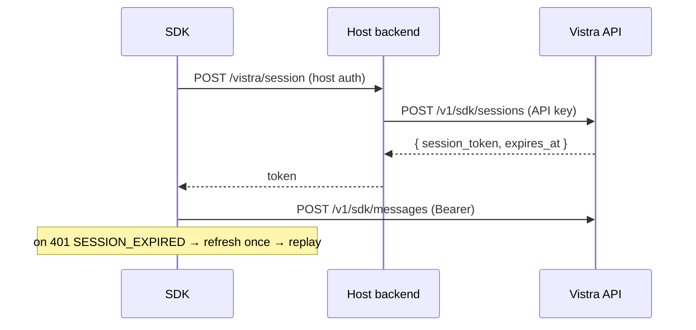

# JavaScript and React SDK

**Doc ID:** 54 · **Status:** Approved (normative) · **Area:** SDK
**Depends on:** [23](../04-backend-and-api/23-API-DESIGN-AND-OPENAPI-CONTRACTS.md), [25](../04-backend-and-api/25-REALTIME-AND-EVENT-ARCHITECTURE.md) · **Related:** [55](55-WIDGET-AND-EMBEDDING-ARCHITECTURE.md), [51](../08-visual-and-ghost-cursor/51-GHOST-CURSOR-ENGINE.md), [58](58-SDK-VERSIONING-AND-PUBLISHING.md)

---

## 1. Purpose

Define the browser SDK contract: initialization, authentication, context collection, messaging, streaming,
guidance, events, errors, teardown, and the React bindings. This is the surface customers actually integrate.

## 2. Packages

| Package | Contents | Deps |
|---|---|---|
| `@vistra/sdk` | `createVistra`, client, context engine, SSE, errors | `@vistra/api-client`, `@vistra/shared-types` |
| `@vistra/react` | `VistraProvider`, hooks | `@vistra/sdk`, react |
| `@vistra/widget` | UI bundle | `@vistra/sdk`, `@vistra/ghost-cursor` |
| `@vistra/ghost-cursor` | Cursor engine | none |

## 3. Initialization

```ts
import { createVistra } from "@vistra/sdk";

const vistra = createVistra({
  appId: "app_01H…",                     // public
  getSessionToken: async () => {         // REQUIRED — host mints via its backend
    const res = await fetch("/api/vistra/session", { method: "POST" });
    const { token } = await res.json();
    return token;
  },
  capture: { dom: true, a11y: true, screenshot: false, selection: true },
  theme: { accent: "#5B5BD6", mode: "auto" },
  locale: "en",
  onEvent: (e) => console.debug(e.type),
  debug: false,
});
```

Rules:
- `appId` is public; **no secret** is ever accepted by the SDK.
- `getSessionToken` must call the customer's backend; the SDK never holds an API key.
- Invalid config rejects immediately with `INVALID_CONFIG` (no network call).
- `createVistra` is synchronous in shape but returns a client whose `ready` promise resolves after config
  validation and widget mount: `await vistra.ready`.

## 4. Public client API

```ts
interface VistraClient {
  readonly ready: Promise<void>;
  ask(input: AskInput): Promise<AskResult>;
  stream(input: AskInput, handlers: StreamHandlers): Promise<AskResult>;
  guide(step: GuideStepInput): Promise<GuideResult>;
  guideFlow(flow: GuideFlowInput): Promise<GuideFlowResult>;
  select(): Promise<ElementDescriptor | null>;      // enters selection mode
  highlight(target: TargetInput, opts?: HighlightOptions): Promise<void>;
  open(): void; close(): void; toggle(): void;
  setContext(ctx: Record<string, unknown>): void;    // host-declared context
  setConsent(granted: boolean): void;               // gates capture
  on<T extends EventType>(type: T, handler: (e: VistraEvent<T>) => void): () => void;
  getSession(): Promise<SessionInfo>;
  destroy(): Promise<void>;
}
```

### Types

```ts
type AskInput = { message: string; context?: HostContext; selection?: boolean };

type StreamHandlers = {
  onDelta?: (text: string) => void;
  onCitation?: (c: Citation) => void;
  onToolProposed?: (t: ToolProposal) => void;
  onApprovalRequired?: (a: ApprovalRequest) => void;
  onStep?: (s: RunStepEvent) => void;
  onDone?: (r: AskResult) => void;
  onError?: (e: VistraError) => void;
};

type AskResult = {
  messageId: string; runId: string;
  text: string; grounded: boolean;
  citations: Citation[];
  usage?: { inputTokens: number; outputTokens: number };
  finishReason: "stop" | "length" | "cancelled" | "error";
};

type Citation = {
  chunkId: string; documentId: string; title: string;
  pageFrom?: number; pageTo?: number; section?: string;
  quote?: string; url?: string;            // signed URL when permitted
};

type VistraError = {
  code: string; message: string; status?: number;
  requestId?: string; retryable: boolean; cause?: unknown;
};
```

## 5. Streaming

- `stream()` opens `POST /v1/sdk/messages` with `Accept: text/event-stream`, parses SSE frames, and invokes
  handlers in order.
- On network drop: reconnect with `Last-Event-ID` (up to 3 attempts, backoff 0.5/1/2 s), then reject with
  `STREAM_INTERRUPTED`.
- `AbortSignal` supported: `stream(input, handlers, { signal })`.
- Deltas are delivered as received; the final `AskResult` is authoritative.

## 6. Guidance API

```ts
await vistra.guide({
  target: { targetId: "invite-member" },       // or { role, name }
  title: "Invite your team",
  description: "Select this button to invite a teammate.",
  waitForUser: true,
  timeoutMs: 20000,
});

await vistra.guideFlow({
  request: "Show me how to invite a teammate",  // server-generated plan
  // or steps: [...]
  onStep: (s) => ui.setStep(s.index, s.status),
});
```

Guidance errors map 1:1 to doc 51 §5 (`TARGET_MISSING`, `TARGET_AMBIGUOUS`, …) and are surfaced, not swallowed.

## 7. Events

| Event | Payload |
|---|---|
| `session.ready` | `{ sessionId }` |
| `session.expired` | `{ reason }` |
| `message.started` / `content.delta` / `message.completed` | message/run ids |
| `citation.added` | `Citation` |
| `tool.proposed` | `{ tool, argsPreview, sideEffect }` |
| `approval.required` | `{ approvalId, summary, expiresAt }` |
| `tool.completed` | `{ tool, verified, resultSummary }` |
| `guide.step` / `guide.completed` | step state |
| `error` | `VistraError` |

`on()` returns an unsubscribe function. Event handler exceptions are caught and logged; they never break the
stream.

## 8. React bindings

```tsx
import { VistraProvider, VistraWidget, useVistra, useGuide } from "@vistra/react";

<VistraProvider appId="app_01H…" getSessionToken={mint} theme={{ accent: "#5B5BD6" }}>
  <App />
  <VistraWidget position="bottom-right" />
</VistraProvider>
```

```tsx
const { ask, streaming, lastError } = useVistra();
const { guideFlow, currentStep, status } = useGuide();

<button onClick={() => ask("How do I export a report?")}>Ask</button>
```

Rules:
- SSR-safe: no `window` access at module scope; the provider renders children unchanged on the server.
- `VistraWidget` is client-only (`dynamic(..., { ssr: false })` internally) and mounts once.
- Hooks throw a clear error outside a provider (`VISTRA_PROVIDER_MISSING`).
- Unmount destroys the client unless `keepAlive` is set.

## 9. Session lifecycle



The SDK never refreshes by itself without the host callback; it calls `getSessionToken` again.

## 10. Cleanup

`destroy()`:
1. aborts in-flight streams,
2. unsubscribes event handlers,
3. destroys the cursor and widget DOM,
4. removes document/visualViewport listeners,
5. clears timers and observers,
6. resolves `ready` rejections for later calls with `CLIENT_DESTROYED`.

Calling any method after destroy rejects with `CLIENT_DESTROYED` (never throws synchronously).

## 11. Error contract

| Code | Meaning | Retryable |
|---|---|---|
| `INVALID_CONFIG` | Missing/invalid appId or callback | no |
| `SESSION_MINT_FAILED` | Host endpoint failed | yes (UI) |
| `SESSION_EXPIRED` | Token expired | yes (auto once) |
| `ORIGIN_NOT_ALLOWED` | Domain not allowlisted | no |
| `NETWORK_ERROR` | Fetch failed | yes |
| `STREAM_INTERRUPTED` | Reconnect exhausted | yes |
| `CAPABILITY_UNAVAILABLE` | Feature not enabled | no |
| `RATE_LIMITED` | 429 | yes after `retryAfterMs` |
| `CLIENT_DESTROYED` | Used after destroy | no |
| `TARGET_*`, `STEP_TIMEOUT`, `VERIFICATION_FAILED` | Guidance | per case |

## 12. Performance and security

- Core bundle ≤ 60 KB gzip; widget+cursor ≤ 110 KB; lazy-load cursor when guidance is first used.
- No `eval`, no `new Function`, no dynamic script injection.
- No third-party analytics or beacons; all network calls go to the configured API origin.
- Tokens held in memory only (never `localStorage`).
- CSP-friendly: no inline `<script>` injection; styles in a shadow root.

## 13. Testing

- Unit: config validation, SSE parser, event emitter, error mapping, teardown.
- Type tests: public surface has no `any`; examples compile.
- Playwright: init → ask → stream → guide → destroy; reconnect; token refresh; 50 mount cycles leak check.
- Bundle budget check in CI.

## 14. Acceptance criteria

- [ ] `createVistra` never sends a request before config validation passes.
- [ ] No secret can be passed through the SDK config.
- [ ] Every method rejects with a typed error after destroy.
- [ ] Streaming reconnect produces no duplicate deltas.
- [ ] React bindings are SSR-safe.

## 15. Related documents

[23](../04-backend-and-api/23-API-DESIGN-AND-OPENAPI-CONTRACTS.md) · [25](../04-backend-and-api/25-REALTIME-AND-EVENT-ARCHITECTURE.md) ·
[51](../08-visual-and-ghost-cursor/51-GHOST-CURSOR-ENGINE.md) · [55](55-WIDGET-AND-EMBEDDING-ARCHITECTURE.md) ·
[58](58-SDK-VERSIONING-AND-PUBLISHING.md)
