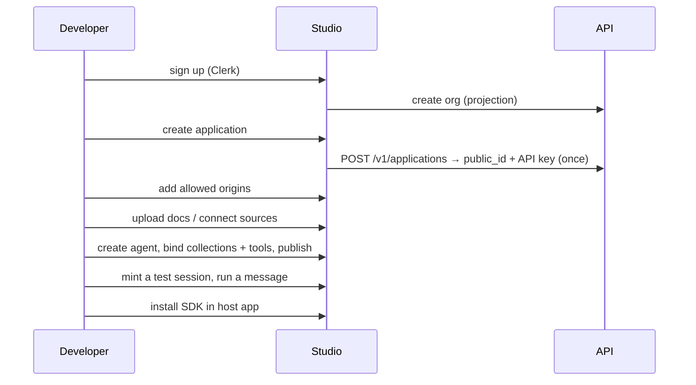

# Public API and Developer Platform

**Doc ID:** 56 · **Status:** Approved · **Area:** DX
**Depends on:** [23](../04-backend-and-api/23-API-DESIGN-AND-OPENAPI-CONTRACTS.md) · **Related:** [54](54-JAVASCRIPT-AND-REACT-SDK.md), [57](57-MCP-WEBHOOKS-AND-EXTERNAL-INTEGRATIONS.md), [59](../10-applications-and-experience/59-VISTRA-STUDIO-ARCHITECTURE.md)

---

## 1. Purpose

Define the developer-facing platform: onboarding, credentials, quotas, SDK/API consumption, documentation,
sandbox vs live, and support expectations. The API is versioned infrastructure; the developer experience is a
product feature.

## 2. Onboarding flow



Target: first successful embedded answer in < 30 minutes. Studio guides each step and shows the exact code
snippet with the developer's `appId`.

## 3. Credentials

| Credential | Where | Scope | Rotation |
|---|---|---|---|
| API key `vst_live_…` / `vst_test_…` | Server env | `sdk:session`, `agents:run`, `knowledge:*`, `tools:invoke` | create-new → overlap → revoke |
| Public app id `app_…` | Browser | none (identifier only) | rotate by creating a new app |
| SDK session token | Browser memory | one session, ≤ 15 min | auto via host endpoint |
| Webhook signing secret | Server | verify inbound deliveries | rotate with dual-secret window (24 h) |

API keys are shown once, stored hashed, and never retrievable. The Studio displays only prefix + last used.

## 4. Required host endpoints

The customer's backend must implement (or call VISTRA server-side for):

| Endpoint | Purpose |
|---|---|
| `POST /vistra/session` | Authenticate its own user, then call `POST /v1/sdk/sessions` with the API key |
| `POST /vistra/tools/*` | The APIs that registered tools call (VISTRA authenticates with the stored credential) |
| `POST /vistra/webhooks` (optional) | Receive VISTRA events with signature verification |

Session minting example (Node):

```ts
app.post("/api/vistra/session", requireUser, async (req, res) => {
  const r = await fetch("https://api.vistra.dev/v1/sdk/sessions", {
    method: "POST",
    headers: { Authorization: `Bearer ${process.env.VISTRA_API_KEY}`, "Content-Type": "application/json" },
    body: JSON.stringify({
      application_id: process.env.VISTRA_APP_ID,
      end_user_ref: req.user.id,
      end_user_meta: { plan: req.user.plan, tags: req.user.tags },
      origin: req.headers.origin,
    }),
  });
  const { session_token, expires_at } = await r.json();
  res.json({ token: session_token, expiresAt: expires_at });
});
```

## 5. Environments

| Mode | Key prefix | Data | Use |
|---|---|---|---|
| Test | `vst_test_…` | Test application data, seeded docs, no production tools | Development, CI |
| Live | `vst_live_…` | Production | Customers |

Test keys cannot read live data or invoke live credentials; a live key cannot mint sessions for a test
application. This is enforced by key mode + application mode.

## 6. Quotas and limits

| Resource | Free | Starter | Growth | Enterprise |
|---|---|---|---|---|
| Apps | 1 | 3 | 10 | custom |
| Messages/mo | 500 | 10k | 100k | custom |
| Knowledge pages | 200 | 5k | 50k | custom |
| Tools | 3 | 20 | 100 | custom |
| Concurrent sessions | 20 | 200 | 2k | custom |
| Storage | 1 GB | 25 GB | 250 GB | custom |

Limits are enforced at request time with clear codes (`PLAN_LIMIT_EXCEEDED`) and surfaced in Studio usage.

## 7. API consumption guidance

- Use the generated client (`@vistra/api-client`) in TypeScript; `httpx`/`requests` elsewhere.
- Server-to-server only for API keys; never ship a key to a browser or mobile binary.
- Retry `GET` on 5xx with jitter; never retry side-effecting calls without an `Idempotency-Key`.
- Respect `Retry-After`; back off on 429.
- Paginate with cursors; never assume page size.
- Store `request_id` from errors for support.

## 8. Documentation surface

| Artifact | Contents |
|---|---|
| Quickstart | 10-minute embed, both script tag and React |
| API reference | Generated from OpenAPI, with examples per operation |
| Guides | Knowledge setup, tools, approvals, guide flows, webhooks, MCP |
| SDK reference | Generated from TSDoc; typed examples |
| Error index | Every `code` with cause and fix |
| Changelog | API + SDK, with breaking-change notices |
| Status page | Availability and incidents |

Docs are versioned with the API (`/v1`). Examples use `app_…` placeholders and never real keys.

## 9. Sandbox tooling

- **Playground** in Studio: send a message as a test end user, inspect retrieval and trace.
- **Tool tester**: dry-run with schema validation and reachability check (doc 45 §8).
- **Guide recorder** (future): click through a flow to generate target descriptors.
- **Eval lab**: run suites against a draft agent version before publishing.

## 10. Support and transparency

- Every response carries `X-Request-Id`.
- Errors include a docs link (`type` URI) resolving to the error index.
- Status page + incident history.
- Breaking changes announced ≥ 90 days ahead with migration guides.

## 11. Failure scenarios

| Scenario | Behavior |
|---|---|
| Developer ships an API key in the browser | Origin checks + scope limits limit damage; secret scanning in docs/SDK; key revocable |
| Key leaked publicly | Rotate with overlap; revoke; audit last-used |
| Wrong environment key | Clear `API_KEY_MODE_MISMATCH` error |
| Origin not allowlisted | 403 with the exact origin to add |
| Quota exhausted | 402 with usage and upgrade path; in-flight requests finish |
| Deprecated field used | `Deprecation` header + warning, not a hard failure until the sunset date |

## 12. Acceptance criteria

- [ ] Key creation returns the secret exactly once and never again.
- [ ] Test/live isolation is enforced server-side and tested.
- [ ] Every error code has a documentation entry.
- [ ] The quickstart works verbatim in a fresh project.
- [ ] Quotas are visible before they are hit (usage API + Studio).

## 13. Related documents

[23](../04-backend-and-api/23-API-DESIGN-AND-OPENAPI-CONTRACTS.md) · [54](54-JAVASCRIPT-AND-REACT-SDK.md) ·
[57](57-MCP-WEBHOOKS-AND-EXTERNAL-INTEGRATIONS.md) · [58](58-SDK-VERSIONING-AND-PUBLISHING.md) ·
[59](../10-applications-and-experience/59-VISTRA-STUDIO-ARCHITECTURE.md) ·
[66](../11-quality-security-and-operations/66-COST-AND-RESOURCE-PLANNING.md)
