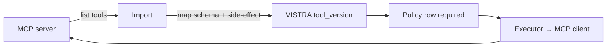

# MCP, Webhooks, and External Integrations

**Doc ID:** 57 · **Status:** Approved · **Area:** Integrations
**Depends on:** [45](../07-agents-and-execution/45-TOOL-REGISTRY-AND-FUNCTION-CALLING.md) · **Related:** [40](../06-knowledge-and-rag/40-KNOWLEDGE-SOURCE-CONNECTORS.md), [27](../04-backend-and-api/27-ERROR-HANDLING-AND-RESILIENCE.md), [18](../03-database-and-identity/18-TENANCY-RBAC-AND-AUTHORIZATION.md)

---

## 1. Purpose

Define how VISTRA connects to the outside world: MCP servers as tool sources, outbound webhooks as an event
feed, OAuth connections, and the security controls for each. External systems never bypass policy.

## 2. MCP integration

### 2.1 Role

MCP supplies **tools** (and optionally resources) that VISTRA agents can call. Imported tools are wrapped in
VISTRA's contract: JSON Schema args, side-effect class, policy mapping, credential binding. A model cannot call
an MCP server directly.



### 2.2 Registration

```json
POST /v1/mcp-servers
{ "name": "acme_crm", "url": "https://mcp.acme.com/mcp", "transport": "streamable_http",
  "auth": { "type": "bearer", "credential_id": "cred_01H…" } }
```

Rules:
- Only Streamable HTTP transport (SSE-only servers are not supported; Gemini's remote-MCP constraint is noted in
  doc 29/31 for parity).
- Names: `^[a-z][a-z0-9_]*$` (no hyphens).
- URL passes the egress filter (SSRF, allowlist).
- `discovered_tools` is refreshed on demand and cached; each import is explicitly enabled.

### 2.3 Tool mapping

| MCP field | VISTRA field |
|---|---|
| `name` | `name` (namespaced `mcp_<server>_<tool>`) |
| `description` | tool description |
| `inputSchema` | `args_schema` (validated; `additionalProperties` forced false) |
| annotations (`readOnlyHint`, `destructiveHint`) | `side_effect` (`read`/`write`/`external`) — a hint, not trusted alone |
| — | `verification` required for write/external |
| — | policy row required (default deny) |

A tool whose schema cannot be validated is not importable. Changes on the server are detected on refresh; a
breaking schema change disables the tool until re-approved.

### 2.4 Execution and timeouts

MCP calls run through the same executor, with a 15 s default timeout (max 120 s), idempotency where supported,
and error mapping to `TOOL_UPSTREAM_*`. MCP server errors are never surfaced raw to users.

## 3. Outbound webhooks

### 3.1 Events

Subscribable: `agent.run.completed`, `agent.run.failed`, `tool.invocation.succeeded`,
`tool.invocation.failed`, `approval.requested`, `approval.granted`, `approval.rejected`,
`knowledge.ingestion.completed`, `knowledge.ingestion.failed`, `guide.flow.completed`,
`session.started`, `session.ended`, `usage.threshold.reached`.

Payload envelope:

```json
{ "id": "evt_01H…", "type": "agent.run.completed", "created_at": "2026-11-14T10:00:00Z",
  "api_version": "v1", "organization_id": "org_…", "application_id": "app_…",
  "data": { "run_id": "run_…", "status": "completed", "session_id": "ses_…" } }
```

No message content, prompts, credentials, or PII in webhook payloads by default; content-bearing events are
opt-in and documented.

### 3.2 Delivery contract

```http
POST /your-endpoint HTTP/1.1
Content-Type: application/json
Vistra-Event-Id: evt_01H…
Vistra-Event-Type: agent.run.completed
Vistra-Timestamp: 1763114400
Vistra-Signature: v1=hex(hmac_sha256(secret, timestamp + "." + body))
User-Agent: Vistra-Webhooks/1.0
```

Verification (documented in every SDK/lang):
1. Reject if `|now - timestamp| > 300 s`.
2. Compute HMAC over `timestamp + "." + raw_body`.
3. Constant-time compare with the `v1=` value; support two active secrets during rotation.
4. Dedupe on `Vistra-Event-Id` for 24 h.

Respond `2xx` within 5 s; do slow work asynchronously.

### 3.3 Retries

| Attempt | Delay |
|---|---|
| 1 | immediate |
| 2 | 30 s |
| 3 | 2 min |
| 4 | 10 min |
| 5 | 1 h |
| 6 | 6 h |
| 7 | 24 h |
| 8 | 24 h → dead |

`4xx` (except 408/429) → permanent failure, no retry. `410 Gone` disables the endpoint. Dead deliveries are
visible in Studio and can be replayed manually.

## 4. OAuth and credentials

| Provider | Flow | Scopes |
|---|---|---|
| GitHub | OAuth app / installation token | repo read |
| Notion | OAuth 2.0 | read content |
| Google Drive | OAuth 2.0 | drive.readonly |
| Confluence | OAuth 2.0 (3LO) | read pages |
| Custom | API key / bearer | per integration |

- Tokens encrypted with AES-GCM (`oauth_connections.ciphertext`), key from env/KMS, versioned.
- Refresh handled by a worker; failures mark the integration `error` with an actionable message.
- Tokens are never returned by the API, never logged, and never included in prompts.
- Revocation via Studio deletes the ciphertext and disables dependent tools/sources.

## 5. Inbound integrations

VISTRA accepts inbound traffic only from:

| Source | Auth | Endpoint |
|---|---|---|
| Clerk | Svix signature | `/v1/internal/webhooks/clerk` |
| GitHub | `X-Hub-Signature-256` | `/v1/internal/webhooks/github` |
| Stripe (post-MVP) | `Stripe-Signature` | `/v1/internal/webhooks/stripe` |
| Customer tool callbacks | per-integration secret | `/v1/internal/tools/callback` |

All are idempotent on event id, verified, rate-limited, and audited. No inbound endpoint performs work
synchronously beyond validation + enqueue.

## 6. Security controls

| Control | Applies to |
|---|---|
| Egress allowlist + SSRF filter | MCP URLs, webhook URLs, OAuth endpoints, tool URLs |
| Credential encryption + rotation | OAuth, API keys, webhook secrets |
| Signature verification | inbound webhooks; outbound signing |
| Replay protection | timestamp + event-id dedupe |
| Rate limits | per endpoint and per org |
| Response caps | 256 KB for MCP/tool responses |
| Prompt safety | all external output is untrusted and fenced (doc 32) |
| Audit | registration, credential change, delivery failure, manual replay |

## 7. Failure scenarios

| Scenario | Behavior |
|---|---|
| MCP server down | tools marked unavailable; agent told tool is unavailable; no retry storm |
| MCP schema changed | tool disabled with `TOOL_SCHEMA_CHANGED` until re-approved |
| Webhook endpoint 500s | retries with backoff; dead after 8; alert |
| Endpoint returns 410 | endpoint disabled automatically |
| OAuth refresh fails | integration `error`; tools/sources blocked with a clear message |
| Signature mismatch (inbound) | 401, no processing, audit |
| Duplicate inbound event | 200, no-op |

## 8. Testing

- MCP: import, schema validation, policy required, execution, timeout, schema-change disable.
- Webhooks: signature vectors, timestamp skew, replay, retry schedule with a fake clock, dead-letter, manual
  replay.
- OAuth: encryption round-trip, refresh failure, revocation.
- SSRF: MCP/webhook URLs against the corpus in doc 40.

## 9. Acceptance criteria

- [ ] No external tool can execute without a VISTRA policy row.
- [ ] Every webhook is signed and every receiver can verify it from the docs.
- [ ] Credentials never appear in API responses, logs, or prompts.
- [ ] Dead deliveries are visible and replayable.
- [ ] MCP schema drift disables rather than silently breaks.

## 10. Related documents

[40](../06-knowledge-and-rag/40-KNOWLEDGE-SOURCE-CONNECTORS.md) · [45](../07-agents-and-execution/45-TOOL-REGISTRY-AND-FUNCTION-CALLING.md) ·
[47](../07-agents-and-execution/47-APPROVALS-POLICY-AND-SAFE-EXECUTION.md) · [27](../04-backend-and-api/27-ERROR-HANDLING-AND-RESILIENCE.md) ·
[63](../11-quality-security-and-operations/63-SECURITY-THREAT-MODEL.md)

## 11. References

- Model Context Protocol — https://modelcontextprotocol.io/
- MCP Streamable HTTP transport — https://modelcontextprotocol.io/specification
- HMAC-based webhook signatures (Svix scheme) — https://docs.svix.com/receiving/verifying-payloads/how
