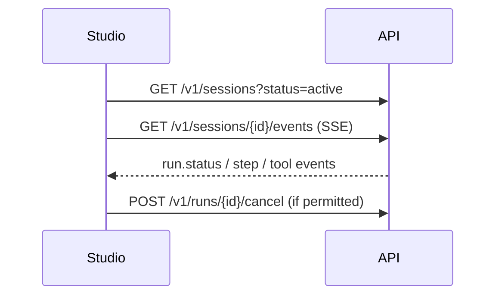

# VISTRA Studio Architecture

**Doc ID:** 59 · **Status:** Approved · **Area:** Experience
**Depends on:** [23](../04-backend-and-api/23-API-DESIGN-AND-OPENAPI-CONTRACTS.md) · **Related:** [48](../07-agents-and-execution/48-AGENT-MEMORY-AND-EXECUTION-TRACES.md), [61](61-ADMINISTRATION-AND-ANALYTICS.md), [55](../09-sdk-and-integrations/55-WIDGET-AND-EMBEDDING-ARCHITECTURE.md)

---

## 1. Purpose

Define Studio as a coherent application, not a set of dashboards: information architecture, routes, data
dependencies, roles, state management, realtime behavior, and the rule that every page is backed by a real
endpoint.

## 2. Scope

The Next.js admin console at `studio.vistra.dev`. It consumes the same `/v1` API as everyone else; it has no
privileged bypass.

## 3. Shell

```
┌──────────────────────────────────────────────────────────┐
│ Org switcher · env badge (Test/Live) · search · help · ⚙ │
├────────────┬─────────────────────────────────────────────┤
│ Applications│  Page header: title, actions, filters       │
│ Agents      │  ┌───────────────────────────────────────┐  │
│ Knowledge   │  │ Content                                │  │
│ Tools       │  └───────────────────────────────────────┘  │
│ Workflows   │                                             │
│ Live        │                                             │
│ Evaluations │                                             │
│ Analytics   │                                             │
│ Cost        │                                             │
│ Security    │                                             │
│ Settings    │                                             │
└────────────┴─────────────────────────────────────────────┘
```

Server components fetch data; client components handle interaction. `X-Organization-Id` is always sent and the
server re-verifies membership.

## 4. Pages

| Route | Purpose | Data dependencies | Roles |
|---|---|---|---|
| `/overview` | Day-1 setup checklist, health, recent runs, usage snapshot | `/v1/me`, `/v1/applications`, `/v1/usage`, `/v1/audit-events?limit=5` | all |
| `/applications` | List/create apps, keys, domains, capture config | `/v1/applications`, `/v1/applications/{id}/keys`, `/domains` | read: all; write: developer+ |
| `/applications/{id}` | App detail: SDK snippet, keys, origins, agent binding | same + `/v1/sdk/config` | developer+ |
| `/agents` | Agents list, versions, publish state | `/v1/applications/{app}/agents` | developer+ |
| `/agents/{id}` | Builder: prompt version, model overrides, collections, tools, limits; test panel | `/v1/agents/{id}`, `/prompts`, `/tools`, `/knowledge-bases` | developer+ |
| `/knowledge` | KBs, collections, sources, ingestion status | `/v1/knowledge-bases`, `/sources`, `/ingestion-jobs` | read: all; write: developer+ |
| `/knowledge/{kb}/search` | Playground with retrieval scores + citations | `/v1/knowledge/search` | developer+ |
| `/tools` | Registry, schemas, credentials, policy, test | `/v1/tools`, `/policies` | developer+ |
| `/workflows` | Definitions, versions, run history | `/v1/workflows` | developer+ |
| `/live` | Active sessions/runs stream, filters, cancel | `/v1/sessions`, `/v1/sessions/{id}/events` (SSE) | analyst+ |
| `/runs/{id}` | Trace: plan, steps, retrieval, policy, approvals, verification | `/v1/runs/{id}`, `/steps` | analyst+ |
| `/evaluations` | Suites, runs, per-case diffs, regressions | `/v1/evaluation-suites` | analyst+ |
| `/analytics` | Deflection, completion, grounded rate, top questions, gaps | `/v1/analytics/*` | all |
| `/cost` | Spend by day/provider/model/capability, budgets | `/v1/usage`, `/v1/usage/export` | analyst+ |
| `/security` | Audit log, capture config, retention, keys, sessions | `/v1/audit-events`, `/v1/applications/{id}` | admin+ |
| `/settings` | Org, members, roles, billing, retention | `/v1/organizations/{id}`, `/members` | admin+ |

Every page has loading skeletons, empty states with a next action, error states with `request_id`, and
permission-denied states that explain the required role (not a blank screen).

## 5. Key screens

### 5.1 Agent builder

- Left: steps (Identity, Instructions, Knowledge, Tools, Policy, Limits).
- Center: editor for the prompt version with variable hints and a token estimate.
- Right: live test panel (uses `/v1/knowledge/search` + a dry-run message endpoint) showing retrieval and the
  would-be plan, without side effects.
- Publishing requires a passed eval suite (or an explicit override with a recorded reason).

### 5.2 Live sessions



- Virtualized list sorted by recency; filter by application, status, intent, grounded.
- Clicking a run opens the trace drawer without losing the stream.
- New runs appear within 2 s (SSE), with a "paused streaming" indicator on disconnect.

### 5.3 Trace viewer

Tabs: Summary · Plan · Retrieval (chunks, scores, filters) · Provider calls (model, tokens, latency, fallback) ·
Policy & approvals · Tool invocations (args redacted, result summary, verification) · Raw events.
No raw prompts unless debug capture is on for the org.

## 6. State management

- Server state via the generated client + TanStack Query keys scoped by `(orgId, appId, resourceId)`.
- Org switch invalidates the whole cache (tenant boundary in the key).
- URL is the source of truth for filters/pagination (shareable links).
- Local UI state (drawer open, tab) is component state, not global.
- Realtime events merge into cached lists; they never replace a fetch's authority on full reload.

## 7. Authorization in the UI

| Role | Sees |
|---|---|
| viewer | overview, apps (read), knowledge (read), analytics |
| analyst | + live, runs, evaluations, cost, audit (read/export) |
| developer | + builder, tools, workflows, keys |
| admin | + members, roles, security, retention |
| owner | + billing, org deletion |

The UI hides actions it knows are forbidden, but the API is the enforcement point. Hidden ≠ secure.

## 8. Performance and UX budgets

| Constraint | Budget |
|---|---|
| TTFB (server component) | ≤ 400 ms p95 |
| Route transition | ≤ 200 ms with prefetch |
| Table render (1k rows virtualized) | ≤ 50 ms |
| SSE event → UI update | ≤ 250 ms |
| Bundle per route (gzip) | ≤ 180 KB |

## 9. Failure scenarios

| Scenario | Behavior |
|---|---|
| API 5xx | page-level error with retry + request id |
| Membership removed | redirect to org selection with a message |
| Org deleted | read-only notice + support link |
| SSE drops | banner "live updates paused", auto-reconnect with backoff |
| Stale role in UI | action fails with 403; UI refreshes permissions |
| Endpoint not implemented yet | the page is absent, not mocked |

## 10. Anti-patterns (explicitly rejected)

- Mock data modules in any route.
- Client-side filtering that hides server-authorized rows (pagination must be server-side).
- Dashboards whose numbers are computed in the browser from sampled events.
- A second API for Studio.
- Storing tokens in `localStorage`.

## 11. Acceptance criteria

- [ ] Every page in §4 maps to existing endpoints and is covered by an integration test.
- [ ] No imported mock/fixture module exists in `apps/studio` production code (build assertion).
- [ ] Role-based visibility matches doc 18 and is tested per role.
- [ ] The trace viewer shows every field in doc 48 §6.
- [ ] Realtime updates reconcile with refetches without duplicates.

## 12. Related documents

[48](../07-agents-and-execution/48-AGENT-MEMORY-AND-EXECUTION-TRACES.md) · [55](../09-sdk-and-integrations/55-WIDGET-AND-EMBEDDING-ARCHITECTURE.md) ·
[61](61-ADMINISTRATION-AND-ANALYTICS.md) · [23](../04-backend-and-api/23-API-DESIGN-AND-OPENAPI-CONTRACTS.md) ·
[62](../11-quality-security-and-operations/62-TESTING-STRATEGY.md)
