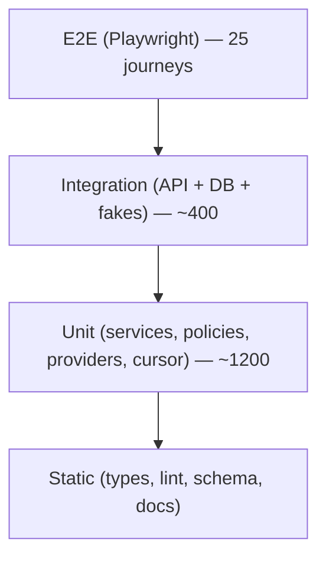

# Testing and Quality Strategy

**Doc ID:** 62 · **Status:** Approved (normative) · **Area:** Quality
**Depends on:** [08](../01-product-and-ideation/08-ACCEPTANCE-CRITERIA.md) · **Related:** [34](../05-ai-and-model-infrastructure/34-AI-EVALUATION-AND-COST-MANAGEMENT.md), [42](../06-knowledge-and-rag/42-RAG-EVALUATION-AND-QUALITY.md), [72](../12-deployment-and-release/72-CI-CD-AND-GITHUB-ACTIONS.md)

---

## 1. Purpose

Define the test pyramid, environments, fixtures, gates, and the specific suites that prove each subsystem works.
Testing is part of implementation, not a phase.

## 2. Pyramid



Targets: unit fast (< 60 s total), integration < 5 min, e2e < 15 min (sharded), full PR feedback < 12 min.

## 3. Layers

| Layer | Tool | Scope | Gate |
|---|---|---|---|
| Static | ruff, mypy --strict, eslint, tsc, import-linter, OpenAPI diff, docs validator | types, boundaries, contracts | block |
| Unit (py) | pytest | services, policies, providers, chunking, retrieval math | block |
| Unit (ts) | Vitest + jsdom | sdk, cursor, widget, hooks | block |
| DB | pytest + Postgres | migrations, constraints, RLS, retrieval SQL | block |
| Contract | pytest + openapi.json | response schema conformance | block |
| Integration | pytest + httpx + local Supabase | routes, auth, workers | block |
| Provider | pytest + fixtures (+ opt-in live) | adapters, fallback, errors | block (fixtures) |
| RAG eval | evaluation-worker | recall, citations, faithfulness | block on retrieval changes |
| E2E | Playwright | J1–J9 journeys | block on main |
| Performance | k6 | latency/throughput budgets | nightly + release |
| Security | pytest + custom | tenancy, SSRF, injection, webhooks | block |
| Accessibility | axe + manual | widget/Studio | block (critical only) |

## 4. Environments

| Env | Data | Providers | Purpose |
|---|---|---|---|
| `test` (CI) | ephemeral Postgres + fakes | fake adapters, recorded fixtures | all automated suites |
| `local` | `supabase start` + seeded | real keys optional | development |
| `staging` | seeded, isolated project | real providers (budget-capped) | release validation |
| `production` | real | real | smoke checks only |

No automated test hits a live provider, Clerk, or production Supabase. Live provider smoke tests are a separate
opt-in workflow with a hard spend cap.

## 5. Fixtures and fakes

| Boundary | Fake |
|---|---|
| Gemini | `FakeGemini` implementing the port; responses from `tests/fixtures/providers/gemini/*.json` |
| NVIDIA | `FakeNvidia`; includes a "ignores tools" fixture and a 429 fixture |
| Clerk | `tests/fixtures/clerk/jwks.json` + signed tokens; no network |
| Storage | `InMemoryStorage` + contract suite shared with the Supabase adapter |
| Egress | `FakeEgress` with a recorded allowlist and blocked-IP table |
| Clock | `freezegun` / injected `Clock` protocol for retries and TTLs |
| Queue | `FakeQueue` backed by the DB in tests (no Redis required) |

Rules: fakes implement the same protocol as the real adapter and are validated by the adapter contract suite;
a fake that drifts from reality is a bug.

## 6. Suites by subsystem

| Subsystem | Required tests |
|---|---|
| Auth | valid/expired/tampered/wrong-iss/wrong-aud; JWKS rotation; projection lag |
| Tenancy | 16 adversarial cases (doc 18 §10); RLS select/insert/update/delete per table |
| Applications | key hashing/one-time reveal/rotation; origin allowlist; mode isolation |
| Sessions | mint/refresh/revoke; idempotent message; replay; expiry |
| Agents | state transitions; plan validation; resume; cancel; limits |
| Tools | schema, policy, approval, idempotency, verification, timeout, SSRF |
| Workflows | happy path; abort; compensate; partial; resume |
| Knowledge | each parser fixture; chunk coverage; dedupe; reingest; delete |
| Retrieval | filters, RRF, thresholds, degraded modes, ACL denial |
| Providers | success/error/retry/fallback/capability/no-downgrade/cost |
| Cursor | resolution strategies, ambiguity, scroll, zoom, dynamic DOM, cancel, reduced motion |
| SDK | config, SSE, errors, teardown, React SSR, bundle budget |
| Widget | isolation, keyboard, axe critical, streaming render |
| Studio | each page's loading/empty/error; role visibility |
| Ops | health, migrations, retention job, rollup reconciliation |

## 7. E2E journeys

J1–J9 from [60](../10-applications-and-experience/60-DEMO-APPLICATION-AND-END-TO-END-SCENARIOS.md), plus:

- J10: sign up → create org → create app → first answer (onboarding path).
- J11: cross-tenant probe via API returns 404 (security journey).
- J12: kill the agent worker mid-run → run resumes and completes (chaos journey, non-UI).

Each journey asserts a real state change and a trace field; rendering alone is never sufficient.

## 8. Provider failure testing without an outage

`FakeGemini` supports scripted failure sequences:

```python
fake.script = [Timeout(), ServerError(503), Success("ok")]     # retry then succeed
fake.script = [ServerError(503), ServerError(503), ServerError(503)]  # fallback then exhaust
fake.script = [AuthError(401)]                                  # config error, no fallback
```

Combined with `FakeNvidia`, this proves routing, fallback, and telemetry deterministically in CI. A nightly job
runs the same scenarios against real providers behind a flag, with a budget cap, and reports drift.

## 9. CI gates

| Stage | Runs | Blocking |
|---|---|---|
| 1. Static | lint, types, docs validator, OpenAPI diff | yes |
| 2. Unit | py + ts in parallel | yes |
| 3. DB | migrate clean + RLS + constraints | yes |
| 4. Integration | API routes + workers | yes |
| 5. Contract | schema conformance + client build | yes |
| 6. E2E | Playwright (sharded, main only) | yes on main |
| 7. Eval | retrieval/agent gates on relevant changes | yes |
| 8. Security | tenancy/SSRF/injection suites | yes |
| 9. Perf | k6 smoke (nightly + release) | release |

Flaky tests: quarantined with an owner and a 7-day fix SLA; a quarantined test does not count as passing and is
reported on the release checklist.

## 10. Test data governance

- No production data in tests. Seeds are synthetic and versioned.
- Screenshots in fixtures are generated, not captured from real customers.
- Eval datasets are licensed/owned content with no PII.
- Deleting a tenant in staging is part of the reset script, not manual.

## 11. Definition of a good test

1. Fails for the right reason when the behavior breaks.
2. Asserts an observable outcome (row, status, event, DOM state).
3. Is deterministic (no sleeps, no real time, no network).
4. Runs in the layer where the behavior lives.
5. Names the requirement it protects (`AC-…` in the test docstring).

## 12. Acceptance criteria

- [ ] Every AC in doc 08 maps to at least one automated test.
- [ ] No test requires a live provider or production credentials.
- [ ] RLS and adversarial tenancy suites run on every migration change.
- [ ] E2E asserts state, not just rendering.
- [ ] Flake rate < 2% with quarantine enforced.

## 13. Related documents

[08](../01-product-and-ideation/08-ACCEPTANCE-CRITERIA.md) · [34](../05-ai-and-model-infrastructure/34-AI-EVALUATION-AND-COST-MANAGEMENT.md) ·
[42](../06-knowledge-and-rag/42-RAG-EVALUATION-AND-QUALITY.md) · [63](63-SECURITY-THREAT-MODEL.md) ·
[65](65-PERFORMANCE-AND-SCALABILITY.md) · [72](../12-deployment-and-release/72-CI-CD-AND-GITHUB-ACTIONS.md)
