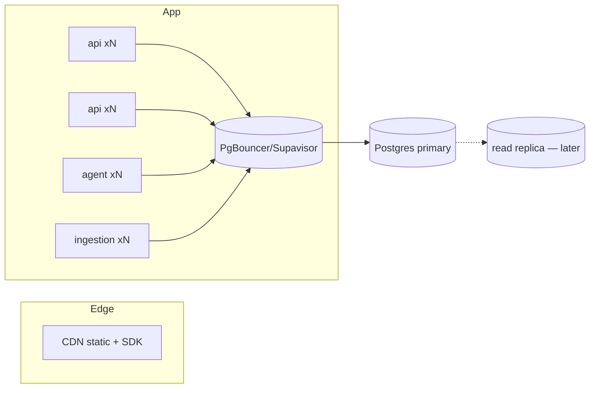

# Performance and Scalability

**Doc ID:** 65 · **Status:** Approved · **Area:** Operations
**Depends on:** [06](../01-product-and-ideation/06-NONFUNCTIONAL-REQUIREMENTS.md) · **Related:** [38](../06-knowledge-and-rag/38-VECTOR-SEARCH-AND-HYBRID-RETRIEVAL.md), [64](64-OBSERVABILITY-LOGGING-AND-MONITORING.md), [66](66-COST-AND-RESOURCE-PLANNING.md)

---

## 1. Purpose

Define the performance budgets, the load model, the bottlenecks, and the scaling strategy. Latency is a product
feature here: a cursor that arrives late is worse than none, and a chat that stalls loses trust.

## 2. Budgets

| Path | p50 | p95 | Hard ceiling |
|---|---|---|---|
| `GET /v1/me` | 60 ms | 150 ms | 500 ms |
| List endpoints (10k rows) | 80 ms | 250 ms | 1 s |
| Session mint | 70 ms | 200 ms | 1 s |
| Message accept (to stream open) | 120 ms | 300 ms | 1 s |
| First token (knowledge answer) | 900 ms | 2.0 s | 8 s |
| Answer completion | 3.5 s | 6 s | 20 s |
| Retrieval | 180 ms | 350 ms | 1.5 s |
| Cursor step start | 200 ms | 400 ms | 1 s |
| Ingestion 10 MB PDF | 25 s | 60 s | 5 min |
| SSE delta delivery | 40 ms | 150 ms | 1 s |
| Studio TTFB | 200 ms | 400 ms | 1.5 s |

## 3. Load model

| Scenario | Traffic |
|---|---|
| Typical tenant | 50k messages/month ≈ 1.2 msg/min, peak 5× |
| Peak concurrency | 2,000 SSE streams per API instance (target), 20 instances |
| Ingestion | 5k pages/day typical; burst 50k on onboarding |
| Tool calls | 10% of messages |
| Studio | 200 concurrent admins |

Load tests (k6):

1. **Read mix** 70% list/detail, 20% session/message reads, 10% search.
2. **Chat steady** 50 msg/s across 500 sessions, assert first-token p95.
3. **SSE fan-out** 2k streams/instance, measure delta latency and memory.
4. **Ingestion burst** 500 documents queued, measure queue drain and worker CPU.
5. **Tool storm** 20 calls/s with approvals, assert no duplicate execution.

## 4. Bottleneck analysis

| Component | Limit | Mitigation |
|---|---|---|
| Postgres connections | Plan-dependent (pooler) | async pool + Supavisor; statement timeouts; read replicas later |
| pgvector ANN | HNSW memory + `ef_search` | filtered partial indexes per index version; partitions for large tenants |
| Provider latency | Dominate p95 | streaming, fast tier for classify, caching, parallel retrieval |
| Provider rate limits | 429s at peak | per-provider semaphore, queueing, fallback |
| SSE connections | File descriptors/memory | async generators, no thread-per-connection, idle timeout |
| Worker CPU (parsing/embeddings) | CPU-bound | separate worker pools, bounded concurrency |
| Redis | Ops/sec | pipelining, short TTLs, no large values |
| Vercel function limits | Execution time | Studio fetches only; no long jobs in Next route handlers |

## 5. Scaling strategy

- API: horizontal, stateless, scale on CPU + in-flight streams.
- Agent workers: scale on queue depth; IO-bound, concurrency 8/replica.
- Ingestion: scale on queue depth; CPU-bound, concurrency 4/replica.
- Read replicas when read latency or pool saturation crosses thresholds (analytics/reporting first).
- Partition `embeddings` and monthly tables at documented thresholds (doc 38 §10, doc 15 §9).

## 6. Caching strategy (latency-motivated)

| Cache | Hit benefit | TTL |
|---|---|---|
| JWKS | avoids auth latency | 300 s |
| Application/agent config | avoids 2 queries per message | 60 s |
| Query embedding | avoids 80–200 ms | 10 min |
| Query rewrite | avoids a model call | 10 min |
| Exact answer | avoids full generation | 5 min, invalidated on content change |
| Studio aggregates | precomputed rollups | 1–15 min |

Cache keys always include tenant and, for retrieval, the allowed-collection hash.

## 7. Frontend performance

- Studio: server components, streaming SSR, route prefetch, virtualized tables, skeleton states.
- Widget: lazy panel/cursor chunks, rAF-batched streaming render, no layout shift, ≤ 110 KB gzip.
- Demo: static shell + client data; images optimized; charts render off the critical path.

## 8. Performance testing in CI

| Test | Gate |
|---|---|
| API route benchmarks (seeded 100k rows) | p95 within budget |
| Retrieval benchmark (1M chunks) | p95 ≤ 350 ms |
| Cursor frame budget | ≤ 8 ms/frame |
| Bundle sizes | within limits |
| N+1 detection | query count per request asserted |
| SSE memory per connection | < 50 KB |

Nightly: k6 steady-state; weekly: burst/soak; release: full matrix with cost measurement.

## 9. Failure and degradation

| Condition | Behavior |
|---|---|
| Pool exhausted | 503 quickly (timeout), no queue growth |
| Provider slow | streaming keeps UX alive; deadline cancels cleanly |
| SSE client slow | coalesce deltas; disconnect if buffer > 256 KB |
| Retrieval slow | return top candidates from the faster list with `degraded` flag |
| Ingestion backlog | queue depth alert; ingestion UI shows position |
| DB replica lag | don't read your own writes from replicas for critical paths |

## 10. Acceptance criteria

- [ ] Budgets in §2 are asserted in CI or nightly benchmarks.
- [ ] Load tests cover the five scenarios in §3.
- [ ] No endpoint performs an unbounded query or N+1.
- [ ] Degradation preserves correctness and is labeled.
- [ ] Scaling actions are documented and do not require code changes.

## 11. Related documents

[06](../01-product-and-ideation/06-NONFUNCTIONAL-REQUIREMENTS.md) · [38](../06-knowledge-and-rag/38-VECTOR-SEARCH-AND-HYBRID-RETRIEVAL.md) ·
[64](64-OBSERVABILITY-LOGGING-AND-MONITORING.md) · [66](66-COST-AND-RESOURCE-PLANNING.md) ·
[69](../12-deployment-and-release/69-RENDER-BACKEND-DEPLOYMENT.md)

## 12. References

- k6 — https://k6.io/docs/
- PostgreSQL performance — https://www.postgresql.org/docs/current/performance-tips.html
- pgvector tuning — https://github.com/pgvector/pgvector#performance
