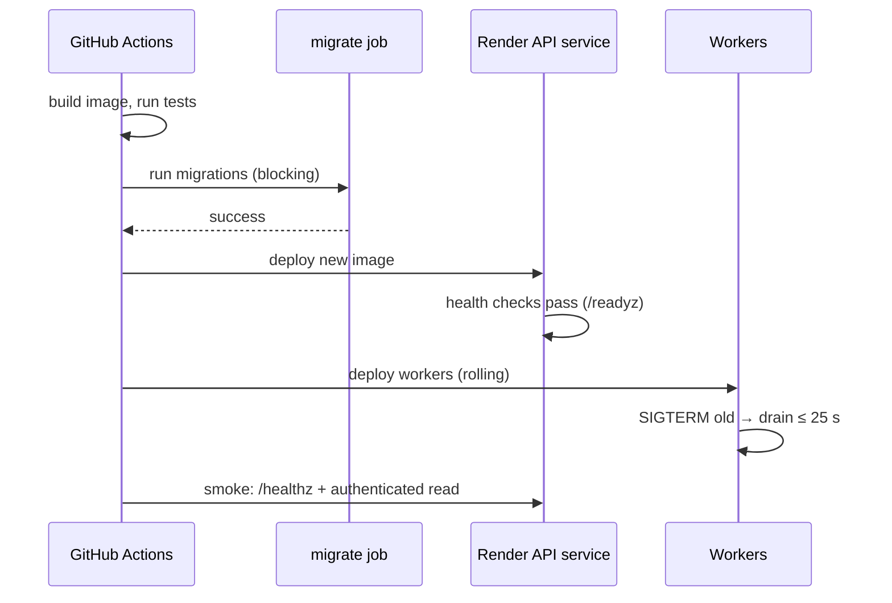

# Render Backend Deployment

**Doc ID:** 69 · **Status:** Approved · **Area:** Platform
**Depends on:** [22](../04-backend-and-api/22-BACKEND-ARCHITECTURE.md), [26](../04-backend-and-api/26-BACKGROUND-JOBS-AND-WORKERS.md) · **Related:** [70](70-VERCEL-FRONTEND-DEPLOYMENT.md), [71](71-SUPABASE-AND-REDIS-PRODUCTION-SETUP.md), [74](74-PRODUCTION-RELEASE-AND-ROLLBACK.md)

---

## 1. Purpose

Specify how the API and workers are packaged and deployed on Render: services, Docker images, build/start
commands, health checks, networking, streaming, scaling, deploys, and rollback.

## 2. Service topology

| Service | Type | Dockerfile | Command | Instances |
|---|---|---|---|---|
| `vistra-api` | Web (public) | `apps/api/Dockerfile` | `uvicorn app.main:app --host 0.0.0.0 --port $PORT` | 2+ |
| `vistra-agent-worker` | Background worker | `services/agent-worker/Dockerfile` | `python -m app.workers.agent` | 2+ |
| `vistra-ingestion` | Background worker | `services/ingestion/Dockerfile` | `python -m app.workers.ingestion` | 2+ |
| `vistra-webhooks` | Background worker | `services/webhook-worker/Dockerfile` | `python -m app.workers.webhook` | 1–2 |
| `vistra-eval` | Background worker (cron-triggered) | `services/evaluation-worker/Dockerfile` | `python -m app.workers.evaluation --once` | 1 |
| `vistra-migrate` | One-off job | `apps/api/Dockerfile` | `python scripts/migrate.py --to head` | run per release |

Workers are **not** scaled by HTTP traffic; they scale on queue depth (doc 65).

## 3. Dockerfile (API)

```dockerfile
# syntax=docker/dockerfile:1.7
FROM python:3.12-slim@sha256:<pinned-digest> AS base
ENV PYTHONDONTWRITEBYTECODE=1 PYTHONUNBUFFERED=1 PIP_NO_CACHE_DIR=1
RUN apt-get update && apt-get install -y --no-install-recommends \
      libpq5 curl && rm -rf /var/lib/apt/lists/*
COPY --from=ghcr.io/astral-sh/uv:0.5 /uv /usr/local/bin/uv

FROM base AS deps
WORKDIR /app
COPY apps/api/pyproject.toml apps/api/uv.lock ./
RUN uv sync --frozen --no-dev --no-install-project

FROM base AS runtime
WORKDIR /app
COPY --from=deps /app/.venv /app/.venv
COPY apps/api/app ./app
COPY apps/api/scripts ./scripts
ENV PATH="/app/.venv/bin:$PATH"
RUN useradd -m -u 10001 app && chown -R app:app /app
USER app
EXPOSE 8000
HEALTHCHECK --interval=30s --timeout=5s --start-period=20s \
  CMD curl -fsS http://localhost:${PORT:-8000}/healthz || exit 1
CMD ["sh", "-c", "uvicorn app.main:app --host 0.0.0.0 --port ${PORT:-8000} --proxy-headers"]
```

Worker images share the base and differ only in `CMD`.

## 4. render.yaml (reference)

```yaml
services:
  - type: web
    name: vistra-api
    runtime: docker
    dockerfilePath: ./apps/api/Dockerfile
    dockerContext: .
    plan: standard
    healthCheckPath: /readyz
    autoDeploy: false            # deploys via CI after migrations
    envVars:
      - fromGroup: vistra-api-prod
    numInstances: 2

  - type: worker
    name: vistra-agent-worker
    runtime: docker
    dockerfilePath: ./services/agent-worker/Dockerfile
    dockerContext: .
    autoDeploy: false
    envVars:
      - fromGroup: vistra-workers-prod
    numInstances: 2

  - type: worker
    name: vistra-ingestion
    runtime: docker
    dockerfilePath: ./services/ingestion/Dockerfile
    dockerContext: .
    autoDeploy: false
    envVars:
      - fromGroup: vistra-workers-prod
    numInstances: 2
```

`autoDeploy: false` is deliberate: migrations must run first (doc 74).

## 5. Environment and secrets

- Use Render environment groups per role (`api`, `workers`); workers never receive browser-facing variables.
- Secrets are set in Render, never in `render.yaml` (which is committed).
- The full variable list is in doc 68. Required at minimum: `DATABASE_URL`, `REDIS_URL`, Supabase keys, Clerk
  keys, encryption key, provider keys.
- `PORT` is injected by Render; never hardcode 8000 in production.

## 6. Networking

| Path | Rule |
|---|---|
| Public → API | HTTPS only, custom domain with managed TLS |
| API → DB | TLS (`sslmode=require`); pooled connection string |
| API → Redis | TLS (`rediss://`) if the plan provides it |
| API → Vercel | CORS with explicit origins (doc 73) |
| Workers → API | prefer importing the service library; if HTTP is required, use the private/internal URL |
| Inbound | only the API is public; workers expose no HTTP except a metrics port bound privately |

Render private networking can be used for worker → API calls; do not rely on public egress for internal traffic.

## 7. Streaming and long requests

- SSE: disable proxy buffering (`X-Accel-Buffering: no`), flush per frame, heartbeat every 15 s. Confirm Render's
  documented request timeout for the plan; keep stream lifetime under it (reconnect at 10 min).
- WebSocket: supported by Render web services; authenticate on upgrade via a single-use ticket (doc 25 §8).
- Long jobs never run in the API process; they are enqueued to workers.

## 8. Persistent storage: none

- Render disks are ephemeral across deploys and not shared across instances. **Never** store user files, SQLite,
  or caches on local disk.
- All durable bytes go to Supabase Storage; all state goes to Postgres/Redis.
- `/tmp` is allowed only for request-scoped scratch and is cleaned up.

## 9. Health checks

```
GET /readyz   → 200 when DB + Redis reachable; used by Render
GET /healthz  → detailed (db, redis, storage, providers) for humans/monitoring
GET /metrics  → internal only
```

A failing `/readyz` removes the instance from rotation. Startup must not depend on providers being reachable
(cached health), or a provider outage would take down the API.

## 10. Deploy lifecycle



Order matters: migrations are backward compatible (expand phase), so old instances keep working during rollout.

## 11. Scaling

| Signal | Action |
|---|---|
| API CPU > 70% or p95 latency > budget | +1 instance (min 2) |
| SSE connections/instance > 1,500 | +1 instance |
| Queue depth > 500 for 5 min | +1 worker |
| Ingestion backlog > 2 h | +2 ingestion workers |
| DB pool saturation > 80% | raise pool (within plan) or add replica |

Autoscaling rules are configured in Render where available; otherwise the runbook documents manual steps.

## 12. Logs and observability

- stdout JSON only; Render captures and forwards to the log drain.
- Every line has `request_id`/`job_id`, `organization_id` (where applicable), `module`.
- No secrets, prompts, or document text (doc 64).
- Panics/unhandled errors produce a stack trace in a separate field, truncated.

## 13. Rollback

1. Identify the previous image tag/deploy in Render.
2. Roll back the API first (workers are backward compatible for one release).
3. If the migration was destructive (should not happen), use the documented restore path (doc 21 §9).
4. Verify `/healthz`, an authenticated read, and error rate.
5. Record the rollback in the release log.

Target: ≤ 10 minutes from decision to healthy previous version.

## 14. Failure scenarios

| Scenario | Behavior |
|---|---|
| Build fails | CI blocks deploy; previous version keeps running |
| Migrate job fails | deploy aborts; no partial rollout |
| New instance fails health check | Render keeps old instances; deploy marked failed |
| Provider outage at boot | API starts; affected routes degrade (doc 31) |
| Worker deploy mid-job | SIGTERM drain; unfinished job requeued |
| Disk filled by logs | platform-managed; no app writes to disk |
| Port mismatch | app reads `$PORT`; health check catches |

## 15. Acceptance criteria

- [ ] Images are digest-pinned and run as non-root.
- [ ] `/readyz` gates deploys; `/healthz` reports dependencies.
- [ ] No durable data on local disk.
- [ ] Migrations run as a separate blocking step.
- [ ] Rollback is rehearsed in staging.

## 16. Related documents

[26](../04-backend-and-api/26-BACKGROUND-JOBS-AND-WORKERS.md) · [64](../11-quality-security-and-operations/64-OBSERVABILITY-LOGGING-AND-MONITORING.md) ·
[68](68-ENVIRONMENT-AND-SECRETS-MANAGEMENT.md) · [70](70-VERCEL-FRONTEND-DEPLOYMENT.md) ·
[74](74-PRODUCTION-RELEASE-AND-ROLLBACK.md) · [75](75-PRODUCTION-RUNBOOK-AND-INCIDENT-RESPONSE.md)

## 17. References

- Render Docker deploys — https://render.com/docs/docker
- Render health checks — https://render.com/docs/health-checks
- Render background workers — https://render.com/docs/background-workers
- Render WebSockets — https://render.com/docs/websocket
- Render disks (ephemeral caveat) — https://render.com/docs/disks
