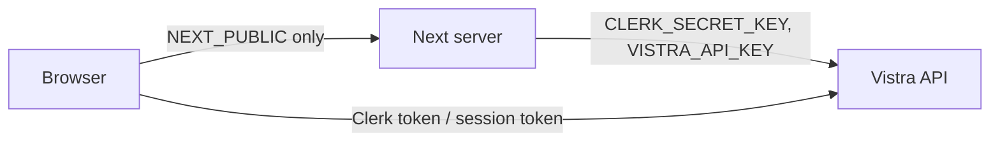

# Vercel Frontend Deployment

**Doc ID:** 70 · **Status:** Approved · **Area:** Platform
**Depends on:** [59](../10-applications-and-experience/59-VISTRA-STUDIO-ARCHITECTURE.md) · **Related:** [69](69-RENDER-BACKEND-DEPLOYMENT.md), [73](73-DOMAIN-CORS-SSL-AND-NETWORKING.md), [68](68-ENVIRONMENT-AND-SECRETS-MANAGEMENT.md)

---

## 1. Purpose

Specify the three Next.js deployments (Studio, demo, docs), their build settings, environments, previews, domains,
auth callbacks, caching, and the boundary between browser and server secrets.

## 2. Projects

| Project | Root | Domain (production) | Preview |
|---|---|---|---|
| `vistra-studio` | `apps/studio` | `studio.vistra.dev` | branch previews |
| `acme-workspace` | `apps/demo` | `demo.vistra.dev` | branch previews |
| `vistra-docs` | `apps/docs-site` | `docs.vistra.dev` | branch previews |

Shared packages (`@vistra/*`) are built in the monorepo; Vercel must install with `pnpm` and respect
`pnpm-lock.yaml`.

## 3. Build settings

```json
{
  "framework": "nextjs",
  "installCommand": "pnpm install --frozen-lockfile",
  "buildCommand": "pnpm --filter @vistra/studio... build",
  "outputDirectory": ".next",
  "nodeVersion": "22.x",
  "rootDirectory": "apps/studio"
}
```

- Ignore builds when only unrelated paths change (Vercel "Ignored Build Step"):
  `git diff --quiet HEAD^ HEAD -- apps/studio packages`.
- `NEXT_TELEMETRY_DISABLED=1`.
- Do not run migrations or workers from Next route handlers.

## 4. Environments and variables

| Variable | Studio | Demo | Docs |
|---|---|---|---|
| `NEXT_PUBLIC_VISTRA_API_URL` | ✅ | ✅ | — |
| `NEXT_PUBLIC_CLERK_PUBLISHABLE_KEY` | ✅ | ✅ | ✅ (sign-in on docs optional) |
| `CLERK_SECRET_KEY` | ✅ server | ✅ server | — |
| `VISTRA_API_KEY` (server, session mint) | — | ✅ | — |
| `NEXT_PUBLIC_VISTRA_APP_ID` | — | ✅ | — |
| `NEXT_PUBLIC_APP_ORIGIN` | ✅ | ✅ | ✅ |
| `SENTRY_DSN` | ✅ | ✅ | ✅ |

Rules: no server secret in `NEXT_PUBLIC_*`; environment scoping (Development/Preview/Production) configured
separately; preview deployments point at the **staging** API, never production.

## 5. Preview deployments

- Every PR gets a preview URL; Clerk allows the preview domain pattern
  (`https://*.vercel.app`) only in the staging Clerk instance.
- Preview uses staging API and staging data; no production writes.
- Auth callbacks and CORS allowlist must include preview origins (wildcard subdomains for `vercel.app` in staging
  only; exact origins in production).
- Preview deployments are not indexed (`X-Robots-Tag: noindex`).

## 6. Domains and TLS

- Production domains are attached in Vercel with automatic TLS.
- `www` → apex redirect for marketing; `studio`/`demo`/`docs` are separate subdomains.
- HSTS enabled at the edge after the domain is verified.
- No mixed content: all API calls use HTTPS.

## 7. Auth callbacks

| Setting | Value |
|---|---|
| Clerk allowed origins | `https://studio.vistra.dev`, `https://demo.vistra.dev`, staging equivalents, preview wildcard (staging only) |
| After sign-in redirect | `/overview` (Studio), `/dashboard` (demo) |
| Sign-out redirect | `/` |
| Cookie domain | subdomain-scoped (no cross-subdomain session sharing) |

A callback mismatch produces a redirect loop; the runbook includes the exact Clerk dashboard paths to check.

## 8. CORS and API communication

- The API allows explicit origins per environment (doc 73). Vercel preview origins are added to staging only.
- Studio calls the API server-side where possible (server components) to avoid browser CORS entirely; client
  calls carry `Authorization` from Clerk.
- The demo calls its own `/api/vistra/session` route (server) to mint VISTRA sessions; the browser never holds the
  VISTRA API key.

## 9. Caching

| Content | Header |
|---|---|
| Static assets (`/_next/static`) | `public, max-age=31536000, immutable` |
| Authenticated HTML/RSC | `private, no-store` |
| Public marketing/docs pages | `s-maxage=3600, stale-while-revalidate=86400` |
| API responses proxied through Next | never cached |

Authenticated data must never be cached at the edge. Studio sets `export const dynamic = "force-dynamic"` on
tenant pages.

## 10. Server vs browser secrets



The browser never receives `CLERK_SECRET_KEY`, `VISTRA_API_KEY`, Supabase secret keys, or provider keys.
`NEXT_PUBLIC_` values are treated as public and reviewed as such.

## 11. Deployment checks

- [ ] Build succeeds with `--frozen-lockfile` and no peer warnings that indicate drift.
- [ ] `next build` reports no ESLint/type errors.
- [ ] Environment variables present for the target scope (Vercel "diff" check).
- [ ] Auth sign-in works on the deployed origin (not just localhost).
- [ ] API calls succeed (no CORS errors) and return real data.
- [ ] `no-store` verified on an authenticated page (`curl -I`).
- [ ] Preview deployment does not touch production data.

## 12. Failure scenarios

| Scenario | Behavior |
|---|---|
| Build fails on missing env | deploy blocked; preview keeps previous |
| CORS error in production | check allowlist + exact origin; fix in API env |
| Cookie not set behind proxy | verify Clerk domain and `SameSite` settings |
| Stale data after deploy | cache headers; revalidate via deployment ID |
| Preview hits production API | misconfigured env scope; block via API origin check |
| Function timeout on slow API | Studio uses server fetch with timeout + error UI, never a hanging page |

## 13. Rollback

Vercel retains immutable deployments: promote the previous deployment (instant), then verify sign-in and one
authenticated read. No build required.

## 14. Acceptance criteria

- [ ] Three projects deploy independently with pinned Node and lockfile.
- [ ] Preview is isolated to staging data.
- [ ] No authenticated response is edge-cached.
- [ ] No server secret is exposed to the browser (build scan).
- [ ] Rollback to a previous deployment is one action and verified.

## 15. Related documents

[59](../10-applications-and-experience/59-VISTRA-STUDIO-ARCHITECTURE.md) · [68](68-ENVIRONMENT-AND-SECRETS-MANAGEMENT.md) ·
[69](69-RENDER-BACKEND-DEPLOYMENT.md) · [73](73-DOMAIN-CORS-SSL-AND-NETWORKING.md) · [74](74-PRODUCTION-RELEASE-AND-ROLLBACK.md)

## 16. References

- Vercel Next.js — https://vercel.com/docs/frameworks/nextjs
- Vercel environment variables — https://vercel.com/docs/projects/environment-variables
- Vercel deployments/rollback — https://vercel.com/docs/deployments/rollback
- Clerk allowed origins — https://clerk.com/docs/security/authorized-parties
