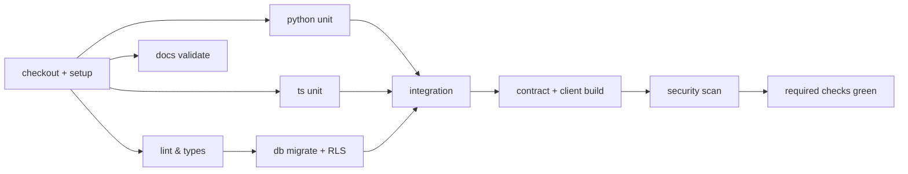

# CI/CD and GitHub Actions

**Doc ID:** 72 · **Status:** Approved · **Area:** Platform
**Depends on:** [62](../11-quality-security-and-operations/62-TESTING-STRATEGY.md) · **Related:** [69](69-RENDER-BACKEND-DEPLOYMENT.md), [70](70-VERCEL-FRONTEND-DEPLOYMENT.md), [74](74-PRODUCTION-RELEASE-AND-ROLLBACK.md)

---

## 1. Purpose

Define the pipelines: validation on PRs, migration and deploy on main, release tagging, docs checks, security
scans, and the rules that keep feedback under ~12 minutes.

## 2. Workflow inventory

| Workflow | Trigger | Purpose |
|---|---|---|
| `pr-validate.yml` | PR | lint, types, unit, DB, integration, contract, docs, security |
| `main-deploy-staging.yml` | push main | migrate staging, deploy API/workers, deploy Vercel preview→staging alias |
| `release.yml` | tag `v*` | migrate production, deploy production, smoke, notify |
| `e2e.yml` | PR→main + nightly | Playwright journeys |
| `eval.yml` | changes to prompts/retrieval/agents + nightly | RAG/agent gates |
| `perf.yml` | nightly + release | k6 budgets |
| `security-scan.yml` | PR + weekly | deps, secrets, SAST |
| `docs.yml` | docs changes | validate-docs, link check, Mermaid fences |
| `sdk-release.yml` | manual dispatch | changesets version/publish (authorized) |

## 3. Path filters

```yaml
on:
  pull_request:
    paths:
      - "apps/**"
      - "packages/**"
      - "services/**"
      - "infrastructure/**"
      - "tests/**"
      - "docs/**"
      - ".github/workflows/**"
```

Jobs use `dorny/paths-filter` to skip unrelated heavy work (e.g. Python tests when only `docs/**` changed).

## 4. PR pipeline



Caching: pnpm store, uv cache, Playwright browsers, Docker layer cache. Concurrency groups cancel superseded runs.

## 5. Job definitions (sketch)

```yaml
name: pr-validate
on: { pull_request: { branches: [main] } }
concurrency: { group: pr-${{ github.ref }}, cancel-in-progress: true }

jobs:
  python:
    runs-on: ubuntu-latest
    services:
      postgres:
        image: pgvector/pgvector:pg16
        env: { POSTGRES_PASSWORD: postgres }
        ports: ["5432:5432"]
        options: >-
          --health-cmd pg_isready --health-interval 5s --health-timeout 5s --health-retries 10
    steps:
      - uses: actions/checkout@v4
      - uses: astral-sh/setup-uv@v3
      - run: uv sync --directory apps/api --frozen
      - run: uv run --directory apps/api ruff check .
      - run: uv run --directory apps/api mypy app
      - run: uv run --directory apps/api pytest -q --cov=app --cov-fail-under=80
      - run: uv run --directory apps/api python scripts/migrate.py --verify

  ts:
    runs-on: ubuntu-latest
    steps:
      - uses: actions/checkout@v4
      - uses: pnpm/action-setup@v4
      - uses: actions/setup-node@v4
        with: { node-version: 22, cache: pnpm }
      - run: pnpm install --frozen-lockfile
      - run: pnpm -r typecheck
      - run: pnpm -r test
      - run: pnpm -r build
      - run: pnpm size-check

  docs:
    runs-on: ubuntu-latest
    steps:
      - uses: actions/checkout@v4
      - run: python docs/tools/validate-docs.py
```

## 6. Database pipeline

1. Start pgvector Postgres.
2. Apply all migrations from zero.
3. Apply migrations onto a snapshot of the previous release schema.
4. Run schema drift check (`scripts/verify_schema.py` vs doc 16).
5. Run RLS suite + constraint tests.
6. Fail on: missing RLS, unforced RLS, destructive DDL without approval label, checksum mismatch.

## 7. Deploy pipeline (staging/production)

```yaml
jobs:
  migrate:
    environment: production
    steps:
      - run: uv run --directory apps/api python scripts/migrate.py --to head --verify
  deploy-api:
    needs: migrate
    steps:
      - run: curl -fsS -X POST "$RENDER_DEPLOY_HOOK_API"
      - run: ./scripts/wait_for_deploy.sh vistra-api 600
  deploy-workers:
    needs: deploy-api
    steps:
      - run: curl -fsS -X POST "$RENDER_DEPLOY_HOOK_WORKERS"
  smoke:
    needs: deploy-workers
    steps:
      - run: ./scripts/smoke.sh "$API_URL"
```

Rules:
- Deploys only from `main` (staging) or a tag (production).
- `environment:` gates require reviewer approval for production.
- Migration failure aborts before any image switch.
- Smoke test: `/healthz`, `/readyz`, one authenticated read, one retrieval query.

## 8. Environments and secrets in Actions

| Environment | Secrets | Protection |
|---|---|---|
| `staging` | staging Clerk/Supabase/provider keys | branch `main` |
| `production` | production keys, Render hooks | required reviewers, tag-only |

OIDC is preferred over long-lived cloud keys where the provider supports it. Secrets are never echoed; `set -x` is
disabled in deploy scripts.

## 9. Release workflow

1. `pnpm changeset version` → commit → PR.
2. Merge to main → staging deploy → smoke + E2E.
3. Tag `vX.Y.Z` → production deploy.
4. Verify; post release notes.
5. Package publishing is a separate, manually dispatched workflow requiring explicit authorization
   (doc 58 §5).

## 10. Security scanning

| Scan | Tool | Gate |
|---|---|---|
| Dependency audit (py/ts) | `pip-audit`, `pnpm audit --prod` | high/critical block |
| Secret scanning | gitleaks | any finding blocks |
| SAST | CodeQL or semgrep ruleset | high blocks |
| Container scan | trivy on built image | critical blocks |
| License check | allowlist | non-allowlisted blocks |
| Docs/bundle secret leak | custom script | blocks |

## 11. Caching and performance

- pnpm + uv caches keyed by lockfile hash.
- Docker buildx with registry cache; only rebuild changed stages.
- Playwright sharded 4×; artifacts uploaded on failure.
- Target: PR feedback ≤ 12 min p50, ≤ 20 min p95.

## 12. Failure scenarios

| Scenario | Behavior |
|---|---|
| Flaky test | quarantine label + issue; does not block but is reported |
| CI secret missing | job fails fast with the variable name (not value) |
| Deploy hook 5xx | retry twice, then fail and alert; no manual ambiguity |
| Migration partially applied | transactional per file; job fails; forward fix |
| Concurrent deploys | concurrency group serializes |
| Docs validator fails | PR blocked; fix links/front-matter |

## 13. Acceptance criteria

- [ ] Required checks are branch-protected on `main`.
- [ ] Production deploys require a tag and reviewer approval.
- [ ] Migrations always run before image switch.
- [ ] Security scans block on high/critical.
- [ ] Every deploy leaves a receipt (run id, image tag, migration version).

## 14. Related documents

[21](../03-database-and-identity/21-MIGRATIONS-BACKUPS-AND-DISASTER-RECOVERY.md) · [62](../11-quality-security-and-operations/62-TESTING-STRATEGY.md) ·
[69](69-RENDER-BACKEND-DEPLOYMENT.md) · [70](70-VERCEL-FRONTEND-DEPLOYMENT.md) · [74](74-PRODUCTION-RELEASE-AND-ROLLBACK.md)

## 15. References

- GitHub Actions — https://docs.github.com/actions
- `dorny/paths-filter` — https://github.com/dorny/paths-filter
- Render deploy hooks — https://render.com/docs/deploy-hooks
