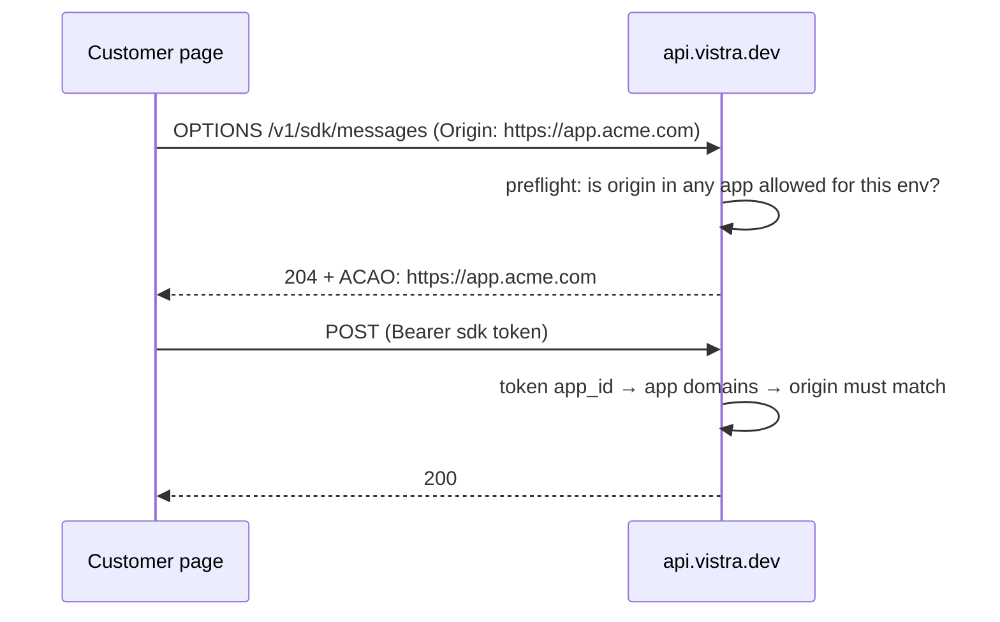

# Domain, CORS, SSL, and Networking

**Doc ID:** 73 · **Status:** Approved · **Area:** Platform
**Depends on:** [69](69-RENDER-BACKEND-DEPLOYMENT.md), [70](70-VERCEL-FRONTEND-DEPLOYMENT.md) · **Related:** [68](68-ENVIRONMENT-AND-SECRETS-MANAGEMENT.md), [63](../11-quality-security-and-operations/63-SECURITY-THREAT-MODEL.md)

---

## 1. Purpose

Define the DNS layout, TLS, CORS policy, and network boundaries across Vercel, Render, Supabase, Redis, and
customer origins. Misconfigured CORS or a missing domain is the most common "works locally" failure.

## 2. Domains

| Host | Target | Purpose |
|---|---|---|
| `vistra.dev` | Vercel (marketing) | Apex, redirects to `www` or serves marketing |
| `www.vistra.dev` | Vercel | Marketing |
| `studio.vistra.dev` | Vercel (`vistra-studio`) | Admin console |
| `demo.vistra.dev` | Vercel (`acme-workspace`) | Reference application |
| `docs.vistra.dev` | Vercel (`vistra-docs`) | Public documentation |
| `api.vistra.dev` | Render (`vistra-api`) | Public API + SSE |
| `cdn.vistra.dev` | CDN (immutable assets) | SDK bundles |
| `embed.vistra.dev` | Vercel or Render | Hosted iframe widget |

Staging equivalents use `-staging` suffixes (`studio-staging.vistra.dev`, `api-staging.vistra.dev`).

## 3. DNS

| Record | Type | Notes |
|---|---|---|
| `api` | CNAME → Render hostname | Managed by Render custom domain |
| `studio`, `demo`, `docs`, `www` | CNAME → Vercel | Vercel-managed |
| `cdn` | CNAME → CDN | Long TTL, immutable content |
| `_dmarc`, `_domainkey` | TXT | Email authentication if email is sent |

TTL: 300 s for platform records during setup, 3600 s after stabilization. Cutovers lower TTL 24 h in advance.

## 4. TLS

- Managed certificates at Vercel and Render; auto-renewal.
- TLS 1.2+ only; HSTS `max-age=31536000; includeSubDomains` after all subdomains are HTTPS.
- No mixed content: every API/storage URL is HTTPS, including signed storage URLs.
- Certificate expiry monitoring: alert at 21 days (doc 64).

## 5. CORS policy

The API allows explicit origins only, per environment:

```env
CORS_ALLOWED_ORIGINS=https://studio.vistra.dev,https://demo.vistra.dev,https://docs.vistra.dev
```

Rules:
- No `*` in production. `*` is permitted only for `GET /v1/public/*` if such endpoints exist (currently none).
- `Access-Control-Allow-Credentials: true` only for endpoints that need cookies (Studio uses bearer tokens, so it
  is false by default).
- Allowed headers: `Authorization`, `Content-Type`, `X-Organization-Id`, `Idempotency-Key`, `X-Request-Id`.
- Exposed headers: `X-Request-Id`, `RateLimit-*`, `Retry-After`.
- Preflight cached 600 s.
- Preview origins (`*.vercel.app`) are allowed **only** in staging.
- Customer-embedded SDK origins are **not** CORS-exempt: the SDK calls the API from the customer's page, so each
  application's allowlisted origins must also be accepted by CORS. This is enforced by a dynamic check: the
  request `Origin` must match an `application_domains` row for the app in the token (doc 18 §5).



**Important:** CORS is not authorization. The origin check is repeated server-side against the application record,
because a non-browser client can forge `Origin`.

## 6. Network boundaries

| Boundary | Control |
|---|---|
| Internet → API | HTTPS, rate limits, WAF/edge rules where available |
| Internet → Vercel | HTTPS, preview protection |
| API → Supabase | TLS + pooled connection; IP allowlist where supported |
| API → Redis | TLS; private endpoint |
| Workers → DB | TLS; separate credentials, smaller pool |
| API → providers | HTTPS egress allowlist; no inbound |
| Workers → customer APIs | HTTPS + egress filter (doc 40 §5) |
| Support → production | break-glass, audited |

Workers expose no public ports. Any internal HTTP uses private networking or a signed service token.

## 7. Egress

- Static provider hosts are allowlisted (`generativelanguage.googleapis.com`, `integrate.api.nvidia.com`,
  `*.supabase.co`, `api.clerk.com`).
- Customer tool/webhook/MCP hosts are validated per request (SSRF filter) and optionally restricted per
  application (allowlist of hostnames).
- An outbound proxy is optional in v1 but recommended at scale for auditing and rate limiting.

## 8. Failure scenarios

| Scenario | Symptom | Fix |
|---|---|---|
| CORS preflight rejected | Browser "blocked by CORS policy" | add the origin (env for Studio/demo; app domains for SDK) |
| Domain not verified | TLS error / `DEPLOYMENT_NOT_FOUND` | re-check CNAME and provider verification |
| Redirect loop after login | callback URL mismatch | align Clerk allowed origins + after-sign-in URL |
| Mixed content | storage URL http | force https in signed URL generation |
| HSTS too early | stubborn HTTP redirects | only enable after all subdomains serve HTTPS |
| Preview hits prod API | env scope wrong | Vercel env scoping + API origin rejection |

## 9. Verification checklist (per environment)

- [ ] `curl -I https://api.<env>.vistra.dev/healthz` → 200, HSTS present.
- [ ] Preflight from each allowed origin → 204 with the exact origin echoed.
- [ ] Preflight from an unlisted origin → no ACAO header.
- [ ] SDK session mint from an unlisted origin → 403 `ORIGIN_NOT_ALLOWED`.
- [ ] TLS grade A on an external scanner.
- [ ] Certificate expiry > 21 days.
- [ ] Signed storage URL is https and expires.

## 10. Acceptance criteria

- [ ] No wildcard CORS in production.
- [ ] Origin allowlisting is enforced server-side, not only by the browser.
- [ ] All public endpoints are HTTPS with valid certs.
- [ ] Preview and production origins are isolated.
- [ ] Verification checklist is part of every release.

## 11. Related documents

[18](../03-database-and-identity/18-TENANCY-RBAC-AND-AUTHORIZATION.md) · [69](69-RENDER-BACKEND-DEPLOYMENT.md) ·
[70](70-VERCEL-FRONTEND-DEPLOYMENT.md) · [68](68-ENVIRONMENT-AND-SECRETS-MANAGEMENT.md) ·
[63](../11-quality-security-and-operations/63-SECURITY-THREAT-MODEL.md)

## 12. References

- MDN CORS — https://developer.mozilla.org/en-US/docs/Web/HTTP/CORS
- HSTS — https://developer.mozilla.org/en-US/docs/Web/HTTP/Headers/Strict-Transport-Security
- Vercel domains — https://vercel.com/docs/domains/working-with-domains
- Render custom domains — https://render.com/docs/custom-domains
