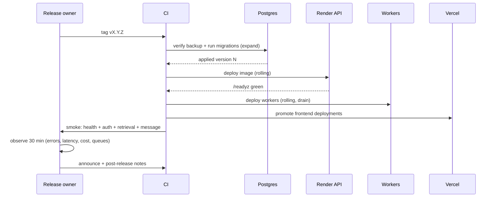

# Production Release and Rollback

**Doc ID:** 74 · **Status:** Approved · **Area:** Platform
**Depends on:** [72](72-CI-CD-AND-GITHUB-ACTIONS.md) · **Related:** [21](../03-database-and-identity/21-MIGRATIONS-BACKUPS-AND-DISASTER-RECOVERY.md), [75](75-PRODUCTION-RUNBOOK-AND-INCIDENT-RESPONSE.md), [58](../09-sdk-and-integrations/58-SDK-VERSIONING-AND-PUBLISHING.md)

---

## 1. Purpose

Define how a release reaches production and how it is undone: preconditions, sequence, verification window,
communication, and rollback triggers. "It deployed" is not "it works".

## 2. Release types

| Type | Contents | Approval |
|---|---|---|
| Patch | fix, docs, config | one reviewer |
| Standard | features, migrations (additive) | two reviewers + staging verification |
| Risky | destructive migration, auth/tenancy, provider routing, policy engine | two reviewers + security review + staged rollout |
| SDK package | npm/CDN | separate authorization (doc 58) |

## 3. Preconditions

- [ ] `main` green (all required checks).
- [ ] Staging deployed from the same commit and smoke-tested.
- [ ] Migrations reviewed; expand/contract respected; backup verified within 24 h.
- [ ] Feature flags for anything incomplete (default off).
- [ ] Changelog and status doc updated.
- [ ] Rollback target identified (image tag + DB state).
- [ ] On-call aware; release window avoids peak.

## 4. Release sequence

**Migration-before-image** is mandatory. Migrations must be backward compatible with the previous image for the
duration of the rollout.

## 5. Verification (first 30 minutes)

| Check | Threshold |
|---|---|
| `/healthz`, `/readyz` | 200, all deps ok |
| 5xx rate | < 0.5% |
| p95 latency (API, retrieval, first token) | within budget |
| Error codes | no new `PROVIDER_CONFIGURATION_ERROR` / `INTERNAL_ERROR` spikes |
| Queue depth | draining, not growing |
| Provider fallback rate | < baseline + 5% |
| A real knowledge answer | grounded, cited |
| A real guide flow (staging demo) | completes |
| A real action (test tenant) | verified, no duplicate |
| Cost rate | within expected band |
| Logs | no new exception class |

Record the numbers; "looks fine" is not a verification.

## 6. Rollback triggers

Roll back immediately if any of:

- 5xx > 2% for 5 minutes or a sustained p95 > 2× baseline.
- A tenancy or auth bypass is suspected (rollback first, investigate second).
- Verification failures for a side-effecting tool.
- Migration caused errors that the previous image cannot tolerate.
- A data-corruption signal (duplicate records, missing writes).

## 7. Rollback procedure

1. **Decide and announce** in the incident channel; assign commander.
2. **Frontend**: promote the previous Vercel deployment (instant).
3. **API**: roll back to the previous image in Render; confirm `/readyz`.
4. **Workers**: roll back after the API is healthy; ensure no job requires the new schema (expand phase makes this
   safe).
5. **Database**: do **not** roll back a migration unless it was destructive and caused corruption; prefer a
   forward fix. If required, use PITR to a new project (doc 21 §9) and repoint.
6. **Verify**: health, authenticated read, one message, queue drain.
7. **Communicate**: status page + tenant notice if user-visible.
8. **Postmortem** within 48 h; add a regression test.

Target: frontend ≤ 2 min, API ≤ 10 min, full ≤ 30 min.

## 8. Communication

| Audience | Channel | Content |
|---|---|---|
| Internal | incident channel | decision, version, status |
| Customers (if affected) | status page / email | impact, workaround, ETA |
| Support | runbook note | what to say, what not to promise |

Never state "resolved" before verification numbers are in hand.

## 9. Post-release

- Monitor for 24 h (error budget, cost, fallback, verification failures).
- Update `IMPLEMENTATION-STATUS.md` and the changelog.
- Close the release with the actual metrics.
- If feature-flagged: enable progressively (1% → 10% → 50% → 100%), watching grounded rate and errors.

## 10. Failure scenarios

| Scenario | Handling |
|---|---|
| Migration fails | abort before image switch; fix forward |
| New image unhealthy | Render keeps old instances; fix or roll back |
| Rollback leaves schema ahead | previous image is compatible (expand); ship a corrective migration |
| Rollback needed after a destructive change | PITR restore + repoint; accept RPO |
| Vercel deploy fine, API down | frontend shows degraded states; roll back API |
| Partial worker rollout | old workers drain; queue continues; idempotency protects |

## 11. Acceptance criteria

- [ ] Every release has a recorded verification table with numbers.
- [ ] Rollback is rehearsed in staging at least once per quarter.
- [ ] Migrations are compatible with N-1 during rollout.
- [ ] No release proceeds without a green staging smoke.
- [ ] Postmortems are completed for every rollback.

## 12. Related documents

[21](../03-database-and-identity/21-MIGRATIONS-BACKUPS-AND-DISASTER-RECOVERY.md) · [69](69-RENDER-BACKEND-DEPLOYMENT.md) ·
[70](70-VERCEL-FRONTEND-DEPLOYMENT.md) · [72](72-CI-CD-AND-GITHUB-ACTIONS.md) ·
[75](75-PRODUCTION-RUNBOOK-AND-INCIDENT-RESPONSE.md)
